# CupBack — Relational Database Architecture & Schema Specification

> **Platform:** CupBack Mobile Café Marketplace  
> **Database Engine:** PostgreSQL 16+ (PROPOSED — AWAITING APPROVAL)  
> **Currency Representation:** Egyptian Piasters (64-bit integer, 1 EGP = 100 Piasters)  
> **Temporal Representation:** Timestamps stored in UTC with timezone (`timestamptz`)  
> **Primary Key Standard:** UUID v4 for external/domain identities; Bigserial for high-volume append logs  

---

## 1. Schema Overview & Entity Relationship Diagram (ERD)

```mermaid
erDiagram
    AREAS ||--o{ CAFES : "located in"
    AREAS ||--o{ USERS : "current browsing area"
    
    CAFES ||--o{ CAFE_BRANCHES : "operates (1:1 in V1)"
    CAFES ||--o{ CAFE_OPERATING_HOURS : "has schedule"
    CAFES ||--o{ CAFE_STAFF : "employs"
    CAFES ||--o{ CATEGORIES : "defines"
    CAFES ||--o{ PRODUCTS : "offers"
    CAFES ||--o{ ORDERS : "receives"
    CAFES ||--o{ CAFE_CUSTOMERS : "tracks CRM"
    CAFES ||--o{ CAFE_CUSTOMER_BLOCKS : "issues blocks"
    CAFES ||--o{ REWARD_PROGRAMS : "configures"
    CAFES ||--o{ PROMOTIONS : "runs"

    USERS ||--o{ CAFE_STAFF : "staff assignment"
    USERS ||--o{ CARTS : "owns"
    USERS ||--o{ ORDERS : "places as customer"
    USERS ||--o{ CAFE_CUSTOMERS : "customer profile"
    USERS ||--o{ CAFE_CUSTOMER_BLOCKS : "targeted by block"
    USERS ||--o{ CUSTOMER_REWARD_PROGRESS : "accumulates"
    USERS ||--o{ AUDIT_LOGS : "acts in"

    CATEGORIES ||--o{ PRODUCTS : "groups"
    PRODUCTS ||--o{ PRODUCT_VARIANTS : "has sizes/options"
    PRODUCTS ||--o{ PRODUCT_MODIFIER_GROUPS : "links"
    MODIFIER_GROUPS ||--o{ PRODUCT_MODIFIER_GROUPS : "applied to"
    MODIFIER_GROUPS ||--o{ MODIFIERS : "contains options"

    CARTS ||--o{ CART_ITEMS : "contains"
    CART_ITEMS ||--o{ CART_ITEM_MODIFIERS : "customized with"

    ORDERS ||--o{ ORDER_ITEMS : "includes"
    ORDER_ITEMS ||--o{ ORDER_ITEM_MODIFIERS : "configured with"
    ORDERS ||--o{ ORDER_STATUS_HISTORY : "tracks lifecycle"
    ORDERS ||--o| PAYMENTS : "settled via"
    PAYMENTS ||--o{ REFUNDS : "refunded by"

    REWARD_PROGRAMS ||--o{ CUSTOMER_REWARD_PROGRESS : "measures"
    REWARD_PROGRAMS ||--o{ REWARD_REDEMPTIONS : "redeemed in"
    
    PROMOTIONS ||--o{ PROMOTION_SCHEDULES : "governed by"
    PROMOTIONS ||--o{ PROMOTION_REDEMPTIONS : "used in"
```



---

## 2. Table Specifications

### 2.1 Geographic & Identity Core

#### `areas`
Administrative geographic regions managed by Platform Admin.
```sql
CREATE TABLE areas (
    id UUID PRIMARY KEY DEFAULT gen_random_uuid(),
    name_ar VARCHAR(100) NOT NULL,
    name_en VARCHAR(100) NOT NULL,
    city_name_ar VARCHAR(100) NOT NULL DEFAULT 'كفر الشيخ',
    city_name_en VARCHAR(100) NOT NULL DEFAULT 'Kafr El-Sheikh',
    is_active BOOLEAN NOT NULL DEFAULT true,
    display_order INT NOT NULL DEFAULT 0,
    created_at TIMESTAMPTZ NOT NULL DEFAULT CURRENT_TIMESTAMP,
    updated_at TIMESTAMPTZ NOT NULL DEFAULT CURRENT_TIMESTAMP,
    deleted_at TIMESTAMPTZ NULL
);
CREATE INDEX idx_areas_active_order ON areas(is_active, display_order);
```

#### `users`
Global identities for Customers, Café Staff, and Platform Administrators.
```sql
CREATE TABLE users (
    id UUID PRIMARY KEY DEFAULT gen_random_uuid(),
    full_name VARCHAR(150) NOT NULL,
    phone_number VARCHAR(20) NOT NULL,
    email VARCHAR(255) NULL,
    password_hash VARCHAR(255) NOT NULL,
    current_area_id UUID NULL REFERENCES areas(id) ON DELETE SET NULL,
    status VARCHAR(20) NOT NULL DEFAULT 'active' CHECK (status IN ('active', 'suspended', 'deactivated')),
    preferred_locale VARCHAR(5) NOT NULL DEFAULT 'ar' CHECK (preferred_locale IN ('ar', 'en')),
    fcm_device_token TEXT NULL,
    created_at TIMESTAMPTZ NOT NULL DEFAULT CURRENT_TIMESTAMP,
    updated_at TIMESTAMPTZ NOT NULL DEFAULT CURRENT_TIMESTAMP,
    deleted_at TIMESTAMPTZ NULL
);
CREATE UNIQUE INDEX uq_users_phone ON users(phone_number) WHERE deleted_at IS NULL;
CREATE INDEX idx_users_area ON users(current_area_id);
```

#### `roles` & `permissions` (Spatie RBAC Schema)
```sql
CREATE TABLE roles (
    id BIGSERIAL PRIMARY KEY,
    name VARCHAR(50) NOT NULL,
    guard_name VARCHAR(50) NOT NULL DEFAULT 'api',
    created_at TIMESTAMPTZ NOT NULL DEFAULT CURRENT_TIMESTAMP,
    updated_at TIMESTAMPTZ NOT NULL DEFAULT CURRENT_TIMESTAMP
);
CREATE UNIQUE INDEX uq_roles_name_guard ON roles(name, guard_name);

CREATE TABLE permissions (
    id BIGSERIAL PRIMARY KEY,
    name VARCHAR(100) NOT NULL,
    guard_name VARCHAR(50) NOT NULL DEFAULT 'api',
    created_at TIMESTAMPTZ NOT NULL DEFAULT CURRENT_TIMESTAMP,
    updated_at TIMESTAMPTZ NOT NULL DEFAULT CURRENT_TIMESTAMP
);
CREATE UNIQUE INDEX uq_permissions_name_guard ON permissions(name, guard_name);

CREATE TABLE model_has_roles (
    role_id BIGINT NOT NULL REFERENCES roles(id) ON DELETE CASCADE,
    model_type VARCHAR(255) NOT NULL,
    model_id UUID NOT NULL,
    PRIMARY KEY (role_id, model_id, model_type)
);

CREATE TABLE role_has_permissions (
    permission_id BIGINT NOT NULL REFERENCES permissions(id) ON DELETE CASCADE,
    role_id BIGINT NOT NULL REFERENCES roles(id) ON DELETE CASCADE,
    PRIMARY KEY (permission_id, role_id)
);
```

---

### 2.2 Café Merchant & Operation Entities

#### `cafes`
```sql
CREATE TABLE cafes (
    id UUID PRIMARY KEY DEFAULT gen_random_uuid(),
    name_ar VARCHAR(150) NOT NULL,
    name_en VARCHAR(150) NOT NULL,
    slug VARCHAR(180) NOT NULL UNIQUE,
    area_id UUID NOT NULL REFERENCES areas(id) ON DELETE RESTRICT,
    description_ar TEXT NULL,
    description_en TEXT NULL,
    logo_url TEXT NULL,
    banner_url TEXT NULL,
    phone_number VARCHAR(20) NOT NULL,
    status VARCHAR(20) NOT NULL DEFAULT 'pending_approval' 
        CHECK (status IN ('pending_approval', 'active', 'suspended', 'rejected')),
    is_open_manually BOOLEAN NOT NULL DEFAULT true,
    timezone VARCHAR(50) NOT NULL DEFAULT 'Africa/Cairo',
    created_at TIMESTAMPTZ NOT NULL DEFAULT CURRENT_TIMESTAMP,
    updated_at TIMESTAMPTZ NOT NULL DEFAULT CURRENT_TIMESTAMP,
    deleted_at TIMESTAMPTZ NULL
);
CREATE INDEX idx_cafes_area_status ON cafes(area_id, status);
```

#### `cafe_branches`
Schema-ready for multi-branch; constrained to 1:1 in V1 application logic.
```sql
CREATE TABLE cafe_branches (
    id UUID PRIMARY KEY DEFAULT gen_random_uuid(),
    cafe_id UUID NOT NULL REFERENCES cafes(id) ON DELETE CASCADE,
    name_ar VARCHAR(150) NOT NULL DEFAULT 'الفرع الرئيسي',
    name_en VARCHAR(150) NOT NULL DEFAULT 'Main Branch',
    address_text TEXT NOT NULL,
    is_primary BOOLEAN NOT NULL DEFAULT true,
    created_at TIMESTAMPTZ NOT NULL DEFAULT CURRENT_TIMESTAMP,
    updated_at TIMESTAMPTZ NOT NULL DEFAULT CURRENT_TIMESTAMP
);
CREATE INDEX idx_cafe_branches_cafe ON cafe_branches(cafe_id);
```

#### `cafe_operating_hours`
Supports daily recurring schedules and overnight shifts (crossing midnight).
```sql
CREATE TABLE cafe_operating_hours (
    id BIGSERIAL PRIMARY KEY,
    cafe_id UUID NOT NULL REFERENCES cafes(id) ON DELETE CASCADE,
    day_of_week INT NOT NULL CHECK (day_of_week BETWEEN 0 AND 6), -- 0=Sunday, 6=Saturday
    opening_time TIME NOT NULL,
    closing_time TIME NOT NULL,
    is_closed BOOLEAN NOT NULL DEFAULT false,
    created_at TIMESTAMPTZ NOT NULL DEFAULT CURRENT_TIMESTAMP,
    updated_at TIMESTAMPTZ NOT NULL DEFAULT CURRENT_TIMESTAMP
);
CREATE UNIQUE INDEX uq_cafe_operating_day ON cafe_operating_hours(cafe_id, day_of_week);
```

#### `cafe_staff`
Links platform users to café tenants with specific operational assignments.
```sql
CREATE TABLE cafe_staff (
    id UUID PRIMARY KEY DEFAULT gen_random_uuid(),
    cafe_id UUID NOT NULL REFERENCES cafes(id) ON DELETE CASCADE,
    user_id UUID NOT NULL REFERENCES users(id) ON DELETE CASCADE,
    is_active BOOLEAN NOT NULL DEFAULT true,
    created_at TIMESTAMPTZ NOT NULL DEFAULT CURRENT_TIMESTAMP,
    updated_at TIMESTAMPTZ NOT NULL DEFAULT CURRENT_TIMESTAMP
);
CREATE UNIQUE INDEX uq_cafe_staff_user ON cafe_staff(cafe_id, user_id);
```

---

### 2.3 Product Catalog, Variants & Modifiers

#### `categories`
```sql
CREATE TABLE categories (
    id UUID PRIMARY KEY DEFAULT gen_random_uuid(),
    cafe_id UUID NOT NULL REFERENCES cafes(id) ON DELETE CASCADE,
    name_ar VARCHAR(100) NOT NULL,
    name_en VARCHAR(100) NOT NULL,
    display_order INT NOT NULL DEFAULT 0,
    is_active BOOLEAN NOT NULL DEFAULT true,
    created_at TIMESTAMPTZ NOT NULL DEFAULT CURRENT_TIMESTAMP,
    updated_at TIMESTAMPTZ NOT NULL DEFAULT CURRENT_TIMESTAMP,
    deleted_at TIMESTAMPTZ NULL
);
CREATE INDEX idx_categories_cafe_order ON categories(cafe_id, is_active, display_order);
```

#### `products`
```sql
CREATE TABLE products (
    id UUID PRIMARY KEY DEFAULT gen_random_uuid(),
    cafe_id UUID NOT NULL REFERENCES cafes(id) ON DELETE CASCADE,
    category_id UUID NOT NULL REFERENCES categories(id) ON DELETE RESTRICT,
    name_ar VARCHAR(150) NOT NULL,
    name_en VARCHAR(150) NOT NULL,
    description_ar TEXT NULL,
    description_en TEXT NULL,
    image_url TEXT NULL,
    is_available BOOLEAN NOT NULL DEFAULT true,
    display_order INT NOT NULL DEFAULT 0,
    created_at TIMESTAMPTZ NOT NULL DEFAULT CURRENT_TIMESTAMP,
    updated_at TIMESTAMPTZ NOT NULL DEFAULT CURRENT_TIMESTAMP,
    deleted_at TIMESTAMPTZ NULL
);
CREATE INDEX idx_products_cafe_category ON products(cafe_id, category_id, is_available);
```

#### `product_variants`
Represents sizes and discrete physical options with independent base prices.
```sql
CREATE TABLE product_variants (
    id UUID PRIMARY KEY DEFAULT gen_random_uuid(),
    product_id UUID NOT NULL REFERENCES products(id) ON DELETE CASCADE,
    name_ar VARCHAR(100) NOT NULL, -- e.g., 'صغير', 'وسط', 'كبير'
    name_en VARCHAR(100) NOT NULL, -- e.g., 'Small', 'Medium', 'Large'
    price_piasters BIGINT NOT NULL CHECK (price_piasters >= 0),
    is_default BOOLEAN NOT NULL DEFAULT false,
    is_available BOOLEAN NOT NULL DEFAULT true,
    created_at TIMESTAMPTZ NOT NULL DEFAULT CURRENT_TIMESTAMP,
    updated_at TIMESTAMPTZ NOT NULL DEFAULT CURRENT_TIMESTAMP
);
CREATE INDEX idx_variants_product ON product_variants(product_id, is_available);
```

#### `modifier_groups`
```sql
CREATE TABLE modifier_groups (
    id UUID PRIMARY KEY DEFAULT gen_random_uuid(),
    cafe_id UUID NOT NULL REFERENCES cafes(id) ON DELETE CASCADE,
    name_ar VARCHAR(100) NOT NULL, -- e.g., 'نوع الحليب', 'درجة السكر'
    name_en VARCHAR(100) NOT NULL, -- e.g., 'Milk Choice', 'Sugar Level'
    is_required BOOLEAN NOT NULL DEFAULT false,
    min_selections INT NOT NULL DEFAULT 0,
    max_selections INT NOT NULL DEFAULT 1,
    created_at TIMESTAMPTZ NOT NULL DEFAULT CURRENT_TIMESTAMP,
    updated_at TIMESTAMPTZ NOT NULL DEFAULT CURRENT_TIMESTAMP
);
CREATE INDEX idx_modifier_groups_cafe ON modifier_groups(cafe_id);
```

#### `modifiers` (Add-ons & Options)
```sql
CREATE TABLE modifiers (
    id UUID PRIMARY KEY DEFAULT gen_random_uuid(),
    modifier_group_id UUID NOT NULL REFERENCES modifier_groups(id) ON DELETE CASCADE,
    name_ar VARCHAR(100) NOT NULL, -- e.g., 'حليب شوفان', 'شوت إضافي'
    name_en VARCHAR(100) NOT NULL, -- e.g., 'Oat Milk', 'Extra Shot'
    price_adjustment_piasters BIGINT NOT NULL DEFAULT 0 CHECK (price_adjustment_piasters >= 0),
    is_available BOOLEAN NOT NULL DEFAULT true,
    created_at TIMESTAMPTZ NOT NULL DEFAULT CURRENT_TIMESTAMP,
    updated_at TIMESTAMPTZ NOT NULL DEFAULT CURRENT_TIMESTAMP
);
CREATE INDEX idx_modifiers_group ON modifiers(modifier_group_id, is_available);
```

#### `product_modifier_group` (Pivot)
```sql
CREATE TABLE product_modifier_group (
    product_id UUID NOT NULL REFERENCES products(id) ON DELETE CASCADE,
    modifier_group_id UUID NOT NULL REFERENCES modifier_groups(id) ON DELETE CASCADE,
    display_order INT NOT NULL DEFAULT 0,
    PRIMARY KEY (product_id, modifier_group_id)
);
```

---

### 2.4 Carts & Shopping Sessions

```sql
CREATE TABLE carts (
    id UUID PRIMARY KEY DEFAULT gen_random_uuid(),
    user_id UUID NOT NULL UNIQUE REFERENCES users(id) ON DELETE CASCADE,
    cafe_id UUID NOT NULL REFERENCES cafes(id) ON DELETE CASCADE,
    created_at TIMESTAMPTZ NOT NULL DEFAULT CURRENT_TIMESTAMP,
    updated_at TIMESTAMPTZ NOT NULL DEFAULT CURRENT_TIMESTAMP
);

CREATE TABLE cart_items (
    id UUID PRIMARY KEY DEFAULT gen_random_uuid(),
    cart_id UUID NOT NULL REFERENCES carts(id) ON DELETE CASCADE,
    product_id UUID NOT NULL REFERENCES products(id) ON DELETE CASCADE,
    product_variant_id UUID NOT NULL REFERENCES product_variants(id) ON DELETE CASCADE,
    quantity INT NOT NULL CHECK (quantity > 0),
    created_at TIMESTAMPTZ NOT NULL DEFAULT CURRENT_TIMESTAMP,
    updated_at TIMESTAMPTZ NOT NULL DEFAULT CURRENT_TIMESTAMP
);

CREATE TABLE cart_item_modifiers (
    id BIGSERIAL PRIMARY KEY,
    cart_item_id UUID NOT NULL REFERENCES cart_items(id) ON DELETE CASCADE,
    modifier_id UUID NOT NULL REFERENCES modifiers(id) ON DELETE CASCADE
);
```

---

### 2.5 Orders, Items & Immutable Snapshots

#### `orders`
```sql
CREATE TABLE orders (
    id UUID PRIMARY KEY DEFAULT gen_random_uuid(),
    order_number BIGSERIAL UNIQUE, -- User-facing sequential human ID (e.g., #10042)
    customer_id UUID NOT NULL REFERENCES users(id) ON DELETE RESTRICT,
    cafe_id UUID NOT NULL REFERENCES cafes(id) ON DELETE RESTRICT,
    branch_id UUID NOT NULL REFERENCES cafe_branches(id) ON DELETE RESTRICT,
    fulfillment_type VARCHAR(20) NOT NULL CHECK (fulfillment_type IN ('pickup', 'dine_in')),
    table_number VARCHAR(20) NULL,
    status VARCHAR(30) NOT NULL DEFAULT 'pending_confirmation' 
        CHECK (status IN ('pending_payment', 'pending_confirmation', 'confirmed', 'preparing', 'ready', 'completed', 'cancelled', 'rejected')),
    payment_method VARCHAR(20) NOT NULL CHECK (payment_method IN ('cash', 'online')),
    payment_status VARCHAR(30) NOT NULL DEFAULT 'pending' 
        CHECK (payment_status IN ('pending', 'processing', 'paid', 'failed', 'cancelled', 'refund_pending', 'refunded')),
    subtotal_piasters BIGINT NOT NULL CHECK (subtotal_piasters >= 0),
    discount_piasters BIGINT NOT NULL DEFAULT 0 CHECK (discount_piasters >= 0),
    total_piasters BIGINT NOT NULL CHECK (total_piasters >= 0),
    applied_discount_type VARCHAR(30) NULL CHECK (applied_discount_type IN ('loyalty_reward', 'promotion', NULL)),
    applied_discount_reference_id UUID NULL,
    rejection_reason TEXT NULL,
    rejected_by_user_id UUID NULL REFERENCES users(id) ON DELETE SET NULL,
    cash_confirmed_by_user_id UUID NULL REFERENCES users(id) ON DELETE SET NULL,
    cash_confirmed_at TIMESTAMPTZ NULL,
    created_at TIMESTAMPTZ NOT NULL DEFAULT CURRENT_TIMESTAMP,
    updated_at TIMESTAMPTZ NOT NULL DEFAULT CURRENT_TIMESTAMP
);

-- Crucial Partial Index: Guarantees Q3 active order check runs in microsecond time
CREATE INDEX idx_orders_customer_active ON orders(customer_id) 
WHERE status NOT IN ('completed', 'cancelled', 'rejected');

CREATE INDEX idx_orders_cafe_status ON orders(cafe_id, status, created_at DESC);
```

#### `order_items` (Immutable Item Snapshot)
```sql
CREATE TABLE order_items (
    id UUID PRIMARY KEY DEFAULT gen_random_uuid(),
    order_id UUID NOT NULL REFERENCES orders(id) ON DELETE CASCADE,
    product_id UUID NULL REFERENCES products(id) ON DELETE SET NULL,
    product_variant_id UUID NULL REFERENCES product_variants(id) ON DELETE SET NULL,
    product_name_ar VARCHAR(150) NOT NULL,
    product_name_en VARCHAR(150) NOT NULL,
    variant_name_ar VARCHAR(100) NOT NULL,
    variant_name_en VARCHAR(100) NOT NULL,
    unit_price_piasters BIGINT NOT NULL CHECK (unit_price_piasters >= 0),
    quantity INT NOT NULL CHECK (quantity > 0),
    total_price_piasters BIGINT NOT NULL CHECK (total_price_piasters >= 0),
    created_at TIMESTAMPTZ NOT NULL DEFAULT CURRENT_TIMESTAMP
);
CREATE INDEX idx_order_items_order ON order_items(order_id);
```

#### `order_item_modifiers` (Immutable Modifier Snapshot)
```sql
CREATE TABLE order_item_modifiers (
    id BIGSERIAL PRIMARY KEY,
    order_item_id UUID NOT NULL REFERENCES order_items(id) ON DELETE CASCADE,
    modifier_id UUID NULL REFERENCES modifiers(id) ON DELETE SET NULL,
    modifier_name_ar VARCHAR(100) NOT NULL,
    modifier_name_en VARCHAR(100) NOT NULL,
    price_adjustment_piasters BIGINT NOT NULL DEFAULT 0 CHECK (price_adjustment_piasters >= 0)
);
CREATE INDEX idx_order_item_modifiers_item ON order_item_modifiers(order_item_id);
```

#### `order_status_history`
```sql
CREATE TABLE order_status_history (
    id BIGSERIAL PRIMARY KEY,
    order_id UUID NOT NULL REFERENCES orders(id) ON DELETE CASCADE,
    from_status VARCHAR(30) NULL,
    to_status VARCHAR(30) NOT NULL,
    actor_user_id UUID NULL REFERENCES users(id) ON DELETE SET NULL,
    comment TEXT NULL,
    created_at TIMESTAMPTZ NOT NULL DEFAULT CURRENT_TIMESTAMP
);
CREATE INDEX idx_order_history_order ON order_status_history(order_id, created_at);
```

---

### 2.6 Payments & Refunds

#### `payments`
```sql
CREATE TABLE payments (
    id UUID PRIMARY KEY DEFAULT gen_random_uuid(),
    order_id UUID NOT NULL UNIQUE REFERENCES orders(id) ON DELETE RESTRICT,
    gateway_name VARCHAR(50) NOT NULL DEFAULT 'cash' CHECK (gateway_name IN ('cash', 'paymob')),
    gateway_transaction_id VARCHAR(100) NULL,
    gateway_order_id VARCHAR(100) NULL,
    amount_piasters BIGINT NOT NULL CHECK (amount_piasters >= 0),
    currency VARCHAR(5) NOT NULL DEFAULT 'EGP',
    status VARCHAR(30) NOT NULL DEFAULT 'pending' 
        CHECK (status IN ('pending', 'processing', 'paid', 'failed', 'cancelled', 'refund_pending', 'refunded')),
    gateway_response_payload JSONB NULL,
    paid_at TIMESTAMPTZ NULL,
    created_at TIMESTAMPTZ NOT NULL DEFAULT CURRENT_TIMESTAMP,
    updated_at TIMESTAMPTZ NOT NULL DEFAULT CURRENT_TIMESTAMP
);
CREATE INDEX idx_payments_gateway_tx ON payments(gateway_transaction_id) WHERE gateway_transaction_id IS NOT NULL;
```

#### `refunds`
```sql
CREATE TABLE refunds (
    id UUID PRIMARY KEY DEFAULT gen_random_uuid(),
    payment_id UUID NOT NULL REFERENCES payments(id) ON DELETE RESTRICT,
    order_id UUID NOT NULL REFERENCES orders(id) ON DELETE RESTRICT,
    amount_piasters BIGINT NOT NULL CHECK (amount_piasters > 0),
    status VARCHAR(30) NOT NULL DEFAULT 'pending' CHECK (status IN ('pending', 'completed', 'failed')),
    gateway_refund_id VARCHAR(100) NULL,
    reason TEXT NOT NULL,
    initiated_by_user_id UUID NULL REFERENCES users(id) ON DELETE SET NULL,
    completed_at TIMESTAMPTZ NULL,
    created_at TIMESTAMPTZ NOT NULL DEFAULT CURRENT_TIMESTAMP,
    updated_at TIMESTAMPTZ NOT NULL DEFAULT CURRENT_TIMESTAMP
);
CREATE INDEX idx_refunds_payment ON refunds(payment_id);
```

---

### 2.7 Café Customer CRM & Disciplinary Blocking (Q18 Confirmed)

#### `cafe_customers`
Pivotal relationship capturing isolated customer engagement metrics per café.
```sql
CREATE TABLE cafe_customers (
    id UUID PRIMARY KEY DEFAULT gen_random_uuid(),
    cafe_id UUID NOT NULL REFERENCES cafes(id) ON DELETE CASCADE,
    customer_id UUID NOT NULL REFERENCES users(id) ON DELETE CASCADE,
    total_completed_orders INT NOT NULL DEFAULT 0 CHECK (total_completed_orders >= 0),
    total_spent_piasters BIGINT NOT NULL DEFAULT 0 CHECK (total_spent_piasters >= 0),
    first_order_at TIMESTAMPTZ NULL,
    last_order_at TIMESTAMPTZ NULL,
    created_at TIMESTAMPTZ NOT NULL DEFAULT CURRENT_TIMESTAMP,
    updated_at TIMESTAMPTZ NOT NULL DEFAULT CURRENT_TIMESTAMP
);
CREATE UNIQUE INDEX uq_cafe_customers_pair ON cafe_customers(cafe_id, customer_id);
CREATE INDEX idx_cafe_customers_order_count ON cafe_customers(cafe_id, total_completed_orders);
CREATE INDEX idx_cafe_customers_last_order ON cafe_customers(cafe_id, last_order_at);
```

#### `cafe_customer_blocks`
Enforces tenant-scoped customer disciplinary restrictions with administrative appeal.
```sql
CREATE TABLE cafe_customer_blocks (
    id UUID PRIMARY KEY DEFAULT gen_random_uuid(),
    cafe_id UUID NOT NULL REFERENCES cafes(id) ON DELETE CASCADE,
    customer_id UUID NOT NULL REFERENCES users(id) ON DELETE CASCADE,
    blocked_by_user_id UUID NOT NULL REFERENCES users(id) ON DELETE RESTRICT,
    reason TEXT NOT NULL,
    is_active BOOLEAN NOT NULL DEFAULT true,
    unblocked_at TIMESTAMPTZ NULL,
    unblocked_by_user_id UUID NULL REFERENCES users(id) ON DELETE SET NULL,
    admin_override_by_user_id UUID NULL REFERENCES users(id) ON DELETE SET NULL,
    admin_override_comment TEXT NULL,
    created_at TIMESTAMPTZ NOT NULL DEFAULT CURRENT_TIMESTAMP,
    updated_at TIMESTAMPTZ NOT NULL DEFAULT CURRENT_TIMESTAMP
);
CREATE INDEX idx_active_cafe_blocks ON cafe_customer_blocks(cafe_id, customer_id) WHERE is_active = true;
```

---

### 2.8 Loyalty & Rewards Engine

#### `reward_programs`
```sql
CREATE TABLE reward_programs (
    id UUID PRIMARY KEY DEFAULT gen_random_uuid(),
    cafe_id UUID NOT NULL REFERENCES cafes(id) ON DELETE CASCADE,
    name VARCHAR(150) NOT NULL,
    description TEXT NULL,
    required_orders INT NOT NULL CHECK (required_orders > 0), -- e.g., 5 orders
    reward_type VARCHAR(30) NOT NULL CHECK (reward_type IN ('percentage_discount', 'fixed_amount_discount', 'free_item', 'free_order')),
    reward_value_piasters BIGINT NULL CHECK (reward_value_piasters >= 0), -- for fixed discount
    reward_percentage NUMERIC(5,2) NULL CHECK (reward_percentage BETWEEN 0.01 AND 100.00), -- for percentage
    reward_scope VARCHAR(30) NOT NULL CHECK (reward_scope IN ('entire_menu', 'selected_categories', 'selected_products')),
    eligible_product_ids JSONB NULL, -- list of UUIDs
    eligible_category_ids JSONB NULL, -- list of UUIDs
    min_order_value_piasters BIGINT NOT NULL DEFAULT 0, -- PROPOSED Q13
    expiration_days INT NULL CHECK (expiration_days > 0), -- PROPOSED Q15
    is_active BOOLEAN NOT NULL DEFAULT true,
    created_at TIMESTAMPTZ NOT NULL DEFAULT CURRENT_TIMESTAMP,
    updated_at TIMESTAMPTZ NOT NULL DEFAULT CURRENT_TIMESTAMP,
    deactivated_at TIMESTAMPTZ NULL
);
CREATE INDEX idx_reward_programs_cafe ON reward_programs(cafe_id, is_active);
```

#### `customer_reward_progress`
```sql
CREATE TABLE customer_reward_progress (
    id UUID PRIMARY KEY DEFAULT gen_random_uuid(),
    reward_program_id UUID NOT NULL REFERENCES reward_programs(id) ON DELETE CASCADE,
    cafe_id UUID NOT NULL REFERENCES cafes(id) ON DELETE CASCADE,
    customer_id UUID NOT NULL REFERENCES users(id) ON DELETE CASCADE,
    current_cycle_order_count INT NOT NULL DEFAULT 0 CHECK (current_cycle_order_count >= 0),
    lifetime_rewards_earned INT NOT NULL DEFAULT 0 CHECK (lifetime_rewards_earned >= 0),
    lifetime_rewards_redeemed INT NOT NULL DEFAULT 0 CHECK (lifetime_rewards_redeemed >= 0),
    created_at TIMESTAMPTZ NOT NULL DEFAULT CURRENT_TIMESTAMP,
    updated_at TIMESTAMPTZ NOT NULL DEFAULT CURRENT_TIMESTAMP
);
CREATE UNIQUE INDEX uq_reward_progress_prog_cust ON customer_reward_progress(reward_program_id, customer_id);
```

#### `reward_redemptions`
```sql
CREATE TABLE reward_redemptions (
    id UUID PRIMARY KEY DEFAULT gen_random_uuid(),
    reward_program_id UUID NOT NULL REFERENCES reward_programs(id) ON DELETE RESTRICT,
    cafe_id UUID NOT NULL REFERENCES cafes(id) ON DELETE RESTRICT,
    customer_id UUID NOT NULL REFERENCES users(id) ON DELETE RESTRICT,
    order_id UUID NULL REFERENCES orders(id) ON DELETE SET NULL,
    status VARCHAR(20) NOT NULL DEFAULT 'available' CHECK (status IN ('available', 'consumed', 'expired')),
    earned_at TIMESTAMPTZ NOT NULL DEFAULT CURRENT_TIMESTAMP,
    consumed_at TIMESTAMPTZ NULL,
    expires_at TIMESTAMPTZ NULL,
    discount_applied_piasters BIGINT NOT NULL DEFAULT 0
);
CREATE INDEX idx_reward_redemptions_cust_avail ON reward_redemptions(customer_id, cafe_id, status) WHERE status = 'available';
```

---

### 2.9 Promotions & Offers Engine

#### `promotions`
```sql
CREATE TABLE promotions (
    id UUID PRIMARY KEY DEFAULT gen_random_uuid(),
    cafe_id UUID NOT NULL REFERENCES cafes(id) ON DELETE CASCADE,
    title_ar VARCHAR(150) NOT NULL,
    title_en VARCHAR(150) NOT NULL,
    description_ar TEXT NULL,
    description_en TEXT NULL,
    discount_type VARCHAR(30) NOT NULL CHECK (discount_type IN ('percentage_discount', 'fixed_amount_discount', 'free_item')),
    discount_value_piasters BIGINT NULL,
    discount_percentage NUMERIC(5,2) NULL,
    scope VARCHAR(30) NOT NULL CHECK (scope IN ('entire_menu', 'selected_categories', 'selected_products')),
    eligible_product_ids JSONB NULL,
    eligible_category_ids JSONB NULL,
    min_order_value_piasters BIGINT NOT NULL DEFAULT 0,
    max_total_redemptions INT NULL,
    max_redemptions_per_customer INT NOT NULL DEFAULT 1,
    current_total_redemptions INT NOT NULL DEFAULT 0,
    status VARCHAR(20) NOT NULL DEFAULT 'draft' CHECK (status IN ('draft', 'scheduled', 'active', 'paused', 'expired')),
    start_date DATE NOT NULL,
    end_date DATE NOT NULL,
    created_at TIMESTAMPTZ NOT NULL DEFAULT CURRENT_TIMESTAMP,
    updated_at TIMESTAMPTZ NOT NULL DEFAULT CURRENT_TIMESTAMP
);
CREATE INDEX idx_promotions_cafe_status ON promotions(cafe_id, status, start_date, end_date);
```

#### `promotion_schedules`
Supports precise day-of-week and time windows (e.g., Every Thursday 18:00 to 22:00).
```sql
CREATE TABLE promotion_schedules (
    id BIGSERIAL PRIMARY KEY,
    promotion_id UUID NOT NULL REFERENCES promotions(id) ON DELETE CASCADE,
    day_of_week INT NOT NULL CHECK (day_of_week BETWEEN 0 AND 6),
    start_time TIME NOT NULL,
    end_time TIME NOT NULL
);
CREATE INDEX idx_promotion_schedules_lookup ON promotion_schedules(promotion_id, day_of_week);
```

#### `promotion_target_segments`
```sql
CREATE TABLE promotion_target_segments (
    id BIGSERIAL PRIMARY KEY,
    promotion_id UUID NOT NULL REFERENCES promotions(id) ON DELETE CASCADE,
    segment_type VARCHAR(30) NOT NULL 
        CHECK (segment_type IN ('all_customers', 'new_customers', 'returning_customers', 'frequent_customers', 'specific_customers', 'inactive_customers')),
    min_orders_threshold INT NULL, -- e.g., 20 orders for frequent
    inactive_days_threshold INT NULL -- e.g., 30 days for inactive
);
CREATE INDEX idx_promotion_segments ON promotion_target_segments(promotion_id);
```

#### `promotion_target_customers`
Specific customer targeting whitelist.
```sql
CREATE TABLE promotion_target_customers (
    promotion_id UUID NOT NULL REFERENCES promotions(id) ON DELETE CASCADE,
    customer_id UUID NOT NULL REFERENCES users(id) ON DELETE CASCADE,
    PRIMARY KEY (promotion_id, customer_id)
);
```

#### `promotion_redemptions`
```sql
CREATE TABLE promotion_redemptions (
    id UUID PRIMARY KEY DEFAULT gen_random_uuid(),
    promotion_id UUID NOT NULL REFERENCES promotions(id) ON DELETE RESTRICT,
    cafe_id UUID NOT NULL REFERENCES cafes(id) ON DELETE RESTRICT,
    customer_id UUID NOT NULL REFERENCES users(id) ON DELETE RESTRICT,
    order_id UUID NOT NULL REFERENCES orders(id) ON DELETE RESTRICT,
    discount_amount_piasters BIGINT NOT NULL CHECK (discount_amount_piasters >= 0),
    redeemed_at TIMESTAMPTZ NOT NULL DEFAULT CURRENT_TIMESTAMP
);
CREATE INDEX idx_promo_redemptions_cust_count ON promotion_redemptions(promotion_id, customer_id);
```

---

### 2.10 Audit & Governance

#### `audit_logs`
Immutable, tamper-evident record of all administrative, financial, and disciplinary actions.
```sql
CREATE TABLE audit_logs (
    id BIGSERIAL PRIMARY KEY,
    actor_user_id UUID NULL REFERENCES users(id) ON DELETE SET NULL,
    cafe_id UUID NULL REFERENCES cafes(id) ON DELETE SET NULL,
    action VARCHAR(100) NOT NULL, -- e.g., 'customer_blocked', 'cash_confirmed', 'admin_override'
    resource_type VARCHAR(100) NOT NULL,
    resource_id VARCHAR(100) NOT NULL,
    old_values JSONB NULL,
    new_values JSONB NULL,
    ip_address VARCHAR(45) NULL,
    user_agent TEXT NULL,
    created_at TIMESTAMPTZ NOT NULL DEFAULT CURRENT_TIMESTAMP
);
CREATE INDEX idx_audit_logs_actor ON audit_logs(actor_user_id, created_at DESC);
CREATE INDEX idx_audit_logs_cafe ON audit_logs(cafe_id, created_at DESC);
CREATE INDEX idx_audit_logs_action ON audit_logs(action, created_at DESC);
```
