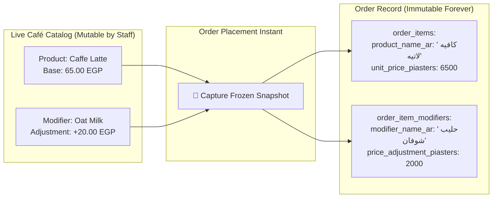
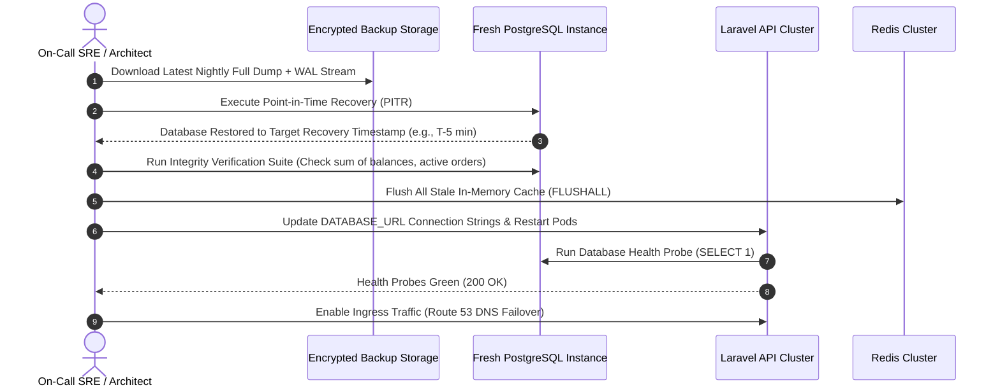

# CupBack — Data Integrity, Protection & Disaster Recovery Specification

> **Platform:** CupBack Mobile Café Marketplace  
> **Recovery Target:** RPO $\le 15\text{ minutes}$, RTO $\le 2\text{ hours}$  
> **Data Integrity Tier:** High-Assurance Financial & Transactional Integrity  
> **Audience:** Database Administrators, Site Reliability Engineers, DevSecOps, Gemini Implementation Agent  

---

## 1. Transaction Boundaries & ACID Guarantees

CupBack enforces strict ACID boundaries. No financial, order-state, loyalty, or inventory mutation may execute outside an explicit database transaction.

### 1.1 Atomic Mutation Matrix

| Business Operation | Encompassed Database Mutations | Isolation Level | Locking Strategy |
|--------------------|--------------------------------|-----------------|------------------|
| **Order Submission** | 1. Active order validation check. 2. Insert `orders` record. 3. Insert `order_items` (immutable snapshots). 4. Insert `order_item_modifiers` (snapshots). 5. Insert `payments` (initial pending record). 6. Insert `order_status_history`. | Read Committed | Pessimistic Lock on Customer Active Orders (`FOR UPDATE`) |
| **Cash Confirmation** | 1. Transition `payments.status` to `paid`. 2. Transition `orders.status` to `completed`. 3. Increment `cafe_customers.total_completed_orders` and `total_spent_piasters`. 4. Increment `customer_reward_progress` (if eligible). 5. Record `audit_logs` entry. | Read Committed | Pessimistic Lock on Order Row (`FOR UPDATE`) |
| **Loyalty Reward Redemption** | 1. Verify `reward_redemptions.status` is `available`. 2. Attach redemption to order. 3. Transition status to `consumed`. 4. Reset `customer_reward_progress.current_cycle_order_count` to 0. 5. Exclude current order from next cycle progress. | Repeatable Read | Row-level Lock on `reward_redemptions` (`FOR UPDATE`) |
| **Customer Disciplinary Block** | 1. Insert `cafe_customer_blocks` with mandatory reason. 2. Insert `audit_logs` entry with actor identity and timestamp. 3. Guarantee ongoing active orders remain unaffected. | Read Committed | Row-level Lock on `cafe_customers` |

---

## 2. Immutable Snapshots & Historical Auditability

A core vulnerability in e-commerce systems is changing prices or altering menu descriptions after an order is placed. CupBack completely prevents historical alteration through immutable data snapshots:

Even if the café subsequently deletes "Caffe Latte" or raises its price to 85.00 EGP, the customer's historical order, receipt, accounting ledger, and tax records remain exactly 85.00 EGP (65.00 + 20.00 EGP).

---

## 3. Disaster Recovery Objectives & Backup Strategy

### 3.1 Recovery Objectives
- **Recovery Point Objective (RPO):** $\le 15\text{ minutes}$. Maximum acceptable data loss under total datacenter destruction. Achieved via continuous PostgreSQL Write-Ahead Log (WAL) archiving to off-site object storage.
- **Recovery Time Objective (RTO):** $\le 2\text{ hours}$. Total elapsed time between catastrophic failure and fully operational, verified service restoration.

### 3.2 Automated Backup Topology

| Backup Tier | Mechanism | Schedule | Retention | Storage Destination |
|-------------|-----------|----------|-----------|---------------------|
| **Continuous WAL Archiving** | `pg_receivewal` / WAL-G | Streaming Real-Time | 7 Days Rolling | Cloudflare R2 / AWS S3 (Separate Region) |
| **Daily Full Snapshot** | `pg_dump` (Compressed Custom) | Nightly at 03:00 UTC | 30 Days Rolling | Encrypted S3 Bucket with Immutable Object Lock |
| **Monthly Archive** | Encrypted Snapshot Archive | 1st of each month | 12 Months | Glacier / Deep Archive |
| **Redis Cache State** | RDB Snapshot | Hourly | 24 Hours | Local NVMe (Disposable Cache) |

---

## 4. Disaster Recovery & Restoration Runbook

In the event of a catastrophic database failure or cloud host compromise, SRE personnel must execute the following verified procedure:

### 4.1 Post-Restoration Verification Checklist
- [ ] Verify primary key sequences (`SELECT MAX(id) FROM orders`).
- [ ] Check active orders consistency (ensure no orphaned pending payment rows).
- [ ] Warm up critical caches: Areas, approved Cafés list, active operating hours.
- [ ] Confirm Laravel Horizon queue workers connect and consume cleanly.
- [ ] Transmit test transaction on staging environment prior to global DNS traffic switch.
