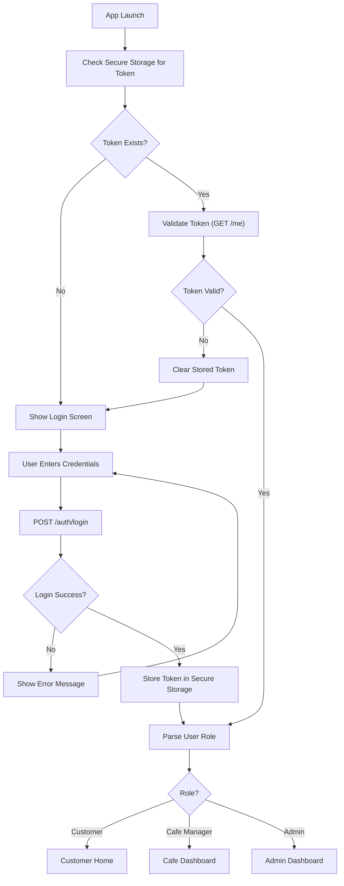
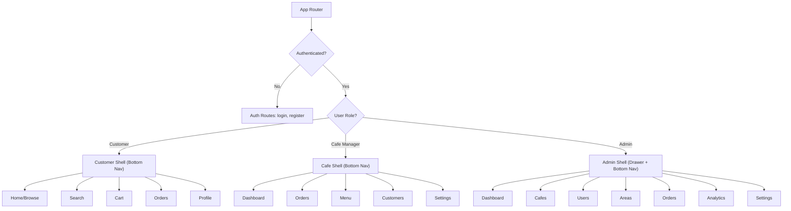
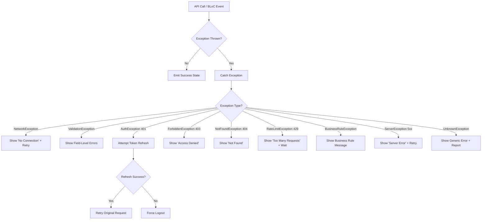

# Flutter Architecture — CupBack Marketplace Platform

> **Document Version:** 1.0  
> **Last Updated:** 2026-11-09  
> **Status:** Contains both APPROVED and PROPOSED decisions  
> **Related Documents:** [UI_UX_GUIDELINES.md](./UI_UX_GUIDELINES.md), [TESTING_STRATEGY.md](./TESTING_STRATEGY.md), [GEMINI_HANDOFF.md](./GEMINI_HANDOFF.md)

---

## Table of Contents

1. [Architecture Pattern](#1-architecture-pattern)
2. [Project Structure](#2-project-structure)
3. [Networking Layer](#3-networking-layer)
4. [State Management](#4-state-management)
5. [Authentication Flow](#5-authentication-flow)
6. [Navigation](#6-navigation)
7. [Local Storage](#7-local-storage)
8. [Error Handling](#8-error-handling)
9. [Localization & RTL](#9-localization--rtl)
10. [Accessibility](#10-accessibility)
11. [Dependency Injection](#11-dependency-injection)
12. [Key Packages](#12-key-packages)

---

## 1. Architecture Pattern

### PROPOSED — AWAITING APPROVAL: BLoC (Business Logic Component)

After evaluating the three primary state management approaches in the Flutter ecosystem, **BLoC** is the recommended architecture pattern for CupBack.

### Comparison Table

| Criteria | BLoC | Riverpod | Provider + ChangeNotifier |
|---|---|---|---|
| **Separation of Concerns** | ⭐⭐⭐ Excellent — enforces event/state separation | ⭐⭐ Good — flexible but conventions vary | ⭐ Basic — business logic can leak into UI |
| **Testability** | ⭐⭐⭐ Excellent — pure event→state mapping, easy to unit test | ⭐⭐⭐ Excellent — providers are independently testable | ⭐⭐ Fair — ChangeNotifier harder to isolate |
| **Scalability** | ⭐⭐⭐ Excellent — scales well in large codebases | ⭐⭐⭐ Excellent — code-gen based, scales well | ⭐ Poor — becomes unwieldy in large apps |
| **Learning Curve** | ⭐⭐ Moderate — requires understanding Events/States/Streams | ⭐⭐ Moderate — new paradigm with code generation | ⭐⭐⭐ Easy — simple mental model |
| **Community / Ecosystem** | ⭐⭐⭐ Mature — large ecosystem, extensive documentation | ⭐⭐ Growing — modern but smaller ecosystem | ⭐⭐⭐ Mature — Flutter's built-in recommendation |
| **Debugging** | ⭐⭐⭐ Excellent — BlocObserver logs all transitions | ⭐⭐ Good — DevTools integration available | ⭐⭐ Fair — manual logging required |
| **Boilerplate** | ⭐ High — Events + States + BLoC classes | ⭐⭐ Moderate — code-gen reduces boilerplate | ⭐⭐⭐ Low — minimal setup |
| **Predictability** | ⭐⭐⭐ Excellent — unidirectional data flow, immutable states | ⭐⭐⭐ Excellent — immutable by convention | ⭐⭐ Fair — mutable state can introduce bugs |
| **Concurrency Handling** | ⭐⭐⭐ Built-in — event transformers (sequential, droppable, restartable) | ⭐⭐ Good — async notifier | ⭐ Manual — developer manages concurrency |
| **Multi-role App Suitability** | ⭐⭐⭐ Excellent — feature isolation maps well to role-based modules | ⭐⭐⭐ Excellent | ⭐⭐ Fair |

### Why BLoC for CupBack

1. **Role-based complexity**: CupBack serves three roles (Customer, Cafe Manager, Admin) with very different feature sets. BLoC's feature-isolated architecture cleanly maps to this structure.
2. **Real-time requirements**: BLoC's stream-based architecture integrates naturally with WebSocket/SSE streams for live order tracking.
3. **Server-side validation emphasis**: BLoC's unidirectional data flow ensures UI always reflects server state, critical given the "never trust client" requirement.
4. **Concurrent request protection**: Event transformers handle concurrent events (e.g., double-tap order placement) at the architecture level.
5. **Audit & debugging**: `BlocObserver` provides automatic logging of all state transitions — valuable for debugging complex order/payment flows.
6. **Team scalability**: Different developers can work on different feature modules independently.

### Clean Architecture Layers

Each feature module follows a three-layer clean architecture:

```
feature/
├── data/           # Data layer — concrete implementations
│   ├── datasources/    # Remote (API) and Local (cache) data sources
│   ├── models/         # Data Transfer Objects (JSON serializable)
│   └── repositories/   # Repository implementations
├── domain/         # Domain layer — business rules
│   ├── entities/       # Business objects (plain Dart classes)
│   ├── repositories/   # Repository interfaces (abstract classes)
│   └── usecases/       # Use case classes (one per business action)
└── presentation/   # Presentation layer — UI
    ├── bloc/           # BLoC classes (Events, States, BLoC)
    ├── screens/        # Full-page screen widgets
    └── widgets/        # Reusable widgets scoped to this feature
```

**Data flow:** `UI → Event → BLoC → UseCase → Repository (interface) → Repository (impl) → DataSource → API`

**Dependency direction:** `presentation → domain ← data` (domain depends on nothing; data implements domain interfaces)

---

## 2. Project Structure

```
lib/
├── app/                            # App entry point, theme, routing
│   ├── app.dart                    # MaterialApp / GoRouter setup
│   ├── app_bloc_observer.dart      # Global BLoC observer for logging
│   └── routes/
│       ├── app_router.dart         # GoRouter configuration
│       ├── route_names.dart        # Named route constants
│       └── guards/
│           ├── auth_guard.dart     # Redirect unauthenticated users
│           └── role_guard.dart     # Restrict routes by role
│
├── core/                           # Shared utilities, constants, extensions
│   ├── constants/
│   │   ├── api_constants.dart      # Base URL, endpoints, timeouts
│   │   ├── app_constants.dart      # App-wide magic numbers/strings
│   │   └── storage_keys.dart       # Secure/local storage key names
│   ├── errors/
│   │   ├── exceptions.dart         # Custom exception classes
│   │   ├── failures.dart           # Failure classes (for Either returns)
│   │   └── error_handler.dart      # Global error handler
│   ├── extensions/
│   │   ├── context_extensions.dart # BuildContext helpers
│   │   ├── string_extensions.dart
│   │   ├── num_extensions.dart     # Currency formatting, etc.
│   │   └── date_extensions.dart
│   ├── network/
│   │   ├── dio_client.dart         # Configured Dio instance
│   │   ├── interceptors/
│   │   │   ├── auth_interceptor.dart
│   │   │   ├── error_interceptor.dart
│   │   │   └── logging_interceptor.dart
│   │   ├── api_response.dart       # Typed API response wrapper
│   │   ├── api_error_model.dart    # Error response model
│   │   └── network_info.dart       # Connectivity checker
│   ├── storage/
│   │   ├── secure_storage.dart     # Token storage (flutter_secure_storage)
│   │   └── local_storage.dart      # General cache (shared_preferences / Hive)
│   ├── theme/
│   │   ├── app_theme.dart          # ThemeData for light (and future dark)
│   │   ├── app_colors.dart         # Color constants
│   │   ├── app_typography.dart     # TextStyle definitions
│   │   ├── app_spacing.dart        # Spacing constants (4dp base)
│   │   └── app_decorations.dart    # Shared BoxDecoration, BorderRadius, etc.
│   └── utils/
│       ├── validators.dart         # Input validation helpers
│       ├── date_formatter.dart     # Locale-aware date/time formatting
│       ├── currency_formatter.dart # EGP / piasters formatting
│       ├── debouncer.dart          # Search debounce utility
│       └── logger.dart             # Structured logging wrapper
│
├── features/                       # Feature-based modules
│   ├── auth/
│   │   ├── data/
│   │   │   ├── datasources/
│   │   │   │   ├── auth_remote_datasource.dart
│   │   │   │   └── auth_local_datasource.dart
│   │   │   ├── models/
│   │   │   │   ├── user_model.dart
│   │   │   │   ├── login_request_model.dart
│   │   │   │   ├── register_request_model.dart
│   │   │   │   └── token_model.dart
│   │   │   └── repositories/
│   │   │       └── auth_repository_impl.dart
│   │   ├── domain/
│   │   │   ├── entities/
│   │   │   │   └── user.dart
│   │   │   ├── repositories/
│   │   │   │   └── auth_repository.dart
│   │   │   └── usecases/
│   │   │       ├── login_usecase.dart
│   │   │       ├── register_usecase.dart
│   │   │       ├── logout_usecase.dart
│   │   │       ├── get_current_user_usecase.dart
│   │   │       └── refresh_token_usecase.dart
│   │   └── presentation/
│   │       ├── bloc/
│   │       │   ├── auth_bloc.dart
│   │       │   ├── auth_event.dart
│   │       │   └── auth_state.dart
│   │       ├── screens/
│   │       │   ├── login_screen.dart
│   │       │   ├── register_screen.dart
│   │       │   └── splash_screen.dart
│   │       └── widgets/
│   │           ├── login_form.dart
│   │           └── register_form.dart
│   │
│   ├── customer/
│   │   ├── browsing/               # Cafe listing, search, filters
│   │   │   ├── data/
│   │   │   ├── domain/
│   │   │   └── presentation/
│   │   ├── cafe_detail/            # Cafe info, menu, offers, loyalty
│   │   │   ├── data/
│   │   │   ├── domain/
│   │   │   └── presentation/
│   │   ├── cart/                   # Cart management
│   │   │   ├── data/
│   │   │   ├── domain/
│   │   │   └── presentation/
│   │   ├── orders/                 # Order placement, tracking, history
│   │   │   ├── data/
│   │   │   ├── domain/
│   │   │   └── presentation/
│   │   ├── profile/                # Profile management
│   │   │   ├── data/
│   │   │   ├── domain/
│   │   │   └── presentation/
│   │   └── notifications/
│   │       ├── data/
│   │       ├── domain/
│   │       └── presentation/
│   │
│   ├── cafe_management/            # Cafe manager features
│   │   ├── dashboard/
│   │   │   ├── data/
│   │   │   ├── domain/
│   │   │   └── presentation/
│   │   ├── products/               # CRUD products, variants, modifiers
│   │   │   ├── data/
│   │   │   ├── domain/
│   │   │   └── presentation/
│   │   ├── categories/
│   │   │   ├── data/
│   │   │   ├── domain/
│   │   │   └── presentation/
│   │   ├── orders/                 # Incoming, accept/reject, status
│   │   │   ├── data/
│   │   │   ├── domain/
│   │   │   └── presentation/
│   │   ├── customers/              # Customer list, blocking
│   │   │   ├── data/
│   │   │   ├── domain/
│   │   │   └── presentation/
│   │   ├── loyalty/                # Reward program management
│   │   │   ├── data/
│   │   │   ├── domain/
│   │   │   └── presentation/
│   │   ├── promotions/             # Campaign management
│   │   │   ├── data/
│   │   │   ├── domain/
│   │   │   └── presentation/
│   │   ├── operating_hours/
│   │   │   ├── data/
│   │   │   ├── domain/
│   │   │   └── presentation/
│   │   └── analytics/
│   │       ├── data/
│   │       ├── domain/
│   │       └── presentation/
│   │
│   ├── admin/                      # Platform admin features
│   │   ├── areas/
│   │   │   ├── data/
│   │   │   ├── domain/
│   │   │   └── presentation/
│   │   ├── cafes/
│   │   │   ├── data/
│   │   │   ├── domain/
│   │   │   └── presentation/
│   │   ├── users/
│   │   │   ├── data/
│   │   │   ├── domain/
│   │   │   └── presentation/
│   │   ├── orders/
│   │   │   ├── data/
│   │   │   ├── domain/
│   │   │   └── presentation/
│   │   ├── payments/
│   │   │   ├── data/
│   │   │   ├── domain/
│   │   │   └── presentation/
│   │   ├── notifications/
│   │   │   ├── data/
│   │   │   ├── domain/
│   │   │   └── presentation/
│   │   ├── analytics/
│   │   │   ├── data/
│   │   │   ├── domain/
│   │   │   └── presentation/
│   │   └── audit_logs/
│   │       ├── data/
│   │       ├── domain/
│   │       └── presentation/
│   │
│   └── shared/                     # Shared feature components
│       ├── widgets/
│       │   ├── loading_widget.dart
│       │   ├── error_widget.dart
│       │   ├── empty_state_widget.dart
│       │   ├── shimmer_loading.dart
│       │   └── retry_button.dart
│       ├── models/
│       │   └── pagination_model.dart
│       └── bloc/
│           └── connectivity_bloc.dart
│
├── l10n/                           # Localization (Arabic + English)
│   ├── app_ar.arb                  # Arabic translations (primary)
│   ├── app_en.arb                  # English translations
│   └── l10n.dart                   # Generated localization delegate
│
└── injection/                      # Dependency injection setup
    ├── injection_container.dart    # GetIt registration
    ├── auth_injection.dart         # Auth feature DI
    ├── customer_injection.dart     # Customer feature DI
    ├── cafe_injection.dart         # Cafe management feature DI
    └── admin_injection.dart        # Admin feature DI
```

---

## 3. Networking Layer

### HTTP Client: Dio

All network communication uses the **Dio** HTTP client with a layered interceptor chain.

### Dio Client Configuration

```
DioClient
├── Base URL: from environment config
├── Connect Timeout: 15 seconds
├── Receive Timeout: 15 seconds
├── Send Timeout: 15 seconds
├── Content-Type: application/json
├── Accept: application/json
├── Accept-Language: ar / en (from locale)
└── Interceptors (in order):
    1. AuthInterceptor
    2. ErrorInterceptor
    3. LoggingInterceptor (debug only)
```

### Auth Interceptor

| Responsibility | Behavior |
|---|---|
| Attach token | Reads access token from secure storage, adds `Authorization: Bearer <token>` header |
| Handle 401 | Attempts token refresh. If refresh succeeds → retry original request. If refresh fails → clear all tokens → emit logout event → navigate to login |
| Skip auth | Certain endpoints (login, register) are excluded from token attachment |
| Token refresh lock | Prevents multiple simultaneous refresh attempts (use a `Completer` or mutex) |

### Error Interceptor

Maps HTTP errors and Dio exceptions to typed app exceptions:

| HTTP Status | Exception Type | Description |
|---|---|---|
| 400 | `BadRequestException` | Malformed request |
| 401 | `UnauthorizedException` | Invalid/expired token |
| 403 | `ForbiddenException` | Insufficient permissions |
| 404 | `NotFoundException` | Resource not found |
| 422 | `ValidationException` | Server-side validation errors (with field-level messages) |
| 429 | `RateLimitException` | Too many requests |
| 500 | `ServerException` | Internal server error |
| DioExceptionType.connectionTimeout | `NetworkException` | Connection timeout |
| DioExceptionType.receiveTimeout | `NetworkException` | Response timeout |
| DioExceptionType.connectionError | `NetworkException` | No internet connection |
| Other | `UnknownException` | Unexpected error |

### Logging Interceptor (Debug Only)

- Logs request method, URL, headers, body
- Logs response status code, body (truncated)
- Logs errors
- **Redacts** sensitive data: tokens, passwords, payment info
- Enabled only in debug builds via `kDebugMode`

### API Response Model

All API responses follow a consistent envelope:

```dart
class ApiResponse<T> {
  final bool success;
  final String? message;
  final T? data;
  final Map<String, List<String>>? errors;  // Validation errors
  final PaginationMeta? meta;               // For paginated responses
}

class PaginationMeta {
  final int currentPage;
  final int lastPage;
  final int perPage;
  final int total;
}
```

### Base API Client Methods

```dart
abstract class BaseApiClient {
  Future<ApiResponse<T>> get<T>(String path, {Map<String, dynamic>? queryParams});
  Future<ApiResponse<T>> post<T>(String path, {dynamic data});
  Future<ApiResponse<T>> put<T>(String path, {dynamic data});
  Future<ApiResponse<T>> patch<T>(String path, {dynamic data});
  Future<ApiResponse<T>> delete<T>(String path);
  Future<ApiResponse<T>> upload<T>(String path, {required FormData formData});
}
```

---

## 4. State Management

### BLoC Pattern Per Feature

Each feature module contains one or more BLoCs, each responsible for a single concern.

### BLoC Design Rules

| Rule | Description |
|---|---|
| **Single responsibility** | Each BLoC manages one feature concern. Do NOT create "god BLoCs" that handle multiple unrelated features. |
| **Immutable states** | All state classes use `Equatable` and are immutable. Use `copyWith` for state changes. |
| **Typed events** | Events are sealed classes (or abstract with subtypes) for exhaustive pattern matching. |
| **Standard state pattern** | Every data-fetching BLoC has at minimum: `Initial`, `Loading`, `Loaded(data)`, `Error(message)` states. |
| **No UI logic in BLoC** | BLoCs do not import Flutter/widget classes. BLoCs work with domain entities only. |
| **No direct API calls** | BLoCs call UseCases, which call Repositories. Never call data sources directly from BLoCs. |
| **Event transformers** | Use `sequential()` for order-sensitive events, `droppable()` for search/scroll, `restartable()` for debounced input. |

### Standard BLoC Structure

```
OrdersBloc
├── Events:
│   ├── OrdersFetched           → Load order list
│   ├── OrderRefreshed          → Pull-to-refresh
│   ├── OrderStatusUpdated      → Real-time status change
│   ├── OrderLoadMore           → Pagination
│   └── OrderFilterChanged      → Filter/sort
├── States:
│   ├── OrdersInitial
│   ├── OrdersLoading
│   ├── OrdersLoaded(orders, hasMore, filters)
│   ├── OrdersError(message)
│   └── OrdersLoadingMore(orders)   → For pagination
└── Dependencies:
    ├── GetOrdersUseCase
    └── StreamSubscription (real-time)
```

### BLoC Communication

- **Parent-child:** Parent BLoC passes data to child via constructor/event
- **Cross-feature:** Use shared repositories or stream-based communication through the DI container
- **Real-time events:** BLoCs subscribe to real-time event streams (WebSocket/SSE channel) and emit new states when server pushes updates

### Global BLoC Observer

Register a `BlocObserver` in `main.dart` that logs:
- `onCreate` — BLoC instantiated
- `onEvent` — Event received
- `onTransition` — State transition (old state → new state)
- `onError` — Error in BLoC
- `onClose` — BLoC disposed

This provides a complete audit trail for debugging.

---

## 5. Authentication Flow

### Login Flow



### Token Management

| Aspect | Implementation |
|---|---|
| **Storage** | `flutter_secure_storage` — encrypted at OS level |
| **Token type** | Bearer token (type depends on TD-D decision — PROPOSED: Laravel Sanctum) |
| **Auto-login** | On app start, check for stored token → validate with `/me` endpoint → route by role |
| **Token refresh** | When 401 received, attempt refresh → if success, retry → if fail, logout |
| **Logout** | Clear all stored tokens → reset all BLoC states → navigate to login → clear navigation stack |
| **Multi-device** | Server-side token management — revoking one token doesn't affect others (unless admin revokes all) |

### Role Detection & Routing

After successful authentication, the server returns the user's role(s). The app routes to the appropriate home screen:

| Role | Home Screen | Navigation Shell |
|---|---|---|
| `customer` | Cafe Browsing / Home | Bottom Navigation (5 tabs) |
| `cafe_manager` | Cafe Dashboard | Bottom Navigation (5 tabs) |
| `admin` | Admin Dashboard | Drawer + Bottom Navigation |

If a user has multiple roles (e.g., admin who is also a customer), the app defaults to the highest-privilege role and allows switching (future consideration).

---

## 6. Navigation

### PROPOSED — AWAITING APPROVAL: GoRouter

**GoRouter** is recommended for navigation due to:
- Declarative routing with strong typing
- Built-in redirect/guard support
- Deep linking support (future)
- Shell routes for bottom navigation
- Maintained by Flutter team

### Route Structure

```dart
// Top-level routes
/splash
/login
/register
/select-area

// Customer routes (within ShellRoute with bottom nav)
/customer/home
/customer/search
/customer/cart
/customer/orders
/customer/orders/:orderId
/customer/profile
/customer/profile/edit
/customer/notifications
/customer/cafe/:cafeId
/customer/cafe/:cafeId/menu
/customer/cafe/:cafeId/product/:productId
/customer/cafe/:cafeId/loyalty
/customer/cafe/:cafeId/promotions

// Cafe Manager routes (within ShellRoute with bottom nav)
/cafe/dashboard
/cafe/orders
/cafe/orders/:orderId
/cafe/menu
/cafe/menu/categories
/cafe/menu/products
/cafe/menu/products/create
/cafe/menu/products/:productId/edit
/cafe/menu/modifiers
/cafe/customers
/cafe/customers/:customerId
/cafe/loyalty
/cafe/loyalty/create
/cafe/loyalty/:programId/edit
/cafe/promotions
/cafe/promotions/create
/cafe/promotions/:promotionId/edit
/cafe/settings
/cafe/settings/hours
/cafe/analytics
/cafe/notifications

// Admin routes (within ShellRoute with drawer/bottom nav)
/admin/dashboard
/admin/areas
/admin/areas/create
/admin/cafes
/admin/cafes/:cafeId
/admin/cafes/create
/admin/users
/admin/users/:userId
/admin/orders
/admin/orders/:orderId
/admin/payments
/admin/payments/:paymentId
/admin/notifications
/admin/notifications/send
/admin/audit-logs
/admin/analytics
/admin/settings
```

### Route Guards

**Auth Guard:**
- Checks if user is authenticated (token exists and valid)
- Unauthenticated users → redirect to `/login`
- Exception: `/login`, `/register`, `/splash` are public routes

**Role Guard:**
- Checks if authenticated user's role matches the route prefix
- Customer trying to access `/cafe/*` → redirect to `/customer/home`
- Cafe manager trying to access `/admin/*` → redirect to `/cafe/dashboard`

### Navigation Shells



---

## 7. Local Storage

### Storage Strategy

| Data Type | Storage | Package | Encryption | TTL |
|---|---|---|---|---|
| Access token | Secure storage | `flutter_secure_storage` | OS-level encryption | Until logout/expiry |
| Refresh token | Secure storage | `flutter_secure_storage` | OS-level encryption | Until logout/expiry |
| User profile | Local DB | `Hive` or `shared_preferences` | No (non-sensitive) | Until logout |
| Selected area | Local storage | `shared_preferences` | No | Persistent |
| Language preference | Local storage | `shared_preferences` | No | Persistent |
| Cafe list cache | Local DB | `Hive` | No | 15 minutes |
| Menu cache | Local DB | `Hive` | No | 10 minutes |
| Cart state | Local DB | `Hive` | No | Until order placed or cleared |
| Recent searches | Local storage | `shared_preferences` | No | Persistent (max 20) |

### Cache Invalidation

| Event | Cached Data to Invalidate |
|---|---|
| User changes area | Cafe list cache |
| Order placed | Cart state, active orders |
| Order status changed | Order detail, order list |
| Menu updated (server push) | Menu cache for that cafe |
| Logout | ALL cached data |
| Pull-to-refresh | Relevant list cache |
| App resumed from background | Check staleness, refresh if >TTL |

### Offline Behavior

CupBack requires network connectivity for core operations (ordering, payments). The offline strategy is:

1. **Show cached data** when available (cafe list, menu) with a "last updated" indicator
2. **Show clear offline indicator** when no network detected
3. **Disable order placement** when offline
4. **Queue non-critical actions** (e.g., marking notification as read) for retry when online
5. **Auto-retry** on connectivity restored (for queued actions only)
6. **Never show stale prices** — if menu cache is >10 minutes old and offline, show "prices may have changed" warning

---

## 8. Error Handling

### Exception Hierarchy

```
AppException (abstract)
├── NetworkException
│   ├── NoInternetException
│   ├── TimeoutException
│   └── ConnectionRefusedException
├── AuthException
│   ├── UnauthorizedException
│   ├── ForbiddenException
│   └── TokenExpiredException
├── ValidationException (contains field-level errors)
├── ServerException
├── NotFoundException
├── RateLimitException
├── BusinessRuleException
│   ├── ActiveOrderExistsException
│   ├── CustomerBlockedException
│   ├── CafeClosedException
│   └── InsufficientPermissionException
└── UnknownException
```

### Error Handling Flow



### User-Friendly Error Messages

All error messages must be:
- Translated (Arabic + English)
- Free of technical jargon
- Actionable (tell the user what to do)
- Contextual (different message for same error in different contexts)

Example mappings:

| Exception | Arabic Message | English Message |
|---|---|---|
| `NoInternetException` | لا يوجد اتصال بالإنترنت. تحقق من اتصالك وحاول مرة أخرى | No internet connection. Check your connection and try again |
| `ActiveOrderExistsException` | لديك طلب نشط بالفعل. يجب إتمام الطلب الحالي أولاً | You already have an active order. Complete your current order first |
| `CustomerBlockedException` | لا يمكنك الطلب من هذا الكافيه حالياً. تواصل مع الكافيه للمزيد من المعلومات | You cannot order from this cafe currently. Contact the cafe for more information |
| `CafeClosedException` | هذا الكافيه مغلق حالياً | This cafe is currently closed |

### Retry Mechanism

- Transient failures (network, 5xx) → show retry button → exponential backoff (1s, 2s, 4s, max 3 retries)
- Non-transient failures (4xx) → show error message, no auto-retry
- Pull-to-refresh available on all list screens

---

## 9. Localization & RTL

### Languages

| Language | Code | Direction | Status |
|---|---|---|---|
| Arabic | `ar` | RTL | Primary language |
| English | `en` | LTR | Secondary language |

### Implementation

- Use Flutter's `intl` package with `.arb` files
- `flutter_localizations` for Material/Cupertino localization
- All user-facing strings in `.arb` files — **zero hardcoded strings**
- Pluralization rules per locale
- Date formatting: locale-aware (`DateFormat` with locale parameter)
- Time formatting: 12-hour for Arabic locale, configurable
- Number formatting: locale-aware (`NumberFormat` with locale parameter)

### Currency Formatting

| Format | Example |
|---|---|
| Egyptian Pound display | ١٥٠٫٠٠ ج.م. (Arabic) / EGP 150.00 (English) |
| Piasters handling | If amount has piasters: ١٥٠٫٧٥ ج.م. / EGP 150.75 |
| Zero piasters | ١٥٠ ج.م. (omit .00 for cleanliness — or keep consistent, decide in implementation) |

### RTL Layout Guidelines

| Aspect | RTL (Arabic) | LTR (English) |
|---|---|---|
| Text alignment | Right-aligned by default | Left-aligned by default |
| Navigation flow | Right to left | Left to right |
| Back button | Right side | Left side |
| List item leading icon | Right side | Left side |
| Swipe direction | Right to left = forward | Left to right = forward |
| Directional icons | Mirrored (arrows, chevrons) | Standard |
| Non-directional icons | NOT mirrored (clock, heart, star) | Standard |
| Phone number input | LTR always (numbers) | LTR |
| Bottom nav order | Right to left (first tab on right) | Left to right |

### Locale Switching

- User can switch language in profile settings
- App rebuilds with new locale (no restart required)
- Preference persisted in local storage
- Default: Arabic (primary market is Egypt)

---

## 10. Accessibility

### Requirements

| Category | Requirement |
|---|---|
| **Semantic labels** | All interactive elements have `Semantics` or `semanticLabel` for screen readers |
| **Touch targets** | Minimum 48×48dp touch targets on all interactive elements |
| **Color contrast** | WCAG AA minimum contrast ratios (4.5:1 for normal text, 3:1 for large text) |
| **Focus order** | Logical focus traversal order for keyboard/accessibility navigation |
| **Screen reader** | All screens navigable via TalkBack (Android) / VoiceOver (iOS) |
| **Text scaling** | UI adapts to system text size scaling (up to 200%) |
| **Motion** | Respect `reduceMotion` system setting — disable animations when enabled |
| **Error announcement** | Screen reader announces form errors when they appear |
| **Loading announcement** | Screen reader announces loading states |

### Implementation Checklist

- Use `Semantics` widget for complex UI components
- Provide `excludeSemantics: true` on decorative elements
- Use `MergeSemantics` to group related elements
- Test with Android TalkBack and iOS VoiceOver
- Test with system font scaling at 200%
- Provide alternative text for all images

---

## 11. Dependency Injection

### PROPOSED — AWAITING APPROVAL: GetIt + Injectable

Use **GetIt** as the service locator with **Injectable** for code generation.

### Registration Pattern

```dart
// injection_container.dart
final sl = GetIt.instance;

Future<void> initDependencies() async {
  // Core
  sl.registerLazySingleton<DioClient>(() => DioClient());
  sl.registerLazySingleton<SecureStorage>(() => SecureStorage());
  sl.registerLazySingleton<LocalStorage>(() => LocalStorage());
  
  // Features
  await _initAuth();
  await _initCustomer();
  await _initCafe();
  await _initAdmin();
}

Future<void> _initAuth() async {
  // Data sources
  sl.registerLazySingleton<AuthRemoteDataSource>(
    () => AuthRemoteDataSourceImpl(sl()),
  );
  // Repositories
  sl.registerLazySingleton<AuthRepository>(
    () => AuthRepositoryImpl(sl(), sl()),
  );
  // Use cases
  sl.registerLazySingleton(() => LoginUseCase(sl()));
  sl.registerLazySingleton(() => RegisterUseCase(sl()));
  // BLoCs
  sl.registerFactory(() => AuthBloc(
    loginUseCase: sl(),
    registerUseCase: sl(),
    logoutUseCase: sl(),
  ));
}
```

### Registration Types

| Type | Use For | Lifetime |
|---|---|---|
| `registerSingleton` | Eagerly created singletons | App lifetime |
| `registerLazySingleton` | Lazily created singletons (services, repositories) | App lifetime |
| `registerFactory` | New instance each time (BLoCs) | Widget lifetime |
| `registerFactoryParam` | Parameterized factory (BLoCs needing initial data) | Widget lifetime |

---

## 12. Key Packages

### PROPOSED Package List

| Category | Package | Purpose |
|---|---|---|
| **State Management** | `flutter_bloc` | BLoC pattern implementation |
| **Networking** | `dio` | HTTP client |
| **Routing** | `go_router` | Declarative navigation |
| **DI** | `get_it`, `injectable` | Dependency injection |
| **Storage** | `flutter_secure_storage` | Encrypted token storage |
| **Storage** | `hive`, `hive_flutter` | Local data cache |
| **Storage** | `shared_preferences` | Simple key-value storage |
| **Serialization** | `json_serializable`, `json_annotation` | JSON model generation |
| **Equatable** | `equatable` | Value equality for states/events |
| **Localization** | `intl`, `flutter_localizations` | i18n and l10n |
| **Images** | `cached_network_image` | Image loading with caching |
| **Loading** | `shimmer` | Skeleton loading effects |
| **Notifications** | `firebase_messaging` (PROPOSED, depends on TD-G) | Push notifications |
| **Real-time** | `web_socket_channel` or `pusher_channels_flutter` (depends on TD-F) | Live updates |
| **Forms** | `formz` or manual validation | Form state management |
| **Connectivity** | `connectivity_plus` | Network status monitoring |
| **Permissions** | `permission_handler` | OS permission management |
| **Build** | `build_runner` | Code generation runner |
| **Functional** | `dartz` or `fpdart` | Either/Failure pattern |
| **Linting** | `very_good_analysis` or `flutter_lints` | Code quality rules |

> [!IMPORTANT]
> Package versions must be pinned in `pubspec.yaml` lock file. All packages must be evaluated for maintenance status and security before adoption.

---

## Appendix A: File Naming Conventions

| Type | Convention | Example |
|---|---|---|
| Dart files | `snake_case.dart` | `auth_bloc.dart` |
| BLoC events | `feature_event.dart` | `auth_event.dart` |
| BLoC states | `feature_state.dart` | `auth_state.dart` |
| Models | `entity_model.dart` | `user_model.dart` |
| Entities | `entity.dart` | `user.dart` |
| Repositories (interface) | `feature_repository.dart` | `auth_repository.dart` |
| Repositories (impl) | `feature_repository_impl.dart` | `auth_repository_impl.dart` |
| Screens | `feature_screen.dart` | `login_screen.dart` |
| Widgets | `descriptive_name.dart` | `cafe_card.dart` |
| Use cases | `action_usecase.dart` | `login_usecase.dart` |
| Constants | `category_constants.dart` | `api_constants.dart` |

## Appendix B: BLoC Naming Conventions

| Component | Convention | Example |
|---|---|---|
| BLoC class | `FeatureBloc` | `OrdersBloc` |
| Event base | `FeatureEvent` | `OrdersEvent` |
| Event subtypes | `FeatureActionVerb` | `OrdersFetched`, `OrderStatusUpdated` |
| State base | `FeatureState` | `OrdersState` |
| State subtypes | `FeatureStatus` | `OrdersInitial`, `OrdersLoading`, `OrdersLoaded` |

---

## Appendix C: Brand Theme & Official Design Tokens

Based on the official **CupBack — Brand & App Concept** guidelines:

### 1. Official App Icon
- **Selected Variant:** Middle Variant (Variant 2).
- **Background:** Off-White / Cream (`#F2E9DC`).
- **Foreground Artwork:** Espresso Brown (`#4B2E1F`) coffee cup with latte art heart/leaf, crescent wrapper, and rising aroma.

### 2. Design Tokens Dart Implementation (`lib/core/theme/app_colors.dart`)

```dart
import 'package:flutter/material.dart';

class AppColors {
  AppColors._();

  // Official Brand Palette
  static const Color creamWhite = Color(0xFFF9F5EC);     // Primary light background
  static const Color offWhite = Color(0xFFF2E9DC);       // Surface & icon background
  static const Color vanillaLatte = Color(0xFFE8D2B7);   // Borders, dividers & chips
  static const Color espressoBrown = Color(0xFF4B2E1F);  // Primary brand, titles & CTAs
  static const Color caramelAccent = Color(0xFFC87C43);  // Badges, stamp fill, progress ring

  // Semantic Status Colors
  static const Color success = Color(0xFF2ECC71);        // Ready, in stock, paid
  static const Color error = Color(0xFFE63946);          // Rejections, blocks, alerts
  static const Color info = Color(0xFF3498DB);           // Preparing, table tags
  static const Color warning = Color(0xFFF39C12);        // Expiry warnings
}
```

### 3. Typography Assets (`pubspec.yaml` & `app_typography.dart`)

- **English Brand/Headings:** Skellige-inspired display font.
- **Arabic Display/Headings:** Palestine-inspired display calligraphy (e.g., "المكافآت", "عروض مميزة").
- **Body & Operational Text:**
  - Arabic: **Cairo** (`google_fonts` or local asset).
  - English: **Plus Jakarta Sans** (`google_fonts` or local asset).


