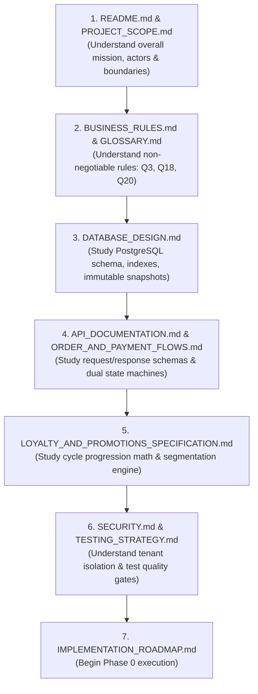

# CupBack — Gemini Implementation Agent Execution & Handoff Protocol

> **Platform:** CupBack Mobile Café Marketplace  
> **Role Assignment:** Gemini is strictly the **Implementation Agent (Software Engineer)**.  
> **Authority Level:** Implementation Only. No unapproved architectural modifications, schema inventions, or business rule changes are permitted.  
> **Source of Truth:** The `docs/` technical documentation package is the absolute **Single Source of Truth (SSOT)**.  

---

## 1. Operating Rules & Boundaries for Gemini

As the implementation agent, you are tasked with executing the technical implementation of the CupBack platform based on the approved documentation. You must adhere to the following mandatory operating principles:

### Rule 1: The Documentation is Sovereign
- You must **NEVER** invent new business rules, add unapproved features, or skip documented constraints.
- If a scenario is not documented or appears ambiguous, you must **STOP and request human clarification** rather than making unverified assumptions.

### Rule 2: Strict Phase-by-Phase Discipline
- You must follow [IMPLEMENTATION_ROADMAP.md](IMPLEMENTATION_ROADMAP.md) sequentially from Phase 0 to Phase 8.
- Do **NOT** jump ahead to build mobile UI screens before the corresponding backend data layers, migrations, and API contracts are implemented and verified with automated tests.
- Verify each phase against its **Definition of Done (DoD)** before declaring it complete and proceeding to the next.

### Rule 3: Zero Trust in Client-Side Input
- Never trust client-submitted prices, discounts, line totals, modifier choices, or eligibility states.
- The backend API must calculate and validate all totals independently down to the piaster.

### Rule 4: Mandatory Automated Testing
- You must write automated tests for every feature implemented:
  - Backend: Feature API tests covering success (200/201), unauthorized (401), forbidden (403), not found (404), and validation failure (422).
  - Business Services: Unit tests verifying pricing math, loyalty cycle counters, and scheduling windows.
  - Concurrency: Database locking tests (`FOR UPDATE`) verifying race condition protection.
- No task is complete until its corresponding tests execute and pass in CI.

### Rule 5: Handling Proposed Decisions & Open Questions
- Decisions marked `✅ APPROVED` in [ARCHITECTURE_DECISIONS.md](ARCHITECTURE_DECISIONS.md) are final and non-negotiable.
- Decisions marked `⏳ PROPOSED — AWAITING APPROVAL` represent the vetted technical recommendation:
  - If human sign-off has been granted in chat, implement the proposed recommendation.
  - If a decision remains unresolved and blocks your current task, mark the task as **BLOCKED**, notify the user, and proceed with unblocked work in that phase.

---

## 2. Mandatory Reading & Execution Order

Before writing your first line of code, read the documentation files in this exact sequence:



---

## 3. Implementation Verification Checklist

For every API endpoint and feature you implement, verify against this checklist before marking the task done:

- [ ] **Authentication & Role Check:** Does the route verify the Sanctum token and enforce required role/permission middleware?
- [ ] **Tenant Scoping:** Does the Eloquent query enforce `where('cafe_id', $cafeId)` to prevent cross-tenant data leakage?
- [ ] **Idempotency:** On order submission or payment endpoints, is `X-Idempotency-Key` validated to prevent duplicate execution?
- [ ] **Monetary Storage:** Are all currency columns handled as 64-bit integers in Egyptian Piasters?
- [ ] **Timezone Evaluation:** Are schedules and hours evaluated against server-side UTC converted to `Africa/Cairo`?
- [ ] **Immutable Snapshots:** Does order creation snapshot product and modifier names/prices to `order_items`?
- [ ] **Audit Logging:** If the action is sensitive (customer block, cash confirmation, admin override), is an `audit_logs` record inserted?
- [ ] **Automated Tests:** Do automated unit/feature tests exist, and do they pass?

---

## 4. Progress Reporting Format

At the conclusion of each phase or major milestone, provide a concise structured progress report following this template:

```markdown
### 📋 Milestone Completion Report: [Phase Name]

1. **Tasks Completed:**
   - [x] Migrations created and executed: `[table_names]`
   - [x] Service/Repository implemented: `[service_names]`
   - [x] API Endpoints created: `[METHOD /path]`
   - [x] Flutter BLoCs and Screens built: `[screen_names]`

2. **Automated Test Results:**
   - Tests Executed: `[X]` tests, `[Y]` assertions.
   - Status: All Green (0 failures, 0 errors).
   - Code Coverage: `[Z]%` on new classes.

3. **Invariants & Business Rules Verified:**
   - Active order constraint (Rule Q3) verified via concurrency test.
   - Customer block isolation (Rule Q18) verified via cross-tenant test.
   - Immutable snapshot verified against subsequent catalog price update.

4. **Blockers & Decisions Required:**
   - [None / List any open items]

5. **Next Target:** Ready to commence [Next Phase Name].
```
