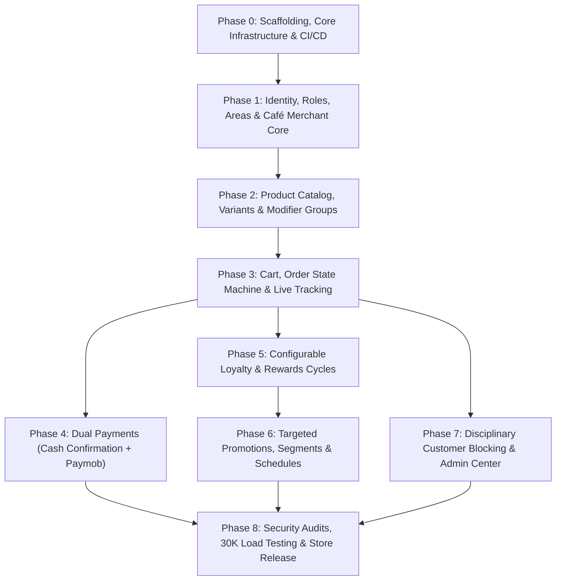

# CupBack — Technical Implementation Roadmap & Execution Blueprint

> **Platform:** CupBack Mobile Café Marketplace  
> **Execution Model:** 9-Phase Sequential & Parallel Milestone Execution  
> **Implementation Agent:** Gemini (Coding Agent)  
> **Audience:** Lead Architects, DevOps, QA Engineers, Gemini Implementation Agent  

---

## 1. Execution Dependency Graph

---

## 2. Detailed Phase Specifications

### Phase 0: Scaffolding, Core Infrastructure & CI/CD
- **Objective:** Establish production-grade repositories, containerized runtimes, linting standards, and CI/CD automation.
- **Prerequisites:** Approved Architecture Decision Records (ADRs).
- **Backend Responsibilities (Laravel):**
  - Scaffold Laravel 11 application with PHP 8.3+.
  - Configure PostgreSQL connection pooling, Redis caching, and Redis queue drivers.
  - Install and configure Laravel Horizon, Laravel Sanctum, and Laravel Reverb.
  - Establish GitHub Actions workflow: PHPStan (Level 8), Pint, and Pest test runner.
- **Mobile Responsibilities (Flutter):**
  - Initialize Flutter project with feature-driven Clean Architecture folder layout.
  - Configure dependencies: `flutter_bloc`, `dio`, `go_router`, `flutter_secure_storage`, `intl`, `firebase_core`.
  - Establish typography (Cairo & Plus Jakarta Sans) and color token themes.
  - Configure CI workflow: `flutter analyze` and `flutter test`.
- **Definition of Done (DoD):** Clean builds passing on CI; API health-check endpoint (`GET /health`) returning 200 OK connected to PostgreSQL and Redis.

---

### Phase 1: Identity, Roles, Areas & Café Merchant Core
- **Objective:** Implement user registration, token management, area assignment, and café onboarding workflows.
- **Prerequisites:** Phase 0 complete.
- **Backend Responsibilities:**
  - Database migrations: `areas`, `users`, `roles`, `permissions`, `cafes`, `cafe_branches`, `cafe_staff`, `cafe_operating_hours`.
  - Implement Spatie RBAC with roles: `customer`, `cafe_manager`, `cafe_staff`, `platform_admin`.
  - Auth endpoints: `POST /auth/register` (Name, Phone, Area), `POST /auth/login`, `POST /auth/logout`.
  - Area management CRUD and customer active area switcher (`PUT /customer/profile/area`).
  - Café onboarding and approval state machine (`pending_approval` $\to$ `active` / `suspended`).
  - Operating schedule evaluator supporting daily hours, overnight spans, and manual overrides.
- **Flutter Responsibilities:**
  - Build Auth Flow: Splash Screen, Phone Registration, Password Login.
  - Build Area Selection Sheet.
  - Role-based Shell Routing: Direct authenticated user to Customer Home, Café Dashboard, or Admin Center.
- **Testing Requirements:** Unit tests for phone validation; Feature tests for auth endpoints; Operating hours overnight calculation tests.
- **Definition of Done (DoD):** Customer can register and choose an area; Café manager can log in; Admin can approve cafés and create areas.

---

### Phase 2: Product Catalog, Variants & Modifier Groups
- **Objective:** Build the dynamic catalog engine with variants, modifier groups, and server-side pricing.
- **Prerequisites:** Phase 1 complete.
- **Backend Responsibilities:**
  - Database migrations: `categories`, `products`, `product_variants`, `modifier_groups`, `modifiers`, `product_modifier_group`.
  - Implement tenant-scoped CRUD for categories, products, variants, and modifiers.
  - Implement `GET /cafes/{id}/menu` with Redis caching and ETag support.
  - Enforce modifier group selection validation (required groups, min/max choices).
  - Implement authoritative server-side price calculator service.
- **Flutter Responsibilities:**
  - Build Categorised Menu Exploration Screen with category tabs.
  - Build interactive Product Customization Bottom Sheet with variant radio pills, modifier checkboxes, and dynamic price bar.
  - Café Manager Menu Management screens: Add/edit products, sizes, and add-on groups.
- **Testing Requirements:** 100% test coverage on price calculation service; Tenant isolation tests on catalog CRUD.
- **Definition of Done (DoD):** Customer can customize any beverage with sizes and modifiers; backend validates constraints and calculates identical prices down to the piaster.

---

### Phase 3: Cart, Order State Machine & Live Tracking
- **Objective:** Implement single-café cart enforcement, the order state machine, active order limits, and real-time WebSocket tracking.
- **Prerequisites:** Phase 2 complete.
- **Backend Responsibilities:**
  - Database migrations: `carts`, `cart_items`, `cart_item_modifiers`, `orders`, `order_items`, `order_item_modifiers`, `order_status_history`.
  - Implement `POST /orders` with transactional active order concurrency check (`FOR UPDATE`) and immutable item/modifier snapshots.
  - Implement Order State Machine transitions: `pending_confirmation` $\to$ `confirmed` $\to$ `preparing` $\to$ `ready` $\to$ `completed` / `rejected`.
  - Café incoming order management endpoints (accept, reject with mandatory reason, update status, mark ready).
  - Broadcast real-time events over Laravel Reverb and dispatch FCM push alerts.
- **Flutter Responsibilities:**
  - Single-café Cart Screen with clear/replace warning dialog.
  - Checkout Screen (Pickup vs. Dine-In with optional Table Number).
  - Real-Time Live Order Tracking Screen with visual pulsing stepper.
  - Café Incoming Orders Live Feed with sound alerts.
- **Testing Requirements:** Concurrency tests for active order limits; Snapshot immutability tests; Rejection reason validation tests.
- **Definition of Done (DoD):** Full ordering loop operational from mobile cart to café acceptance, preparation, and ready notification.

---

### Phase 4: Financial Settlements (Cash Confirmation + Paymob)
- **Objective:** Complete cash counter confirmation and Paymob online payment integration.
- **Prerequisites:** Phase 3 complete.
- **Backend Responsibilities:**
  - Database migrations: `payments`, `refunds`.
  - Implement `PUT /cafe-management/orders/{id}/confirm-cash` requiring `confirm_cash` permission.
  - Integrate Paymob Unified Checkout (Card, Meeza, Mobile Wallets).
  - Implement `POST /payments/webhook` with HMAC signature verification and idempotency keys.
  - Automated refund initiation workflow for rejected online orders.
- **Flutter Responsibilities:**
  - Payment method selector at checkout.
  - Paymob mobile checkout integration (WebView / SDK).
  - Café Cash Collection Confirmation action button with modal confirmation.
- **Testing Requirements:** Webhook HMAC tampering tests; Duplicate webhook idempotency tests; Cash collection audit logging tests.
- **Definition of Done (DoD):** Cash orders only complete upon explicit counter confirmation; Online orders settle via Paymob with automatic refunds on rejection.

---

### Phase 5: Configurable Loyalty & Rewards Cycles
- **Objective:** Implement the café-specific order-count loyalty cycle engine.
- **Prerequisites:** Phase 3 complete (Orders must exist).
- **Backend Responsibilities:**
  - Database migrations: `reward_programs`, `customer_reward_progress`, `reward_redemptions`.
  - Progression Service: increment order count upon order completion; generate unlocked reward at threshold $N$.
  - Single-use redemption service with pessimistic row locks (`FOR UPDATE`).
  - Enforce critical cycle reset rule: Order $N+1$ (reward order) does not count toward the next cycle.
  - Customer loyalty progress endpoints.
- **Flutter Responsibilities:**
  - Digital Loyalty Stamp Card widget.
  - Reward redemption picker in cart.
  - Café Reward Program creation wizard.
- **Testing Requirements:** Cycle mechanics regression suite; Concurrency double-redemption tests.
- **Definition of Done (DoD):** Customer completes 5 orders, receives reward on 6th, and cycle resets cleanly with 7th order as cycle 2 count 1.

---

### Phase 6: Targeted Promotions, Segments & Schedules
- **Objective:** Implement promotional campaigns with customer segmentation and temporal schedules.
- **Prerequisites:** Phase 5 complete (for offer conflict handling).
- **Backend Responsibilities:**
  - Database migrations: `promotions`, `promotion_schedules`, `promotion_target_segments`, `promotion_target_customers`, `promotion_redemptions`.
  - Segmentation Evaluator: new, returning, frequent ($>N$), specific, inactive ($>N$ days).
  - Temporal Schedule Evaluator: daily time windows, overnight shifts, Cairo timezone.
  - Enforce Offer Stacking Rule Q11: Single offer per order constraint.
  - Campaign redemption counters and usage limits.
- **Flutter Responsibilities:**
  - Café Promotions Management Wizard (Segment selection, schedule picker, product scope).
  - Customer Available Promotions carousel and cart offer selector.
- **Testing Requirements:** Overnight schedule evaluation tests; Segment categorization tests; Campaign redemption cap tests.
- **Definition of Done (DoD):** Café can launch a Thursday afternoon promotion targeting new customers; eligible customers see and redeem it seamlessly.

---

### Phase 7: Disciplinary Customer Blocking (Q18) & Admin Center
- **Objective:** Implement per-café customer blocking with audit trails, and the complete platform admin control center.
- **Prerequisites:** Phase 3 & Phase 4 complete.
- **Backend Responsibilities:**
  - Database migration: `cafe_customer_blocks`, `audit_logs`.
  - Blocking endpoints: `POST /cafe-management/customers/{id}/block` (requires `block_customers` permission and mandatory reason).
  - Customer unblocking and Platform Admin override (`PUT /admin/customers/{cafe_id}/{cust_id}/unblock`).
  - Active order immunity: blocks do not alter existing in-flight orders.
  - Platform Admin control center APIs: Area management, café vetting, audit log explorer, dispute mediation.
- **Flutter Responsibilities:**
  - Café Customer CRM Directory with block button and reason dialog.
  - Customer Disciplinary Block Notice Modal (respectful messaging).
  - Platform Admin Control Center: Areas, Cafés, Audit Logs, Block Overrides.
- **Testing Requirements:** Block tenant isolation tests (blocked at A, allowed at B); Audit logging completeness tests.
- **Definition of Done (DoD):** Café can block non-collecting customers; admin can oversee and override; full audit trail maintained.

---

### Phase 8: Hardening, Security Audits, 30K Load Testing & Store Release
- **Objective:** Final performance optimization, penetration testing, k6 load testing, and store submission.
- **Prerequisites:** All previous phases complete.
- **Execution Checklist:**
  - Execute automated k6 load test: Sustain 30,000 concurrent active users with $p95 \le 200\text{ ms}$ for reads and $p95 \le 500\text{ ms}$ for writes.
  - Conduct OWASP API Security Top 10 penetration testing and remediation.
  - Audit Redis caching invalidation across all catalog and operational entities.
  - Complete Arabic (RTL) and English (LTR) visual QA on Android and iOS devices.
  - Finalize store assets, privacy policies, and release builds for Google Play Store and Apple App Store.
- **Definition of Done (DoD):** Platform load-tested at 30K concurrency with zero data corruption; zero high/critical vulnerabilities; production launch approval.
