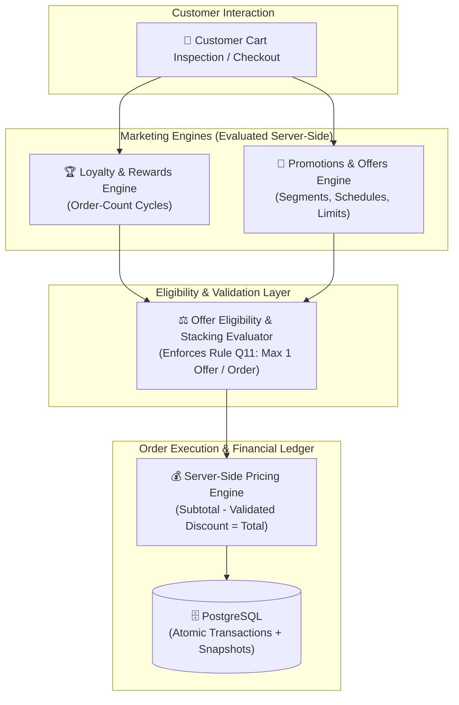
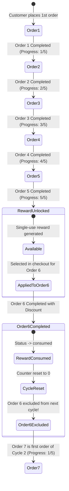

# CupBack — Advanced Loyalty, Customer Segmentation & Promotions Engine Specification

> **Platform:** CupBack Mobile Café Marketplace  
> **Status:** Implementation-Ready Technical Specification  
> **Audience:** Backend Architects, Core Developers, QA Engineers, Gemini Implementation Agent  

---

## 1. Engine Architecture & Separation of Concerns

The CupBack platform treats **Loyalty & Rewards** and **Promotional Campaigns** as two distinct, decoupled marketing engines sharing a unified eligibility evaluation and discount calculation pipeline.



---

## 2. Advanced Loyalty & Rewards Engine (Part of V1 MVP)

### 2.1 Core Architectural Principles
1. **Café-Specific Isolation:** Every reward program operates strictly within the boundary of a single café tenant. Customer order counts, reward credits, and redemption histories at Café A have zero bearing on Café B.
2. **Order-Count Cycle Mechanics:** Loyalty progression is driven by completed orders meeting configured eligibility criteria.
3. **Multi-Program Support:** A single café can operate multiple concurrent reward programs (e.g., Program A: 5 orders $\to$ 20% off; Program B: 10 orders $\to$ Free Sandwich).

### 2.2 Mathematical Cycle Mechanics & Progression Model

Consider an active reward program configured with threshold $N = 5$:

$$\text{Cycle Length } N = 5 \text{ Completed Orders}$$



#### The Seven Rules of Cycle Progression:
1. **Order Completion Trigger:** Progress increments ONLY when an order transitions to `completed` (order ready + cash confirmed or online payment verified). Cancelled or rejected orders NEVER increment progress.
2. **Threshold Achievement:** When `current_cycle_order_count` reaches $N$, an immutable `reward_redemptions` record is generated in `available` status.
3. **Counter Lock:** While an unused reward remains in `available` status for that program, the counter remains at $N$.
4. **Redemption on Order $N+1$:** The customer applies the reward on Order $N+1$.
5. **Consumption on Completion:** When Order $N+1$ completes, the reward status transitions to `consumed`.
6. **Cycle Reset:** The program's `current_cycle_order_count` resets to $0$.
7. **Exclusion of the Redemption Order (CRITICAL):** Order $N+1$ does **NOT** count as Order 1 of the next cycle. The customer's next standard order (Order $N+2$) represents Order 1 of Cycle 2.

### 2.3 Interaction Across Multiple Programs (Rule Q12 Proposal)
When a café runs Program A ($N=5$) and Program B ($N=10$):
- Standard completed orders increment both programs simultaneously.
- When the customer redeems Program A's reward on Order 6, Order 6 is skipped for Program A's next cycle.
- **Rule Q12 (Recommended):** Order 6 **DOES** count toward Program B (moving Program B from 5/10 to 6/10), provided Order 6 meets Program B's minimum spend threshold. This prevents penalizing customer engagement across independent programs.

### 2.4 Reward Types & Valuation Mechanics
| Reward Type | Value Definition | Pricing Engine Calculation |
|-------------|------------------|----------------------------|
| **Percentage Discount** | `reward_percentage` (e.g., $20\%$) | $\text{Discount} = \text{Eligible Subtotal} \times \left(\frac{\text{reward\_percentage}}{100}\right)$ |
| **Fixed Amount Discount** | `reward_value_piasters` (e.g., 5000 Piasters = 50 EGP) | $\text{Discount} = \min(\text{Eligible Subtotal}, \text{reward\_value\_piasters})$ |
| **Free Item** | Specific Product/Variant or cheapest eligible item in scope | $\text{Discount} = \text{Unit Price of Eligible Item Snapshot}$ |
| **Free Order** | 100% discount on entire cart up to optional café ceiling | $\text{Discount} = \text{Entire Eligible Subtotal}$ |

### 2.5 Concurrency Safeguards & Anti-Abuse
- **Pessimistic Locking on Redemption:**
```sql
BEGIN;
SELECT id, status FROM reward_redemptions 
WHERE id = :reward_id AND customer_id = :customer_id AND status = 'available' 
FOR UPDATE;

-- If row missing or status != 'available', ROLLBACK and throw 409 Conflict.
-- Attach to Order, transition to 'consumed' upon successful order completion.
COMMIT;
```

---

## 3. Advanced Promotions & Offers Engine (Part of V1 MVP)

### 3.1 Customer Segmentation Engine

The engine categorizes customers dynamically based on relational metrics stored in `cafe_customers`:

| Segment Identifier | Dynamic Evaluation Criteria | Business Intent |
|--------------------|-----------------------------|-----------------|
| `all_customers` | Unconditional across all customers viewing the café. | Broad awareness campaigns. |
| `new_customers` | `cafe_customers.total_completed_orders = 0` (or record does not exist). | Acquisition & trial incentive. |
| `returning_customers`| `cafe_customers.total_completed_orders >= 1`. | Repeat retention. |
| `frequent_customers` | `cafe_customers.total_completed_orders >= min_orders_threshold` (e.g., $>5, >10, >20$). | VIP & high-value rewards. |
| `specific_customers` | Customer's `user_id` exists in `promotion_target_customers`. | Personalized concierge offers. |
| `inactive_customers` (Q16) | `last_order_at <= CURRENT_TIMESTAMP - INTERVAL 'X days'`. | Win-back churned patrons. |

### 3.2 Temporal Scheduling & Timezone Integrity
- All promotional schedules store `start_date`, `end_date`, `day_of_week` ($0$ to $6$), `start_time`, and `end_time`.
- Evaluation executes strictly against server-side UTC time converted to the café’s local timezone (`Africa/Cairo`).
- **Overnight Schedule Handling:**
```php
// PHP / Laravel Server-Side Evaluation:
$now = Carbon::now('Africa/Cairo');
$currentDay = $now->dayOfWeek; // 0=Sunday, 4=Thursday
$currentTime = $now->format('H:i:s');

if ($schedule->start_time <= $schedule->end_time) {
    // Standard intra-day window (e.g., 10:00 to 14:00)
    $isTimeMatch = ($currentTime >= $schedule->start_time && $currentTime <= $schedule->end_time);
} else {
    // Overnight window (e.g., 20:00 to 02:00 next day)
    $isTimeMatch = ($currentTime >= $schedule->start_time || $currentTime <= $schedule->end_time);
}
```

### 3.3 Redemption Limits & Financial Exposure Caps (Q17 Baseline)
1. **Total Campaign Redemptions Cap:** `current_total_redemptions < max_total_redemptions`. Once saturated, campaign status transitions to `expired`.
2. **Per-Customer Limit:** $\text{Count of redemptions for this customer} < \text{max\_redemptions\_per\_customer}$.
3. **Minimum Order Value:** $\text{Order Subtotal} \ge \text{min\_order\_value\_piasters}$.

---

## 4. Offer Conflict Resolution & Stacking Policy (Rule Q11 Proposal)

### 4.1 Recommended Stacking Policy: Single Offer Per Order
To safeguard café profit margins and guarantee absolute transparency:

> **Policy Statement:** A customer may redeem **at most ONE offer per order** — either one promotional campaign discount OR one earned loyalty reward. Combining multiple promotions or stacking a promotion with a loyalty reward on the same order is strictly prohibited in Version 1.

### 4.2 Checkout Evaluation Workflow
1. When viewing the cart, the Flutter client calls `GET /cafes/{id}/eligible-offers`.
2. The backend evaluates all active promotions and available loyalty rewards against the customer's cart.
3. The response returns an itemized list of eligible offers, each with calculated piaster savings.
4. The customer selects their preferred offer (or the UI can highlight the highest-value offer).
5. Upon order submission, the backend authoritatively re-verifies the single selected offer and calculates the final total.

---

## 5. Edge Cases & Defensive Failure Scenarios

| Failure Scenario | Defensive Architectural Behavior |
|------------------|----------------------------------|
| **Program Deactivated Mid-Cycle** | In-flight progress is frozen. Customers who already unlocked rewards in `available` status retain the right to redeem them. New progress cannot be accumulated. |
| **Promotion Expires During Checkout** | If a promotion reaches its end time between cart view and order submission, the backend re-validation fails with `422 Unprocessable Entity` ("This promotion has expired. Your cart total has been updated.") |
| **Order Paid Online but Rejected by Café** | If an order using a loyalty reward or promotion is rejected by staff, the transaction rolls back: online payment initiates refund, and the loyalty reward status is reset from `consumed` back to `available`. |
| **Concurrent Double-Tap on Limited Promotion** | Two simultaneous order requests competing for the last available promotion redemption slot execute inside transactions with `FOR UPDATE` on the promotion row. The first commits; the second fails validation. |
