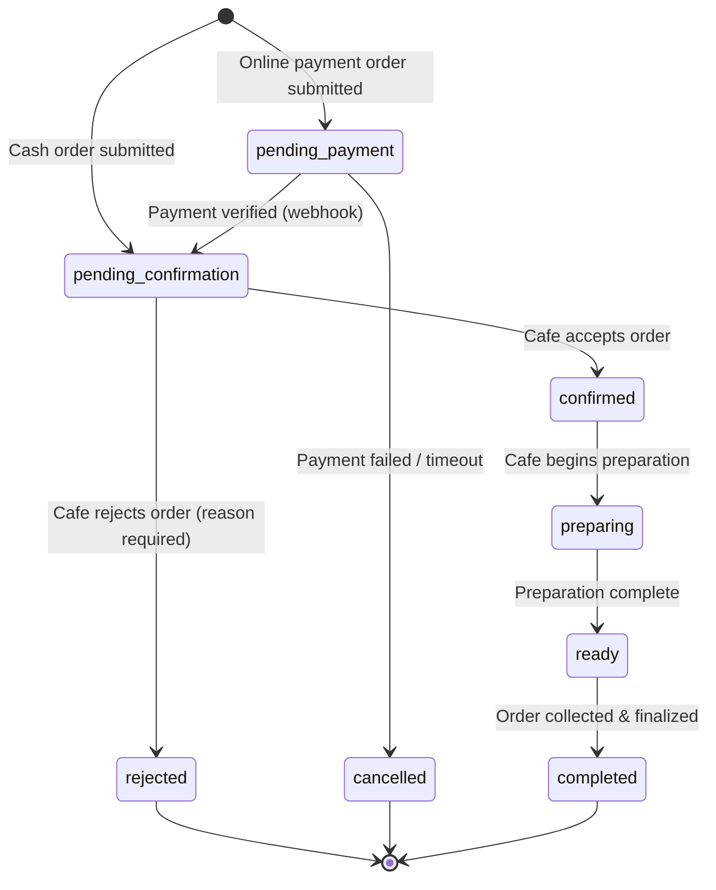
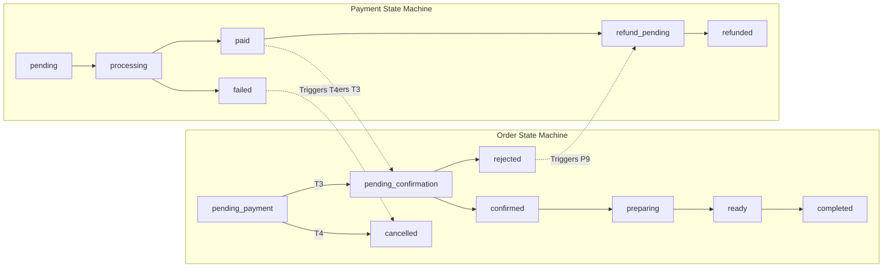
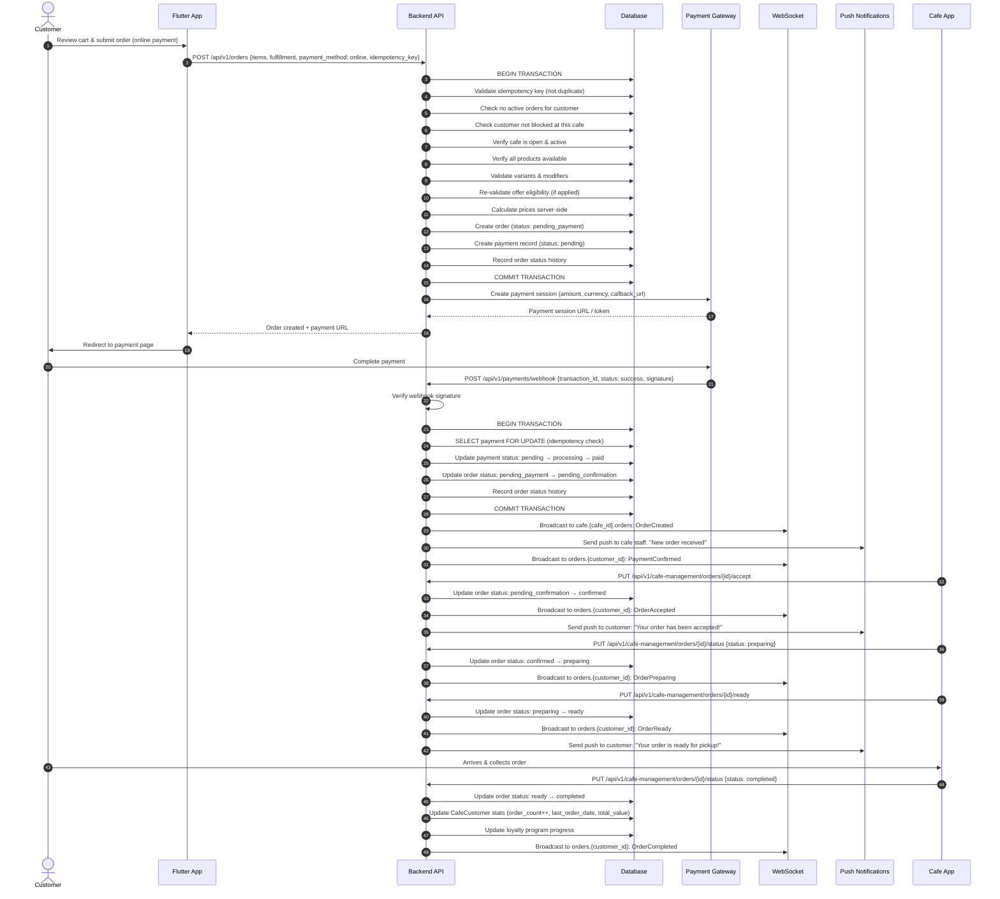
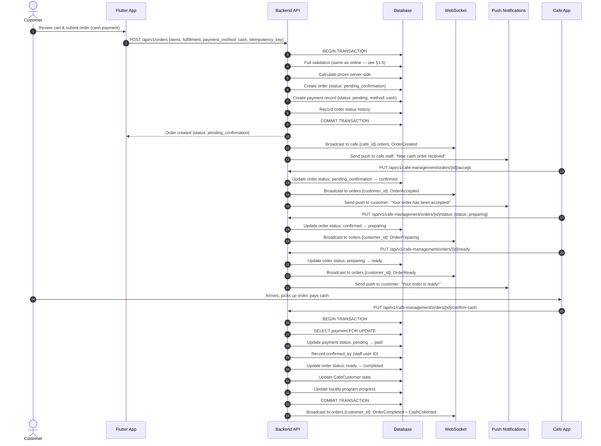
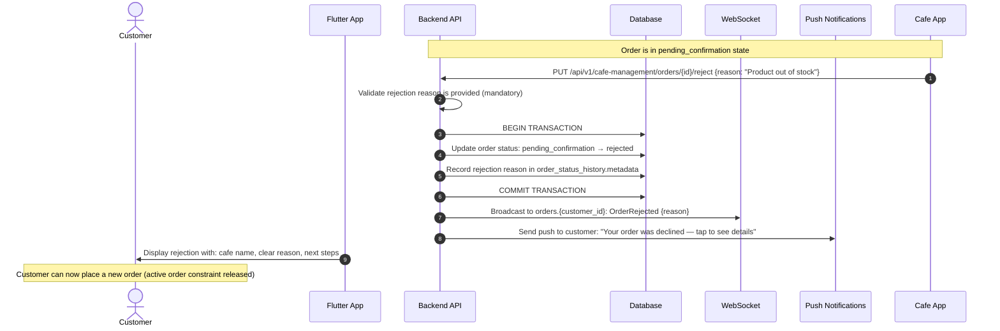
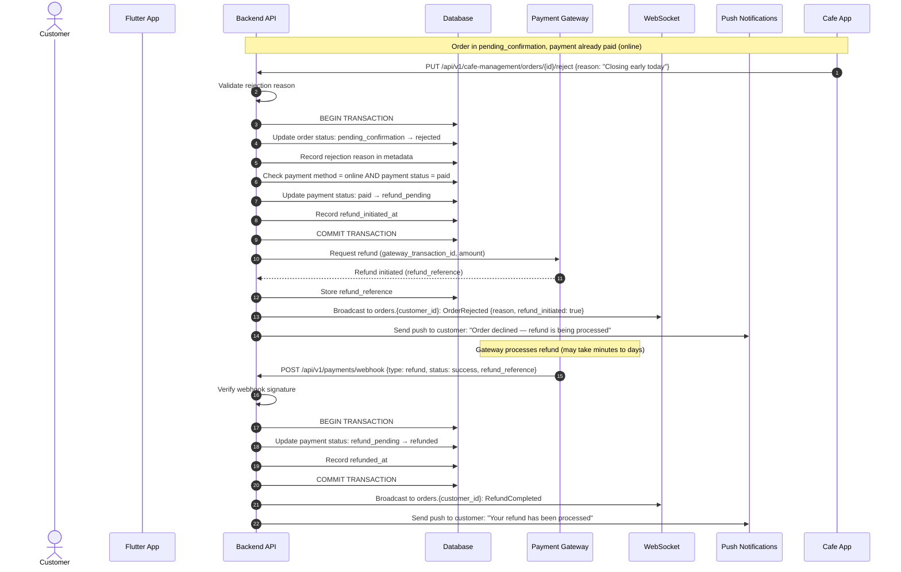
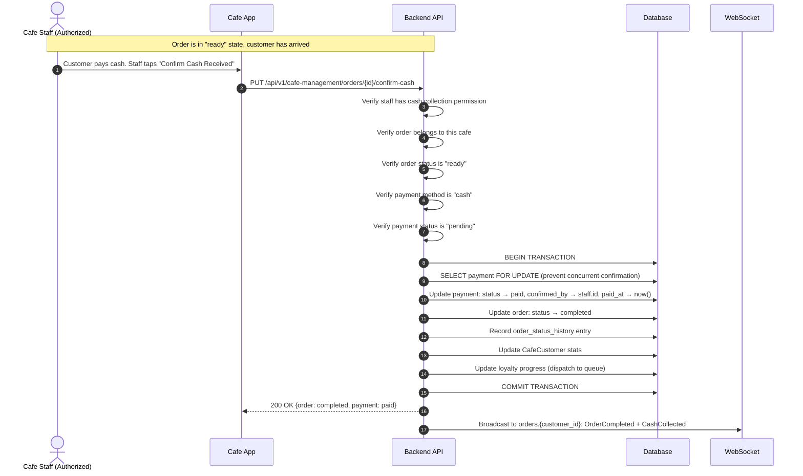
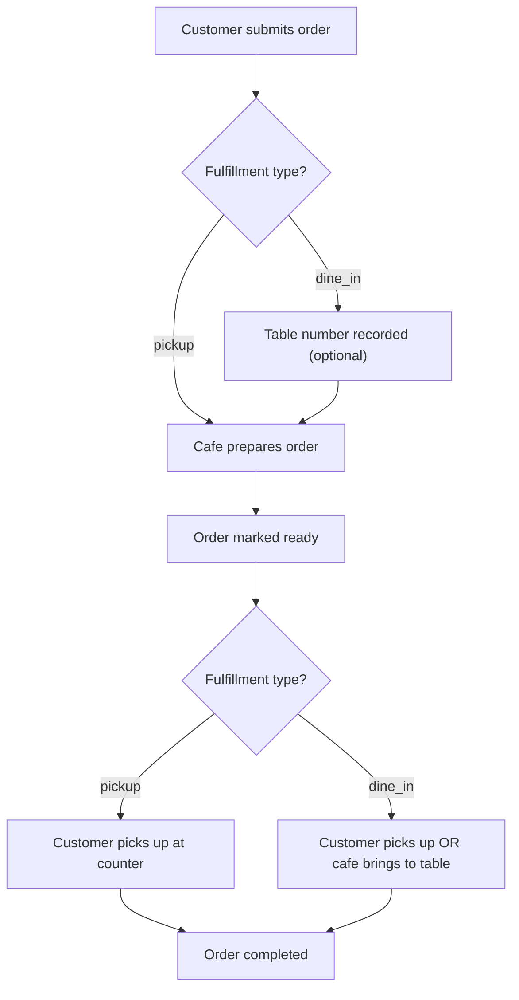
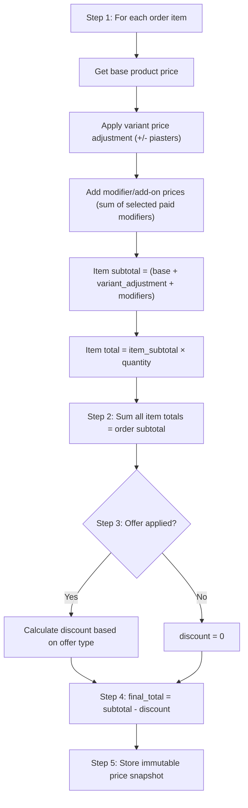

# Order & Payment Flows — CupBack Marketplace Platform

> **Document Version:** 1.0  
> **Status:** Implementation-Ready  
> **Last Updated:** 2026-11-09  
> **Related Documents:** [API_DOCUMENTATION.md](./API_DOCUMENTATION.md), [LOYALTY_AND_PROMOTIONS_SPECIFICATION.md](./LOYALTY_AND_PROMOTIONS_SPECIFICATION.md), [REALTIME_AND_NOTIFICATIONS.md](./REALTIME_AND_NOTIFICATIONS.md)

---

## Table of Contents

1. [Order State Machine](#1-order-state-machine)
2. [Payment State Machine](#2-payment-state-machine)
3. [Sequence Diagrams](#3-sequence-diagrams)
4. [Fulfillment Model](#4-fulfillment-model)
5. [Price Calculation](#5-price-calculation)
6. [Edge Cases & Failure Scenarios](#6-edge-cases--failure-scenarios)
7. [Open Questions](#7-open-questions)

---

## 1. Order State Machine

### 1.1 States

| State | Type | Description |
|---|---|---|
| `pending_payment` | Non-Terminal | Order created, awaiting online payment confirmation. **Online payment orders ONLY.** |
| `pending_confirmation` | Non-Terminal | Payment verified (online) or order submitted (cash). Awaiting cafe acceptance. |
| `confirmed` | Non-Terminal | Cafe has accepted the order. Preparation has not yet started. |
| `preparing` | Non-Terminal | Cafe is actively preparing the order. |
| `ready` | Non-Terminal | Order is prepared and waiting for customer pickup/collection. |
| `completed` | Terminal | Order fulfilled — customer collected, and for cash orders, payment confirmed. |
| `rejected` | Terminal | Cafe rejected the order. Reason provided. |
| `cancelled` | Terminal | System-initiated cancellation (e.g., payment failure, timeout). **Not customer-triggered.** |

> [!IMPORTANT]
> **No customer cancellation.** Customers cannot cancel orders. This is a confirmed business decision (D19). The `cancelled` state is only entered by system-level events such as payment failure.

### 1.2 State Diagram



### 1.3 Valid Transitions

| # | From | To | Trigger | Actor | Conditions |
|---|---|---|---|---|---|
| T1 | `(new)` | `pending_payment` | Customer submits order with online payment | System | All validation passes (see §1.5) |
| T2 | `(new)` | `pending_confirmation` | Customer submits order with cash payment | System | All validation passes (see §1.5) |
| T3 | `pending_payment` | `pending_confirmation` | Payment gateway webhook confirms successful payment | System (webhook) | Webhook signature valid, payment amount matches, idempotency check passes |
| T4 | `pending_payment` | `cancelled` | Payment fails, expires, or is declined | System (webhook / timeout) | Payment gateway reports failure or timeout threshold exceeded |
| T5 | `pending_confirmation` | `confirmed` | Cafe accepts order | Cafe Manager / Staff | Order is in `pending_confirmation`, cafe is still open |
| T6 | `pending_confirmation` | `rejected` | Cafe rejects order | Cafe Manager / Staff | Rejection reason is provided (mandatory) |
| T7 | `confirmed` | `preparing` | Cafe starts preparation | Cafe Manager / Staff | Order is in `confirmed` state |
| T8 | `preparing` | `ready` | Preparation complete | Cafe Manager / Staff | Order is in `preparing` state |
| T9 | `ready` | `completed` | Order collected and finalized | Cafe Manager / Staff | For cash: cash collection must be confirmed first (payment status = `paid`). For online: payment already verified. |

### 1.4 Invalid Transitions (Explicitly Prohibited)

| From | To | Why Prohibited |
|---|---|---|
| `pending_payment` | `confirmed` | Cannot skip payment verification |
| `pending_payment` | `preparing` | Cannot skip payment verification and cafe acceptance |
| `pending_payment` | `ready` | Cannot skip intermediate states |
| `pending_payment` | `completed` | Cannot skip intermediate states |
| `pending_payment` | `rejected` | Cafe has not seen the order yet; must go through `pending_confirmation` |
| `pending_confirmation` | `preparing` | Cannot skip cafe acceptance step |
| `pending_confirmation` | `ready` | Cannot skip intermediate states |
| `pending_confirmation` | `completed` | Cannot skip intermediate states |
| `pending_confirmation` | `cancelled` | Only `pending_payment` can be cancelled (system-only) |
| `confirmed` | `pending_payment` | No backward transitions |
| `confirmed` | `pending_confirmation` | No backward transitions |
| `confirmed` | `ready` | Cannot skip `preparing` |
| `confirmed` | `completed` | Cannot skip `preparing` and `ready` |
| `confirmed` | `rejected` | Already accepted; cannot reject after acceptance |
| `confirmed` | `cancelled` | Already accepted; no system cancellation after acceptance |
| `preparing` | `pending_confirmation` | No backward transitions |
| `preparing` | `confirmed` | No backward transitions |
| `preparing` | `completed` | Cannot skip `ready` |
| `preparing` | `rejected` | Already past acceptance |
| `preparing` | `cancelled` | Already past acceptance |
| `ready` | Any non-`completed` | No backward transitions from `ready` |
| `completed` | Any | Terminal state — no transitions out |
| `rejected` | Any | Terminal state — no transitions out |
| `cancelled` | Any | Terminal state — no transitions out |
| Any | `pending_payment` | Entry state only — cannot transition back to it |

> [!CAUTION]
> **Strict enforcement:** Every transition must be validated at the backend. The API must reject any request that would cause an invalid transition with a `422 Unprocessable Entity` and error code `INVALID_ORDER_TRANSITION`. Never rely on the Flutter client to prevent invalid transitions.

### 1.5 Order Creation Validation Checklist

Before an order enters its first state (`pending_payment` or `pending_confirmation`), the backend MUST validate ALL of the following:

| # | Validation | Error Code |
|---|---|---|
| V1 | Customer is authenticated | `UNAUTHENTICATED` |
| V2 | Customer has no active (non-terminal) order at ANY cafe | `ACTIVE_ORDER_EXISTS` |
| V3 | Customer is not blocked by the target cafe | `CUSTOMER_BLOCKED` |
| V4 | All products belong to the same cafe | `MULTI_CAFE_ORDER` |
| V5 | Cafe exists and is active (not suspended) | `CAFE_UNAVAILABLE` |
| V6 | Cafe is currently open (operating hours + manual override) | `CAFE_CLOSED` |
| V7 | All products are available (not deactivated/out of stock) | `PRODUCT_UNAVAILABLE` |
| V8 | All selected variants exist and belong to their products | `INVALID_VARIANT` |
| V9 | All selected modifiers exist and belong to valid modifier groups for the selected products/variants | `INVALID_MODIFIER` |
| V10 | Required modifier groups have selections | `MISSING_REQUIRED_MODIFIER` |
| V11 | Modifier selections respect min/max limits | `MODIFIER_LIMIT_EXCEEDED` |
| V12 | Quantities are positive integers | `INVALID_QUANTITY` |
| V13 | Fulfillment type is valid (`pickup` or `dine_in`) | `INVALID_FULFILLMENT_TYPE` |
| V14 | Payment method is valid (`online` or `cash`) | `INVALID_PAYMENT_METHOD` |
| V15 | Server-side price calculation matches (client total is advisory only) | N/A (server always recalculates) |
| V16 | If offer applied: re-validate eligibility, recalculate discount server-side | `OFFER_NOT_ELIGIBLE` |
| V17 | Idempotency key provided and not previously used | `DUPLICATE_ORDER` |

### 1.6 Transition Authorization Matrix

| Transition | Customer | Cafe Staff | Cafe Manager | Platform Admin |
|---|---|---|---|---|
| Submit order (→ `pending_payment` / `pending_confirmation`) | ✅ | ❌ | ❌ | ❌ |
| Payment verified (→ `pending_confirmation`) | ❌ (System) | ❌ | ❌ | ❌ |
| Payment failed (→ `cancelled`) | ❌ (System) | ❌ | ❌ | ❌ |
| Accept order (→ `confirmed`) | ❌ | ✅ | ✅ | ❌ |
| Reject order (→ `rejected`) | ❌ | ✅ | ✅ | ❌ |
| Start preparing (→ `preparing`) | ❌ | ✅ | ✅ | ❌ |
| Mark ready (→ `ready`) | ❌ | ✅ | ✅ | ❌ |
| Complete order (→ `completed`) | ❌ | ✅ | ✅ | ❌ |

### 1.7 Order Status History

Every state transition MUST be recorded in an `order_status_history` table:

| Field | Type | Description |
|---|---|---|
| `id` | BIGINT PK | Auto-increment |
| `order_id` | FK → orders | The order |
| `from_status` | ENUM / VARCHAR | Previous status (null for initial) |
| `to_status` | ENUM / VARCHAR | New status |
| `triggered_by` | FK → users (nullable) | User who triggered (null for system) |
| `trigger_type` | ENUM | `customer`, `cafe_staff`, `system`, `webhook` |
| `metadata` | JSON (nullable) | Rejection reason, payment reference, etc. |
| `created_at` | TIMESTAMP | When the transition occurred |

---

## 2. Payment State Machine

### 2.1 States

| State | Type | Description |
|---|---|---|
| `pending` | Non-Terminal | Payment record created, no processing yet |
| `processing` | Non-Terminal | Online payment is being processed by gateway (awaiting webhook) |
| `paid` | Non-Terminal (for refund purposes) | Payment successfully received and verified |
| `failed` | Terminal | Payment processing failed |
| `cancelled` | Terminal | Payment cancelled (order cancelled before payment completed) |
| `refund_pending` | Non-Terminal | Refund has been requested and is being processed |
| `refunded` | Terminal | Refund successfully completed |

> [!NOTE]
> The payment state machine is **fully independent** from the order state machine. They interact through defined integration points but maintain separate state tracking. An order can be `rejected` while payment is `paid`, triggering the refund flow.

### 2.2 State Diagram

```mermaid
stateDiagram-v2
    [*] --> pending : Payment record created

    state "Cash Flow" as cash {
        pending --> paid : Cash physically collected & confirmed by authorized staff
    }

    state "Online Flow" as online {
        pending --> processing : Payment sent to gateway
        processing --> paid : Webhook confirms success
        processing --> failed : Webhook confirms failure / timeout
    }

    paid --> refund_pending : Refund initiated (e.g., order rejected after payment)
    refund_pending --> refunded : Refund confirmed by gateway

    pending --> cancelled : Order cancelled before payment

    failed --> [*]
    cancelled --> [*]
    refunded --> [*]
```

### 2.3 Valid Transitions — Cash Flow

| # | From | To | Trigger | Actor | Conditions |
|---|---|---|---|---|---|
| P1 | `(new)` | `pending` | Order created with cash payment | System | Order passes all validation |
| P2 | `pending` | `paid` | Staff confirms physical cash collection | Cafe Staff (authorized) / Cafe Manager | Order is in `ready` or `completed` state; staff has cash collection permission; confirmation includes timestamp |
| P3 | `pending` | `cancelled` | Order rejected before cash collected | System | Order transitions to `rejected` |

> [!WARNING]
> **Cash is NEVER auto-marked as paid.** This is a confirmed business decision (D12). Cash payment status ONLY changes to `paid` after explicit confirmation by authorized cafe staff who has physically received the money.

### 2.4 Valid Transitions — Online Flow

| # | From | To | Trigger | Actor | Conditions |
|---|---|---|---|---|---|
| P4 | `(new)` | `pending` | Order created with online payment | System | Order passes all validation |
| P5 | `pending` | `processing` | Payment request sent to gateway | System | Gateway accepts the payment request |
| P6 | `processing` | `paid` | Gateway webhook confirms successful payment | System (webhook) | Webhook signature valid, amount matches, not a duplicate |
| P7 | `processing` | `failed` | Gateway webhook confirms failure, or timeout | System (webhook / scheduled job) | Webhook confirms decline or processing timeout exceeded |
| P8 | `pending` | `cancelled` | Order cancelled before payment initiated | System | Timeout or system cancellation |

### 2.5 Refund Transitions

| # | From | To | Trigger | Actor | Conditions |
|---|---|---|---|---|---|
| P9 | `paid` | `refund_pending` | Refund initiated (order rejected after online payment) | System (automatic) or Platform Admin (manual) | Payment was online and status is `paid`; order is `rejected` |
| P10 | `refund_pending` | `refunded` | Gateway confirms refund processed | System (webhook) | Refund webhook signature valid, amount matches |

### 2.6 Invalid Payment Transitions

| From | To | Why Prohibited |
|---|---|---|
| `pending` | `paid` (online) | Must go through `processing` for online payments |
| `processing` | `pending` | No backward transitions |
| `paid` | `pending` | No backward transitions |
| `paid` | `failed` | Already confirmed as paid |
| `failed` | `paid` | Failed payments cannot become paid (customer must re-order) |
| `failed` | `processing` | No retry on same payment record |
| `cancelled` | Any | Terminal state |
| `refunded` | Any | Terminal state |
| `refund_pending` | `paid` | No backward from refund flow |

### 2.7 Payment Record Schema

| Field | Type | Description |
|---|---|---|
| `id` | BIGINT PK | Auto-increment |
| `order_id` | FK → orders | Associated order |
| `payment_method` | ENUM | `online`, `cash` |
| `status` | ENUM | `pending`, `processing`, `paid`, `failed`, `cancelled`, `refund_pending`, `refunded` |
| `amount` | INTEGER | Amount in piasters |
| `currency` | VARCHAR(3) | `EGP` |
| `gateway_transaction_id` | VARCHAR (nullable) | External payment gateway transaction reference |
| `gateway_response` | JSON (nullable) | Raw gateway response (encrypted at rest) |
| `idempotency_key` | VARCHAR UNIQUE | Client-provided idempotency key |
| `paid_at` | TIMESTAMP (nullable) | When payment was confirmed |
| `refund_amount` | INTEGER (nullable) | Refund amount in piasters |
| `refund_reference` | VARCHAR (nullable) | Gateway refund transaction reference |
| `refund_initiated_at` | TIMESTAMP (nullable) | When refund was initiated |
| `refunded_at` | TIMESTAMP (nullable) | When refund was confirmed |
| `confirmed_by` | FK → users (nullable) | Staff who confirmed cash collection |
| `created_at` | TIMESTAMP | Record creation time |
| `updated_at` | TIMESTAMP | Last update time |

### 2.8 Idempotency & Duplicate Handling

| Scenario | Handling |
|---|---|
| **Duplicate order submission** | Client MUST send an idempotency key with every order. Backend checks if idempotency key already exists. If found, return the existing order without creating a duplicate. |
| **Duplicate webhook** | Backend checks `gateway_transaction_id`. If payment already in `paid` state for this transaction, return `200 OK` to gateway without processing again. Log the duplicate. |
| **Out-of-order webhooks** | If a "success" webhook arrives after a "failure" for the same transaction, the first transition wins. The second webhook is logged but ignored. Payments that are already in a terminal state (`failed`, `cancelled`, `refunded`) CANNOT transition. |
| **Concurrent payment confirmation** | Use database-level locking (`SELECT FOR UPDATE` or optimistic locking via version column) to prevent race conditions when processing webhooks. |

### 2.9 Payment–Order Integration Points



---

## 3. Sequence Diagrams

### 3.1 Complete Online Payment Order Flow



### 3.2 Complete Cash Payment Order Flow



### 3.3 Order Rejection Flow (With Reason)



### 3.4 Order Rejection AFTER Online Payment (With Refund)



### 3.5 Cash Collection Confirmation Flow



---

## 4. Fulfillment Model

### 4.1 Supported Fulfillment Types

| Type | Code | Description |
|---|---|---|
| **Pickup / Takeaway** | `pickup` | Customer orders remotely, arrives at cafe, picks up order. |
| **Dine-In** | `dine_in` | Customer is at the cafe or arriving. Optional table number provided. Order prepared and either brought to table or picked up at counter (cafe-specific). |

> [!IMPORTANT]
> **No delivery.** Delivery is explicitly out of V1 scope (D17). The schema should include a `fulfillment_type` enum that can be extended with `delivery` in the future, but no delivery logic is implemented.

### 4.2 Fulfillment Fields on Order

| Field | Type | Required | Description |
|---|---|---|---|
| `fulfillment_type` | ENUM(`pickup`, `dine_in`) | Yes | How the customer receives the order |
| `table_number` | VARCHAR(20) (nullable) | No (optional for dine-in, ignored for pickup) | Customer-provided table identifier |

### 4.3 Fulfillment Flow



---

## 5. Price Calculation

### 5.1 Fundamental Rules

- **All calculations are server-side.** Client-provided totals are NEVER trusted. The client may send a calculated total for display validation, but the server ALWAYS recalculates from scratch.
- **All prices are stored in piasters** (1 EGP = 100 piasters) as integers. This eliminates floating-point precision issues.
- **All prices are immutable on the order.** Once an order is created, the snapshot prices never change regardless of menu updates.

### 5.2 Calculation Steps



### 5.3 Detailed Calculation Formula

```
For each OrderItem i:
    item_base_price[i]      = product.price + variant.price_adjustment
    item_modifiers_price[i]  = SUM(selected_modifier.price for each selected modifier)
    item_unit_price[i]       = item_base_price[i] + item_modifiers_price[i]
    item_total[i]            = item_unit_price[i] × quantity[i]

order_subtotal = SUM(item_total[i]) for all items

IF offer applied:
    IF offer.type = 'percentage':
        discount = FLOOR(order_subtotal × offer.value / 100)
        IF offer.max_discount IS NOT NULL:
            discount = MIN(discount, offer.max_discount)
    ELIF offer.type = 'fixed':
        discount = MIN(offer.value, order_subtotal)  // Cannot exceed subtotal
    ELIF offer.type = 'free_item':
        discount = price of the free item (specific product/variant)
    ELIF offer.type = 'free_order':
        discount = order_subtotal  // Full order value
ELSE:
    discount = 0

final_total = order_subtotal - discount
```

> [!NOTE]
> `FLOOR` is used for percentage calculations to always round down in the customer's favor when dividing piasters.

### 5.4 Immutable Order Snapshot Fields

When an order is created, the following are snapshotted and stored immutably:

**On `order_items` table:**

| Field | Description |
|---|---|
| `product_name` | Product name at time of order |
| `product_price` | Product base price (piasters) |
| `variant_name` | Selected variant name (nullable) |
| `variant_price_adjustment` | Variant price delta (piasters, nullable) |
| `modifier_details` | JSON array of selected modifiers with names and prices |
| `unit_price` | Calculated unit price (base + variant + modifiers) |
| `quantity` | Quantity ordered |
| `total_price` | unit_price × quantity |

**On `orders` table:**

| Field | Description |
|---|---|
| `subtotal` | Sum of all item totals (piasters) |
| `discount_amount` | Applied discount (piasters, 0 if none) |
| `discount_type` | `percentage`, `fixed`, `free_item`, `free_order`, or null |
| `discount_reference_type` | `promotion` or `reward_redemption`, or null |
| `discount_reference_id` | ID of the promotion or reward_redemption record, or null |
| `total` | subtotal - discount_amount (piasters) |

### 5.5 Offer Limit — PROPOSED

> **PROPOSED — AWAITING APPROVAL (Q11)**
> 
> **Recommendation: Option A — One offer per order.** The customer may apply exactly ONE offer to an order, which can be either a promotion OR a loyalty reward, but not both. See [LOYALTY_AND_PROMOTIONS_SPECIFICATION.md](./LOYALTY_AND_PROMOTIONS_SPECIFICATION.md#part-3-offer-stacking-proposed--q11) for full analysis of all options.

---

## 6. Edge Cases & Failure Scenarios

### 6.1 Customer Tries to Order from Closed Cafe

| Aspect | Detail |
|---|---|
| **Detection** | Backend checks cafe's operating hours schedule + manual override status |
| **Response** | `403 Forbidden`, error code `CAFE_CLOSED`, message: "This cafe is currently closed" |
| **Client behavior** | Show closed status prominently, disable order submission |
| **Race condition** | Cafe may close between cart loading and order submission. Backend always re-validates at submission time. |

### 6.2 Customer Tries to Order While Having Active Order

| Aspect | Detail |
|---|---|
| **Detection** | Backend queries: `SELECT EXISTS (SELECT 1 FROM orders WHERE customer_id = ? AND status NOT IN ('completed', 'rejected', 'cancelled'))` |
| **Response** | `409 Conflict`, error code `ACTIVE_ORDER_EXISTS`, include active order ID and status |
| **Client behavior** | Show active order status, prevent new order UI |
| **Note** | This applies across ALL cafes, not just the target cafe |

### 6.3 Customer is Blocked by This Cafe

| Aspect | Detail |
|---|---|
| **Detection** | Backend checks `cafe_customer_blocks` table for active block |
| **Response** | `403 Forbidden`, error code `CUSTOMER_BLOCKED` |
| **Customer sees** | Cafe name + respectful explanation + instructions to contact cafe or submit complaint |
| **Customer does NOT see** | Internal staff notes, who blocked them, admin details |

### 6.4 Product Becomes Unavailable Between Cart and Submission

| Aspect | Detail |
|---|---|
| **Detection** | Backend re-validates every product's availability at order creation time |
| **Response** | `422 Unprocessable Entity`, error code `PRODUCT_UNAVAILABLE`, list unavailable product IDs and names |
| **Client behavior** | Highlight unavailable items, prompt customer to update cart and retry |
| **No partial order** | The entire order is rejected, not partially accepted |

### 6.5 Price Changes Between Cart and Submission

| Aspect | Detail |
|---|---|
| **Detection** | Server ALWAYS recalculates prices from current product/variant/modifier prices. The client total is advisory. |
| **If price increased** | Return `409 Conflict`, error code `PRICE_CHANGED`, include old total and new total. Customer must review and re-confirm. |
| **If price decreased** | Silently use the new (lower) price. Customer benefits from the reduction. |
| **Design decision** | Client MAY send its calculated total for comparison, but server never uses it as source of truth. |

### 6.6 Cafe Goes Offline After Order Placed

| Aspect | Detail |
|---|---|
| **If order is in `pending_confirmation`** | Order remains in `pending_confirmation`. No auto-reject (rejection timeout is DEFERRED — see §7). Cafe will see the order when they come back online. |
| **If order is in `confirmed` / `preparing`** | Order persists. Status is maintained. Customer continues to see current status. |
| **Push notification** | When cafe comes back online and reconnects, they see all pending orders in their queue. |
| **Future consideration** | Rejection timeout mechanism may address excessively long waits (DEFERRED). |

### 6.7 Double-Tap / Duplicate Order Submission

| Aspect | Detail |
|---|---|
| **Prevention** | Client MUST generate a unique `idempotency_key` (UUID v4) per order attempt |
| **Backend check** | Before creating an order, check if `idempotency_key` already exists in the orders table |
| **If duplicate** | Return `200 OK` with the existing order (not `201 Created`). Do NOT create a new order. |
| **Key expiration** | Idempotency keys should be considered valid for 24 hours. After that, the same key can be reused (though in practice UUID collisions are negligible). |
| **Client-side** | Disable submit button after first tap. Show loading state. |

### 6.8 Payment Webhook Timing Issues

| Scenario | Handling |
|---|---|
| **Webhook arrives BEFORE client redirect** | Normal flow. Backend processes webhook, updates payment and order status. When client polls or reconnects, it gets the updated status. |
| **Webhook arrives AFTER expected timeframe** | If order is still in `pending_payment`, process normally. If order was already `cancelled` (by timeout), log the webhook but do NOT resurrect the order. May require manual refund if gateway charged. |
| **Webhook arrives multiple times (duplicate)** | Check if payment already transitioned past the webhook's intended state. If yes, return `200 OK` without processing. Log the duplicate. |
| **Success webhook then failure webhook** | First transition wins. If payment is already `paid`, ignore subsequent `failed` webhook. Log as anomaly for admin review. |
| **Failure webhook then success webhook** | If payment is already `failed` and order is `cancelled`, do NOT process the success webhook. Log as anomaly. The gateway charge may need manual refund by admin. |

### 6.9 Network Interruption During Order Submission

| Aspect | Detail |
|---|---|
| **Client-side** | On timeout or network error, the client should NOT retry with a new idempotency key. It should retry with the SAME key. |
| **Backend** | Idempotency key ensures no duplicate is created even if the request is retried. |
| **If order was created but response was lost** | The retry with the same idempotency key returns the existing order. |
| **If order was NOT created** | The retry creates the order normally. |
| **Active order check** | Client should call `GET /api/v1/orders/active` on app launch / reconnection to detect any order that was created but whose response was lost. |

---

## 7. Open Questions

| ID | Question | Status | Impact |
|---|---|---|---|
| Q6 | Should there be an automatic rejection timeout? | **DEFERRED** | Affects orders stuck in `pending_confirmation` indefinitely. Currently relies on cafe manual action. |
| Q11 | Offer stacking policy | **PROPOSED — AWAITING APPROVAL** | Determines if one or multiple offers can apply to a single order. Recommended: Option A (one per order). |
| TD-E | Payment gateway selection | **UNDECIDED** | Affects webhook format, redirect flow, refund API. Candidates for Egyptian market: Paymob, Fawry, Accept (by Paymob), Kashier. |

---

## Appendix A: Terminal vs Non-Terminal State Quick Reference

```
NON-TERMINAL (blocks new orders):
  pending_payment → pending_confirmation → confirmed → preparing → ready

TERMINAL (releases customer for new orders):
  completed ✅
  rejected  ❌
  cancelled 🚫
```

## Appendix B: Order–Payment State Combination Matrix

| Order State | Valid Payment States (Online) | Valid Payment States (Cash) |
|---|---|---|
| `pending_payment` | `pending`, `processing` | N/A |
| `pending_confirmation` | `paid` | `pending` |
| `confirmed` | `paid` | `pending` |
| `preparing` | `paid` | `pending` |
| `ready` | `paid` | `pending` or `paid` |
| `completed` | `paid` | `paid` |
| `rejected` | `paid`, `refund_pending`, `refunded` | `pending`, `cancelled` |
| `cancelled` | `failed`, `cancelled` | `cancelled` |

