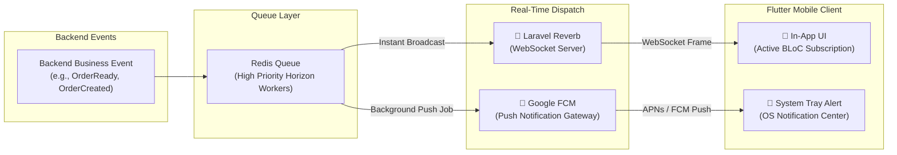

# CupBack — Real-Time Communications & Push Notifications Architecture

> **Platform:** CupBack Mobile Café Marketplace  
> **WebSocket Engine:** Laravel Reverb (PROPOSED — AWAITING APPROVAL)  
> **Push Notifications:** Firebase Cloud Messaging (FCM) (PROPOSED — AWAITING APPROVAL)  
> **Audience:** Backend Engineers, Flutter Engineers, DevSecOps, Gemini Implementation Agent  

---

## 1. Dual-Track Real-Time Strategy

CupBack implements a complementary two-tier communication model:
1. **Low-Latency In-App WebSockets (Laravel Reverb):** Powers active, open-screen workflows (live order countdown, kitchen display incoming order bells, instant state transitions).
2. **Out-of-Band Background Push (FCM):** Delivers critical notifications when the mobile application is minimized, backgrounded, or terminated.



---

## 2. WebSocket Architecture & Channel Topology

### 2.1 Technology Selection: Laravel Reverb
- First-party, asynchronous WebSocket server integrated directly into Laravel 11+.
- Supported by Redis pub/sub backplane for horizontal clustering.
- Sub-5ms broadcast dispatch latency.
- Eliminates third-party subscription costs (e.g., Pusher) while scaling to 30,000+ concurrent connections on standard Linux instances.

### 2.2 Channel Design & Authorization Rules

| Channel Name | Visibility | Target Audience | Authorization Policy |
|--------------|------------|-----------------|----------------------|
| `private-users.{user_id}` | Private | Individual Customer | `auth()->id() === $user_id` |
| `private-cafes.{cafe_id}.orders` | Private | Café Staff & Managers | User has active `cafe_staff` record with `cafe_id` |
| `private-admin.operations` | Private | Platform Administrators | User possesses `platform_admin` role |

### 2.3 Event Schemas & Payloads

#### Event: `OrderCreated` (Broadcast to `private-cafes.{cafe_id}.orders`)
```json
{
  "event": "OrderCreated",
  "channel": "private-cafes.c1a2b3c4-d5e6-7f8a-9b0c-1d2e3f4a5b6c.orders",
  "data": {
    "order_id": "ord-uuid-555",
    "order_number": 1042,
    "customer_name": "أحمد محمود",
    "fulfillment_type": "pickup",
    "table_number": null,
    "payment_method": "cash",
    "payment_status": "pending",
    "total_piasters": 13600,
    "items_count": 2,
    "created_at": "2026-11-09T17:30:00Z"
  }
}
```

#### Event: `OrderStatusUpdated` (Broadcast to `private-users.{user_id}`)
```json
{
  "event": "OrderStatusUpdated",
  "channel": "private-users.u1a2b3c4-d5e6-7f8a-9b0c-1d2e3f4a5b6c",
  "data": {
    "order_id": "ord-uuid-555",
    "order_number": 1042,
    "previous_status": "confirmed",
    "current_status": "ready",
    "cafe_name_ar": "كافيه أروما",
    "rejection_reason": null,
    "timestamp": "2026-11-09T17:42:00Z"
  }
}
```

#### Event: `OrderRejected` (Broadcast to `private-users.{user_id}`)
```json
{
  "event": "OrderRejected",
  "channel": "private-users.u1a2b3c4-d5e6-7f8a-9b0c-1d2e3f4a5b6c",
  "data": {
    "order_id": "ord-uuid-555",
    "order_number": 1042,
    "current_status": "rejected",
    "cafe_name_ar": "كافيه أروما",
    "rejection_reason": "نفاد حليب الشوفان المطلوب مؤقتاً، نعتذر بشدة.",
    "timestamp": "2026-11-09T17:32:00Z"
  }
}
```

### 2.4 Connection Resilience & Offline Recovery
1. **Heartbeat Protocol:** Client sends ping frame every 30 seconds; server replies with pong. If 2 consecutive pings fail, client marks connection as disconnected.
2. **Exponential Backoff Reconnect:** Client attempts immediate reconnect, then backs off (1s, 2s, 4s, 8s, up to max 30s).
3. **State Resynchronization on Reconnect:**
   - Upon successful reconnection, the Flutter client must **NOT** assume in-memory state is accurate.
   - The client invokes `GET /api/v1/orders/active` to re-synchronize the authoritative current state from the database.

---

## 3. Push Notifications Architecture (Firebase Cloud Messaging)

### 3.1 Device Token Lifecycle
1. Upon login or app initialization, the Flutter client calls `FirebaseMessaging.instance.getToken()`.
2. The device token is posted to `POST /api/v1/customer/fcm-token`.
3. The backend associates the token with `users.fcm_device_token`.
4. Upon user logout, the token is cleared from the database to prevent cross-account push leakage on shared family devices.

### 3.2 Notification Scenarios & Payloads

| Trigger Event | Recipient | Title (AR) | Body (AR) | High-Priority Sound |
|---------------|-----------|------------|-----------|---------------------|
| **New Incoming Order** | Café Staff | طلب جديد #1042! | طلب جديد جاهز للتأكيد من العميل. | Custom Loud Chime |
| **Order Accepted** | Customer | تم قبول طلبك! | بدأ تحضير قهوتك الآن في كافيه أروما. | Standard Bell |
| **Order Ready** | Customer | قهوتك جاهزة للاستلام! | يمكنك التوجه لاستلام طلبك #1042 الآن. | Alert Tone |
| **Order Rejected** | Customer | نعتذر، تعذر قبول الطلب | السبب: نفاد حليب الشوفان. | Standard Tone |
| **Reward Unlocked** | Customer | مبروك! كسبت مكافأة 🎉 | أكملت 5 طلبات! مكافأتك جاهزة في طلبك القادم. | Celebration Sound |
| **Admin Announcement** | All / Segment | تنبيه من المنصة | تحديث أوقات العمل في العطلة الرسمية. | Standard Tone |

### 3.3 Background Processing Pipeline
Push notifications are never dispatched synchronously in the API request-response cycle. They are pushed onto the `high-priority` Redis queue and processed by dedicated Horizon workers using the Google HTTP v1 OAuth2 API.
