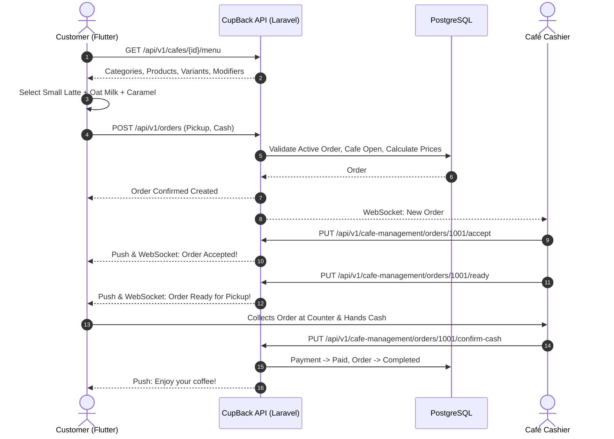
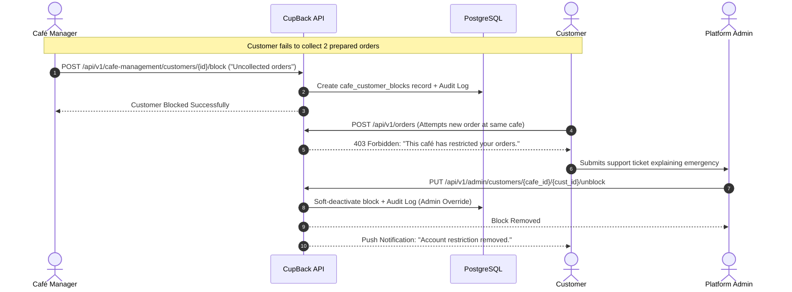

# CupBack — System Requirements Specification (SRS)

> **Platform:** CupBack Mobile Café Marketplace  
> **Document Status:** Complete & Implementation-Ready  
> **Audience:** Solution Architects, Backend Engineers, Flutter Engineers, QA Engineers, Gemini Implementation Agent  

---

## 1. Functional Requirements (FR)

### 1.1 Customer Experience
- **FR-CUST-001 (Registration):** The system shall allow new customers to register by providing Full Name, Mobile Phone Number, and Selected Current Area.
- **FR-CUST-002 (Authentication):** The system shall authenticate customers via password and issue secure, revocable API bearer tokens.
- **FR-CUST-003 (Area Selection):** The system shall allow the customer to switch their active browsing Area at any time. Switching areas must not alter their permanent User ID or order history.
- **FR-CUST-004 (Café Discovery):** The system shall display approved, active cafés assigned to the customer's selected Area, clearly presenting operating status (Open / Closed).
- **FR-CUST-005 (Menu Exploration):** The system shall display categorised menus with product imagery, item descriptions, and starting base prices.
- **FR-CUST-006 (Product Customization):** The system shall allow customers to configure items with Product Variants (e.g., sizes) and Modifiers from designated Modifier Groups.
- **FR-CUST-007 (Modifier Constraints):** The system shall enforce modifier selection limits: preventing submission if required groups are omitted or if selections breach configured minimum/maximum constraints.
- **FR-CUST-008 (Cart Management):** The system shall maintain a single-café cart. Attempting to add an item from a different café shall trigger an explicit confirmation dialog warning that the existing cart will be replaced.
- **FR-CUST-009 (Fulfillment Selection):** The system shall require the customer to select either **Pickup / Takeaway** or **Dine-In**. If Dine-In is selected, an optional Table Number input field shall be provided.
- **FR-CUST-010 (Active Order Restriction):** The backend shall reject any order submission if the customer currently has an active order in a non-terminal state (`pending_payment`, `pending_confirmation`, `confirmed`, `preparing`, `ready`) at any café on the platform.
- **FR-CUST-011 (Payment Selection):** The system shall allow customers to choose between **Online Payment** and **Cash at Counter**.
- **FR-CUST-012 (Loyalty Visibility):** The customer shall be able to inspect their current cycle progress (e.g., "3 of 5 completed orders") for any café they have a relationship with.
- **FR-CUST-013 (Offer Application):** The customer shall be able to select and apply an eligible promotion or earned loyalty reward to their cart before checkout. The system shall dynamically display the calculated discount and updated total.
- **FR-CUST-014 (Real-Time Order Tracking):** The customer shall receive instantaneous order status updates over WebSockets and push notifications as the café updates fulfillment states.
- **FR-CUST-015 (Rejection Notice):** If an order is rejected by the café, the customer shall receive a notification containing the mandatory rejection reason.
- **FR-CUST-016 (Disciplinary Notice):** If a customer is blocked by a café, the app shall display a respectful message indicating the restriction and providing contact instructions, without exposing internal notes.

### 1.2 Café Management & Operations
- **FR-CAFE-001 (Live Order Feed):** The system shall provide an incoming order feed with real-time audio-visual notifications for newly placed, eligible orders.
- **FR-CAFE-002 (Order Confirmation):** The system shall allow authorized café staff to either **Accept** or **Reject** pending orders.
- **FR-CAFE-003 (Mandatory Rejection Reason):** The system shall block order rejection unless a non-empty textual reason is selected or inputted by staff.
- **FR-CAFE-004 (Fulfillment Lifecycle):** The system shall allow staff to transition confirmed orders to "Preparing" and subsequently to "Ready for Pickup".
- **FR-CAFE-005 (Cash Collection Confirmation):** For cash orders, the system shall require authorized staff to manually confirm physical cash collection at the counter before the payment status is marked as "Paid".
- **FR-CAFE-006 (Menu Catalog Management):** The system shall allow café managers to create, edit, sort, and archive Categories, Products, Variants, and Modifier Groups.
- **FR-CAFE-007 (Stock Availability Toggle):** The system shall allow staff to instantly toggle products or specific variants as In Stock or Out of Stock.
- **FR-CAFE-008 (Operating Schedule):** The system shall allow café managers to configure daily opening and closing hours, support overnight spans (e.g., 18:00 to 02:00 next day), set closed days, and toggle a manual emergency Open/Closed switch.
- **FR-CAFE-009 (Customer Relationship Directory):** The system shall provide each café an isolated CRM view of customers who have completed orders at that café, showing total orders, spend, and last order date.
- **FR-CAFE-010 (Customer Blocking):** Staff possessing the `block_customers` permission shall be able to block a customer for non-collection, requiring a mandatory justification, and creating an immutable audit entry.
- **FR-CAFE-011 (Customer Unblocking):** Authorized staff shall be able to remove a previously issued customer block.
- **FR-CAFE-012 (Loyalty Engine Management):** Café managers shall be able to create, configure, activate, and deactivate multiple reward programs based on order-count cycles.
- **FR-CAFE-013 (Promotions Management):** Café managers shall be able to configure targeted promotional campaigns based on customer segments, weekly schedules, date ranges, and usage limits.

### 1.3 Platform Administration
- **FR-ADM-001 (Area Management):** Platform administrators shall have full CRUD capabilities over operational Areas (cities, districts) and assign cafés to these areas.
- **FR-ADM-002 (Café Onboarding Governance):** Administrators shall review pending café registration applications, approve them, and manage activation/suspension states.
- **FR-ADM-003 (RBAC Management):** Administrators shall manage system roles, assign permissions, and supervise staff accounts.
- **FR-ADM-004 (Audit Log Exploration):** Administrators shall be able to query immutable audit logs by actor, action type, resource, and date range.
- **FR-ADM-005 (Customer Block Override):** Administrators shall be able to review café-level customer blocks and administratively remove or override them upon customer appeal.
- **FR-ADM-006 (Dispute & Refund Mediation):** Administrators shall oversee transaction reconciliation and execute refund workflows for online payments associated with rejected or disputed orders.
- **FR-ADM-007 (Broadcast Messaging):** Administrators shall be able to dispatch announcements and operational alerts to specific cafés, all cafés, or customer segments.

---

## 2. Non-Functional Requirements (NFR)

### 2.1 Performance & Scalability
- **NFR-PERF-001 (Concurrency Benchmark):** The system architecture shall support a verified load of **30,000 concurrent active users** performing read/write operations without service degradation.
- **NFR-PERF-002 (API Latency):**
  - Read endpoints (Café list, Menu exploration, Profile): 95th percentile latency $\le 200\text{ ms}$.
  - Complex write endpoints (Order placement, Payment callbacks): 95th percentile latency $\le 500\text{ ms}$.
- **NFR-PERF-003 (Real-Time Dispatch):** WebSocket order status transitions shall be delivered to connected client devices within $100\text{ ms}$ of backend event emission.
- **NFR-PERF-004 (Database Optimization):** Database connections shall utilize pooling; all foreign keys, tenant IDs, and search columns shall possess targeted compound B-Tree indexes.

### 2.2 Security & Data Protection
- **NFR-SEC-001 (OWASP Compliance):** Architecture and API implementations shall adhere to OWASP Top 10 API Security (2023) and OWASP MASVS standards.
- **NFR-SEC-002 (Tenant Scoping):** The system shall enforce strict database query scoping on every café-specific read and write operation. Cross-tenant leakage shall be prevented at both repository and policy layers.
- **NFR-SEC-003 (Admin MFA):** Multi-Factor Authentication (TOTP) shall be strictly enforced for all administrative and elevated operational accounts.
- **NFR-SEC-004 (Monetary Precision):** All monetary figures shall be stored and calculated as 64-bit unsigned integers representing Egyptian Piasters to eliminate floating-point rounding errors.
- **NFR-SEC-005 (Server-Side Authority):** No client-submitted prices, discounts, eligibility checks, or totals shall be trusted. The backend shall re-calculate and validate all numbers authoritatively.

### 2.3 Localization & Usability
- **NFR-LOC-001 (Bilingual Architecture):** The Flutter application shall provide full Arabic (RTL, primary) and English (LTR) language support, including directional mirroring for icons and UI elements.
- **NFR-LOC-002 (Timezone Handling):** All operational schedules, promotion time windows, and audit records shall be evaluated and stored in UTC on the server and rendered in the café's local timezone (`Africa/Cairo`).

---

## 3. Core User Journeys

### 3.1 Customer Ordering & Pickup

### 3.2 Café Disciplinary Customer Block & Administrative Appeal

---

## 4. Acceptance Criteria & Quality Gates

| Module | Acceptance Criteria |
|--------|---------------------|
| **Catalog & Customization** | 1. Products cannot be ordered without selecting all mandatory modifier groups. 2. Selected modifier count cannot violate `min_selections` or `max_selections`. 3. Unit prices and modifier additions match server calculation down to the piaster. |
| **Order Concurrency** | 1. Customer with order in `preparing` status receives 409 Conflict if attempting to place a second order at any café. 2. Customer with rejected or completed order can immediately place a new order. |
| **Cash Confirmation** | 1. Order marked as `ready` remains in payment state `pending` until staff explicitly invokes `/confirm-cash`. 2. Non-authorized staff attempting `/confirm-cash` receive 403 Forbidden. |
| **Loyalty Engine** | 1. Customer completing order 5 in a 5-order cycle receives reward credit. 2. Applying reward on order 6 deducts configured discount. 3. Order 6 does NOT increment the counter for cycle 2. |
| **Tenant Isolation** | 1. Request by Café A staff to access Café B orders via manipulated ID returns 404/403. 2. Customer block issued by Café A does not restrict ordering from Café B. |
