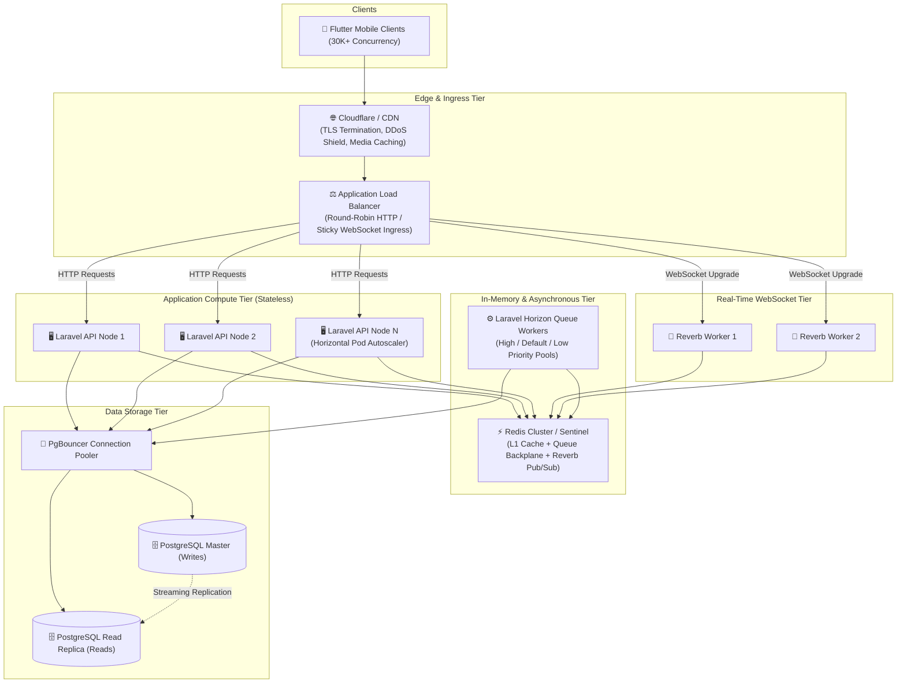

# CupBack — Scalability, Capacity Planning & High-Performance Architecture

> **Platform:** CupBack Mobile Café Marketplace  
> **Initial Milestone Target:** 30,000 Concurrent Active Users  
> **Scaling Horizon:** 50,000 to 100,000+ Concurrent Active Users  
> **Workload Profile:** Read-Heavy E-Commerce ($85\%$ Reads / $15\%$ Writes)  
> **Audience:** Performance Engineers, DevOps, Backend Architects, Gemini Implementation Agent  

---

## 1. Capacity & Workload Profiling

Scalability in CupBack is anchored in measurable mathematical workload models rather than vague assumptions.

### 1.1 Metrics Breakdown at 30,000 Concurrent Users

| Metric | Target Value | Engineering Basis |
|--------|--------------|-------------------|
| **Registered User Base** | 300,000 – 500,000 | Typical 6-10% concurrency ratio during regional lunch/evening peaks. |
| **Daily Active Users (DAU)** | 80,000 – 120,000 | Coffee ordering frequency is high (1-2 orders/day per active patron). |
| **Concurrent WebSocket Connections** | 30,000 persistent sockets | Handled asynchronously via Laravel Reverb + Redis. |
| **Aggregate Request Rate (RPS)** | 2,500 – 4,000 Requests/sec | Average 1 request every 8-12 seconds per active mobile user. |
| **Read / Write Ratio** | $85\%$ Read / $15\%$ Write | Heavy menu browsing, search, and variant exploration before checkout. |
| **Peak Order Submission Rate** | 150 – 300 Orders/sec | Rush hour bursts (08:30–10:00 and 18:00–20:00 Cairo time). |

---

## 2. Multi-Tier Scaling Architecture



---

## 3. High-Performance Caching Strategy (Redis)

To protect the relational database from saturation, read endpoints utilize multi-layered Redis caching with model-observer invalidation.

### 3.1 Cache Tier Specifications

| Cache Key Pattern | Stored Entity | TTL | Invalidation Trigger |
|-------------------|---------------|-----|----------------------|
| `areas:active:list` | Active geographic areas | 24 Hours | Admin updates/creates an area. |
| `cafes:area:{area_id}` | Approved cafés in area | 10 Minutes | Café status changes, operating hours toggle. |
| `menu:cafe:{cafe_id}` | Full menu, variants, modifiers | 30 Minutes | Any edit to category, product, variant, or modifier. |
| `cafe:hours:{cafe_id}` | Current day open/closed status | 5 Minutes | Manual toggle or midnight rollover. |
| `user:active_order:{user_id}` | Boolean flag: has active order | 60 Seconds | Order status transition to terminal state. |

> [!IMPORTANT]
> **Defensive Invariant:** Redis is strictly an ephemeral accelerator. Financial calculations, payment verification, order submission, and loyalty cycle mutations must ALWAYS execute directly against PostgreSQL inside ACID transactions.

---

## 4. Asynchronous Worker Scaling (Laravel Horizon)

Queue workers are grouped into isolated priority pools to ensure mission-critical financial webhooks and order updates are never delayed by bulk notifications.

```ini
; Laravel Horizon Configuration Breakdown
[queue:high-priority]
processes=16
tries=3
timeout=15
; Handles: Payment webhooks, order state transitions, real-time WebSocket events

[queue:default]
processes=8
tries=3
timeout=30
; Handles: Firebase push notifications, SMS/Email fallbacks

[queue:low-priority]
processes=4
tries=2
timeout=120
; Handles: CRM statistics rollups, daily audit archiving, cache pre-warming
```

---

## 5. Load Testing & Verification Protocol (k6)

Prior to production release, the implementation must pass automated k6 load testing executing a blended realistic traffic scenario.

### 5.1 k6 Test Scenario Script Template
```javascript
import http from 'k6/http';
import { check, sleep } from 'k6';

export const options = {
  stages: [
    { duration: '5m', target: 5000 },   // Warm-up to 5K users
    { duration: '10m', target: 15000 }, // Ramp to 15K
    { duration: '15m', target: 30000 }, // Peak sustained 30K concurrent users
    { duration: '5m', target: 0 },      // Ramp-down
  ],
  thresholds: {
    'http_req_duration{type:read}': ['p(95)<200'],  // 95% of reads under 200ms
    'http_req_duration{type:write}': ['p(95)<500'], // 95% of writes under 500ms
    'http_req_failed': ['rate<0.005'],              // Error rate under 0.5%
  },
};

export default function () {
  const headers = { 'Accept': 'application/json', 'Authorization': 'Bearer <test_token>' };
  
  // 1. Browse Cafes (Read)
  let res = http.get('https://api.cupback.app/api/v1/cafes?area_id=a1b2c3d4...', { 
    headers, tags: { type: 'read' } 
  });
  check(res, { 'status is 200': (r) => r.status === 200 });
  sleep(3);

  // 2. Load Menu (Read)
  res = http.get('https://api.cupback.app/api/v1/cafes/c1a2b3c4.../menu', { 
    headers, tags: { type: 'read' } 
  });
  check(res, { 'status is 200': (r) => r.status === 200 });
  sleep(5);
}
```
