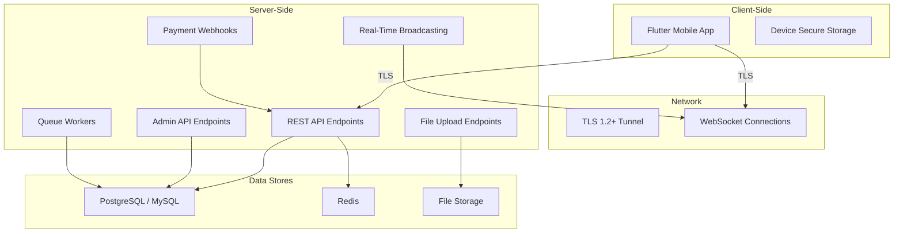
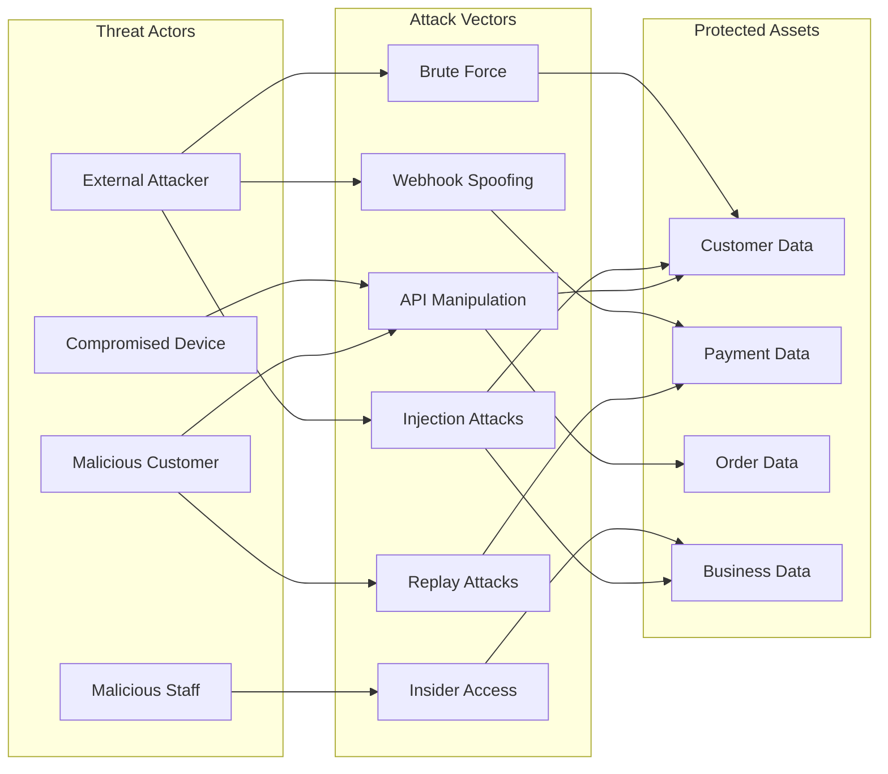
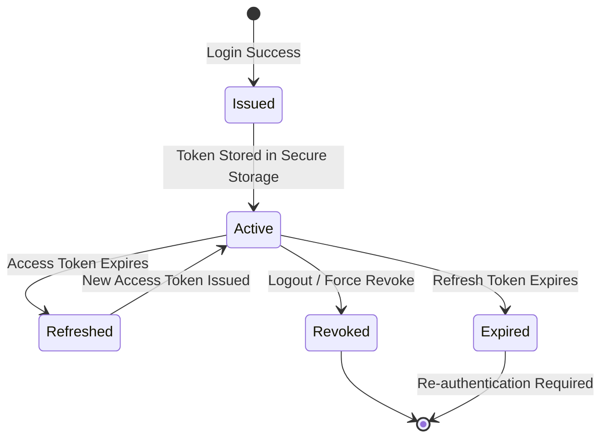
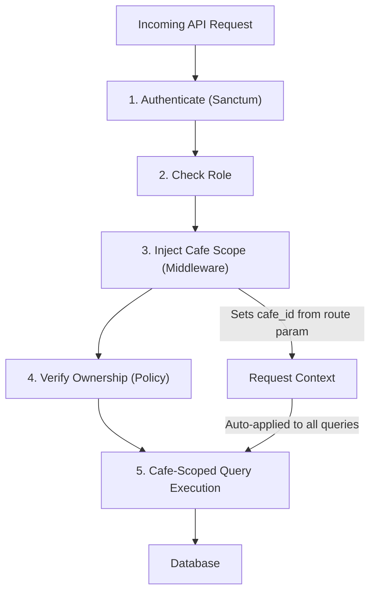
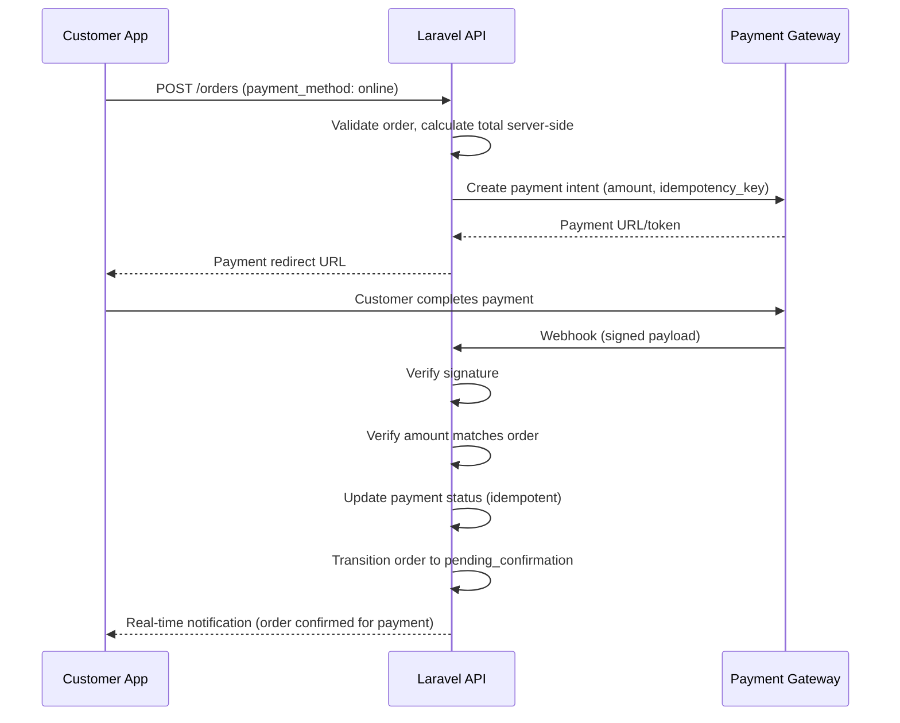

# Security Architecture — CupBack Marketplace Platform

> **Document Version:** 1.0
> **Status:** Draft
> **Last Updated:** 2026-11-09
> **Related Documents:** [DATA_PROTECTION_AND_RECOVERY.md](./DATA_PROTECTION_AND_RECOVERY.md), [SCALABILITY_AND_PERFORMANCE.md](./SCALABILITY_AND_PERFORMANCE.md)

---

## Table of Contents

1. [Threat Model](#1-threat-model)
2. [Authentication & Authorization](#2-authentication--authorization)
3. [Tenant Isolation](#3-tenant-isolation)
4. [Input Validation & Injection Prevention](#4-input-validation--injection-prevention)
5. [Payment Security](#5-payment-security)
6. [Data Protection](#6-data-protection)
7. [Security Testing Plan](#7-security-testing-plan)
8. [OWASP Compliance Checklist](#8-owasp-compliance-checklist)

---

## 1. Threat Model

### 1.1 Asset Inventory

| Asset ID | Asset | Classification | Description |
|----------|-------|----------------|-------------|
| A-01 | Customer PII | **Confidential** | Full name, phone number, area preference |
| A-02 | Customer Credentials | **Secret** | Password hashes, authentication tokens |
| A-03 | Payment Data | **Secret** | Transaction references, payment gateway tokens, refund records |
| A-04 | Order Data | **Internal** | Order details, items, prices, snapshots, status history |
| A-05 | Cafe Business Data | **Confidential** | Revenue, order volumes, customer analytics, product pricing |
| A-06 | Admin Credentials | **Secret** | Admin passwords, MFA seeds, session tokens |
| A-07 | API Tokens | **Secret** | Sanctum tokens, payment gateway API keys, push notification keys |
| A-08 | Loyalty/Promotion Configs | **Internal** | Reward program rules, promotion targeting, customer segments |
| A-09 | Cafe Operational Data | **Internal** | Operating hours, staff accounts, menu data |
| A-10 | Audit Logs | **Restricted** | All admin actions, block/unblock events, payment operations |
| A-11 | Customer Block Records | **Confidential** | Block reasons, staff notes (never exposed to customer) |

### 1.2 Attack Surface



| Surface | Exposure | Risk Level | Notes |
|---------|----------|-----------|-------|
| REST API Endpoints | Public (authenticated) | **High** | Primary attack surface — all business logic |
| Payment Webhooks | Public (signature-verified) | **Critical** | Financial impact if spoofed |
| WebSocket Connections | Public (authenticated) | **Medium** | Real-time order/status channels |
| File Upload Endpoints | Public (authenticated, cafe staff) | **Medium** | Product image uploads |
| Admin API Endpoints | Restricted (role-gated) | **High** | Platform management operations |
| Flutter Mobile App | Public distribution | **Medium** | Client-side code is inspectable |
| Device Storage | Physical access | **Medium** | Token storage on user device |

### 1.3 Threat Actors

| Actor | Motivation | Capability | Examples |
|-------|-----------|-----------|---------|
| **Malicious Customer** | Free items, abuse promotions | Low–Medium: API manipulation, replay attacks | Duplicate reward redemption, price tampering, bypassing active-order constraint |
| **Malicious Cafe Staff** | Financial fraud, data theft | Medium: Authorized insider access | Confirming fake cash collections, accessing other cafes' data, unauthorized blocking |
| **External Attacker** | Data theft, service disruption | Medium–High: Automated tooling, injection attacks | SQL injection, brute-force auth, DDoS, webhook spoofing |
| **Compromised Device** | Token theft, session hijacking | Medium: Malware on device | Stolen auth tokens, intercepted API traffic |
| **Disgruntled Ex-Staff** | Sabotage, data exfiltration | Medium: Knowledge of internal systems | Using cached credentials, API abuse before token revocation |

### 1.4 STRIDE Analysis

#### 1.4.1 Authentication

| Threat | Category | Impact | Likelihood | Mitigation | Residual Risk |
|--------|----------|--------|-----------|-----------|---------------|
| Brute-force login attempts | Spoofing | Account takeover | Medium | Rate limiting (5 attempts/min per IP+phone), exponential backoff, account lockout after 10 failures | Low — determined attacker with IP rotation |
| Token theft from device | Spoofing | Session hijacking | Medium | Secure storage (Keychain/Keystore), token expiry (short-lived access, long-lived refresh), token binding | Low — requires physical device access or malware |
| Token reuse after logout | Spoofing | Unauthorized access | Low | Server-side token revocation on logout, revocation list checked on every request | Minimal |
| Credential stuffing with leaked passwords | Spoofing | Account takeover | Medium | Rate limiting, monitoring for anomalous login patterns, strong password policy enforcement | Low |
| Replay of authentication request | Spoofing | Session hijacking | Low | HTTPS (prevents MITM), token expiry, request timestamps | Minimal |

#### 1.4.2 Authorization

| Threat | Category | Impact | Likelihood | Mitigation | Residual Risk |
|--------|----------|--------|-----------|-----------|---------------|
| Customer accessing cafe management endpoints | Elevation of Privilege | Unauthorized data access/modification | Medium | RBAC middleware on every route group, Policy classes for resource-level checks | Minimal — systematic enforcement |
| Cafe staff accessing another cafe's data | Elevation of Privilege | Tenant data breach | Medium | Cafe-scoped middleware injects `cafe_id`, Policies verify ownership, automated tenant isolation tests | Low |
| Staff escalating to manager permissions | Elevation of Privilege | Unauthorized management actions | Low | Permission-based checks (not role-only), `block_customers` permission explicitly assigned | Minimal |
| Horizontal privilege escalation (customer A accessing customer B's data) | Elevation of Privilege | Privacy breach | Medium | All customer-scoped queries filter by `auth()->id()`, Policy checks on every resource | Low |

#### 1.4.3 Order Creation

| Threat | Category | Impact | Likelihood | Mitigation | Residual Risk |
|--------|----------|--------|-----------|-----------|---------------|
| Client-side price tampering | Tampering | Financial loss | High | Server-side price calculation, client prices ignored, immutable snapshots | Minimal |
| Bypassing active-order constraint | Tampering | Multiple concurrent orders | Medium | DB-level unique constraint on active orders per customer + application-level check in transaction | Low |
| Ordering from closed cafe | Tampering | Invalid orders | Low | Server-side operating hours validation at order creation | Minimal |
| Ordering while blocked at cafe | Tampering | Bypassing block | Medium | Backend block check in order validation, not UI-only | Minimal |
| Race condition on stock/availability | Tampering | Ordering unavailable items | Medium | Transactional validation of product availability, pessimistic locking on critical checks | Low |
| Submitting order with invalid variant/modifier combinations | Tampering | Data integrity violation | Medium | Full server-side validation of variant existence, modifier group rules, min/max limits | Minimal |

#### 1.4.4 Payment Processing

| Threat | Category | Impact | Likelihood | Mitigation | Residual Risk |
|--------|----------|--------|-----------|-----------|---------------|
| Webhook spoofing (fake payment confirmation) | Spoofing | Financial loss, free orders | High | Webhook signature verification (HMAC), IP allowlisting, idempotency keys | Low |
| Replay of successful payment callback | Replay / Tampering | Duplicate payment credit | Medium | Idempotency keys, payment state machine prevents duplicate transitions | Minimal |
| Man-in-the-middle on payment redirect | Information Disclosure | Payment credential theft | Low | TLS 1.2+ enforced, HSTS, certificate pinning in app | Minimal |
| Client-side payment status forgery | Spoofing | Free orders | High | NEVER trust client-side payment status, server-to-server verification only | Minimal |
| Cash collection fraud (staff confirms without receiving cash) | Tampering | Financial loss to cafe | Medium | Audit logging of all cash confirmations, `confirm_cash` permission restricted, cafe-level reconciliation | Low — requires organizational controls |
| Refund fraud | Tampering | Financial loss | Medium | Refund requires admin or authorized role, refund amount validated against original, audit trail | Low |

#### 1.4.5 Reward Redemption

| Threat | Category | Impact | Likelihood | Mitigation | Residual Risk |
|--------|----------|--------|-----------|-----------|---------------|
| Double redemption of same reward | Tampering | Financial loss | High | Transactional redemption with row-level locking, atomic status update, unique constraint on redemption | Minimal |
| Concurrent redemption requests | Tampering | Race condition exploitation | Medium | Pessimistic locking (`SELECT FOR UPDATE`) on reward record within DB transaction | Low |
| Manipulating reward progress count | Tampering | Earning rewards early | Medium | Server-side progress tracking only, client cannot set progress, validated against completed order count | Minimal |
| Replay of redemption request | Replay | Double reward usage | Medium | Idempotent redemption endpoint, unique redemption ID, state check before processing | Minimal |
| Redeeming expired reward | Tampering | Invalid discount | Low | Server-side expiry check at redemption time (if expiry configured) | Minimal |

#### 1.4.6 Promotion Redemption

| Threat | Category | Impact | Likelihood | Mitigation | Residual Risk |
|--------|----------|--------|-----------|-----------|---------------|
| Redeeming promotion beyond max limit | Tampering | Excessive discounts | High | Atomic counter increment within transaction, check before and after increment | Low |
| Ineligible customer redeeming targeted promotion | Elevation of Privilege | Unauthorized discount | Medium | Server-side segment evaluation at order time, never trust client-side eligibility | Minimal |
| Manipulating order to meet minimum value then modifying | Tampering | Discount on ineligible order | Low | Re-validate promotion eligibility on final order submission, immutable snapshot | Minimal |
| Using promotion outside valid time window | Tampering | Out-of-schedule discount | Low | Server-side time validation using cafe's configured timezone | Minimal |

#### 1.4.7 Customer Blocking

| Threat | Category | Impact | Likelihood | Mitigation | Residual Risk |
|--------|----------|--------|-----------|-----------|---------------|
| Unauthorized staff blocking customers | Elevation of Privilege | Abuse of blocking feature | Medium | Explicit `block_customers` permission required, not granted by default | Low |
| Block bypass by creating new account | Tampering | Circumventing block | Medium | Monitor for duplicate phone numbers (unique constraint), future: OTP verification | Low — mitigated fully when OTP is added |
| Cross-cafe block leakage | Information Disclosure | Privacy violation | Low | Block scoped to issuing cafe only, queries always filter by `cafe_id` | Minimal |
| Exposing internal block reason to customer | Information Disclosure | Staff note exposure | Medium | Customer-facing message is separate from internal reason, API never returns internal notes to customer role | Minimal |

#### 1.4.8 Admin Operations

| Threat | Category | Impact | Likelihood | Mitigation | Residual Risk |
|--------|----------|--------|-----------|-----------|---------------|
| Admin account compromise | Spoofing | Full platform control | High | MFA (TOTP), strong password policy, session timeout, IP anomaly alerts | Low |
| Privilege escalation within admin | Elevation of Privilege | Unauthorized admin actions | Medium | Granular RBAC, least-privilege assignment, cannot self-assign permissions | Low |
| Unauthorized bulk data export | Information Disclosure | Data breach | Medium | Audit logging on data access, rate limiting on list endpoints, no bulk export endpoint in V1 | Low |
| Audit log tampering | Tampering | Covering tracks | Low | Immutable audit records (append-only, no update/delete), separate audit DB credentials (future) | Minimal |
| Admin impersonation | Spoofing | Trust exploitation | Low | All admin actions tied to authenticated admin ID, MFA required, session activity logging | Minimal |

### 1.5 Threat Model Diagram



---

## 2. Authentication & Authorization

### 2.1 Token Strategy

> **PROPOSED — AWAITING APPROVAL:** Laravel Sanctum for token-based API authentication.

#### Evaluation: Sanctum vs Passport

| Criterion | Sanctum | Passport |
|-----------|---------|---------|
| Complexity | Lightweight, minimal setup | Full OAuth2 server, complex |
| Token Type | Opaque tokens (database-stored) | JWT (stateless) or opaque |
| Use Case Fit | Mobile app API (SPA/mobile) | Third-party OAuth, multi-service |
| Token Revocation | Immediate (DB deletion) | Requires revocation list or short expiry |
| Performance | DB lookup per request | Stateless verification (JWT) but revocation is harder |
| Scopes/Abilities | Simple abilities system | Full OAuth2 scopes |
| Third-Party Auth | Not designed for it | Full OAuth2 provider |
| Maintenance | Minimal | Higher (OAuth complexity) |

**Recommendation:** Sanctum — CupBack is a first-party mobile app with no third-party API consumers in V1. Sanctum's simplicity, immediate token revocation, and built-in abilities system align with requirements. Passport's OAuth2 complexity is unnecessary overhead.

### 2.2 Token Lifecycle



| Phase | Details |
|-------|---------|
| **Issuance** | On successful login (phone + password), server creates a Sanctum personal access token. Returns `access_token` (short-lived) and `refresh_token` (long-lived). |
| **Access Token TTL** | PROPOSED: 60 minutes. Configurable via environment variable. |
| **Refresh Token TTL** | PROPOSED: 30 days. Configurable via environment variable. |
| **Refresh Flow** | Client sends valid `refresh_token` to `/api/v1/auth/refresh`. Server issues new `access_token`, optionally rotates `refresh_token`. Old access token is revoked. |
| **Revocation** | On logout, server deletes the token record from `personal_access_tokens` table. Immediate effect — next request with that token fails. |
| **Force Revoke All** | Admin can revoke all tokens for a user (e.g., on account compromise). Deletes all records for that `tokenable_id`. |
| **Token Abilities** | Token carries abilities matching user's role: `customer`, `cafe:manage`, `admin:platform`, etc. Checked on every request. |

### 2.3 Mobile Token Storage

| Platform | Storage Mechanism | Details |
|----------|------------------|---------|
| **Android** | Android Keystore via `flutter_secure_storage` | AES-256 encryption, hardware-backed keystore on supported devices |
| **iOS** | iOS Keychain via `flutter_secure_storage` | Keychain Services, encrypted at rest, accessible only to the app |

**Rules:**
- Tokens MUST NOT be stored in SharedPreferences, plain files, or local databases
- Tokens MUST NOT be logged or printed in debug builds (production logging must scrub tokens)
- On app uninstall, tokens are cleared (platform default behavior for Keychain/Keystore)
- On token expiry or revocation, app redirects to login screen

### 2.4 RBAC Model

#### 2.4.1 Roles

| Role | Scope | Description |
|------|-------|-------------|
| `customer` | Global | End-user who browses cafes, places orders, tracks loyalty |
| `cafe_staff` | Per-Cafe | Cafe employee with limited operational permissions |
| `cafe_manager` | Per-Cafe | Cafe owner/manager with full cafe-level management |
| `platform_admin` | Platform | Administrator with specific platform management permissions |
| `super_admin` | Platform | Full platform access, manages other admins |

#### 2.4.2 Permissions

| Permission Key | Description | Scope |
|---------------|-------------|-------|
| `view_orders` | View incoming and historical orders | Cafe |
| `manage_orders` | Accept/reject orders, update status | Cafe |
| `confirm_cash` | Confirm cash collection from customer | Cafe |
| `view_products` | View menu, categories, products | Cafe |
| `manage_products` | Add/edit/remove products, variants, modifiers | Cafe |
| `manage_categories` | Create/edit/remove menu categories | Cafe |
| `manage_availability` | Toggle product/variant availability | Cafe |
| `manage_operating_hours` | Set operating hours, open/close toggle | Cafe |
| `manage_cafe_info` | Edit cafe name, description, images | Cafe |
| `view_customers` | View cafe's customer relationships | Cafe |
| `block_customers` | Block/unblock customers at this cafe | Cafe |
| `manage_promotions` | Create/edit/schedule/manage promotions | Cafe |
| `manage_rewards` | Create/edit loyalty reward programs | Cafe |
| `view_analytics` | View cafe analytics dashboards | Cafe |
| `manage_staff` | Invite/remove staff, assign permissions | Cafe |
| `manage_cafes` | Create/approve/suspend cafes | Platform |
| `manage_areas` | Create/edit/deactivate areas | Platform |
| `manage_users` | Manage customer and cafe user accounts | Platform |
| `manage_admins` | Create/edit admin accounts, assign roles | Platform |
| `manage_platform_config` | Platform-level settings and configuration | Platform |
| `override_blocks` | Override/remove cafe-level customer blocks | Platform |
| `manage_refunds` | Process refund operations | Platform |
| `view_audit_logs` | View audit trail records | Platform |
| `send_notifications` | Send platform messages/announcements | Platform |
| `view_platform_analytics` | View platform-wide analytics | Platform |

#### 2.4.3 Role-Permission Mapping

| Permission | `customer` | `cafe_staff` | `cafe_manager` | `platform_admin` | `super_admin` |
|------------|:---------:|:------------:|:--------------:|:----------------:|:-------------:|
| `view_orders` | — | ✅ | ✅ | ✅ | ✅ |
| `manage_orders` | — | ✅ | ✅ | ✅ | ✅ |
| `confirm_cash` | — | ⚙️ | ✅ | ✅ | ✅ |
| `view_products` | — | ✅ | ✅ | ✅ | ✅ |
| `manage_products` | — | ⚙️ | ✅ | ✅ | ✅ |
| `manage_categories` | — | ⚙️ | ✅ | ✅ | ✅ |
| `manage_availability` | — | ✅ | ✅ | ✅ | ✅ |
| `manage_operating_hours` | — | — | ✅ | ✅ | ✅ |
| `manage_cafe_info` | — | — | ✅ | ✅ | ✅ |
| `view_customers` | — | ✅ | ✅ | ✅ | ✅ |
| `block_customers` | — | ⚙️ | ✅ | ✅ | ✅ |
| `manage_promotions` | — | ⚙️ | ✅ | ✅ | ✅ |
| `manage_rewards` | — | ⚙️ | ✅ | ✅ | ✅ |
| `view_analytics` | — | ⚙️ | ✅ | ✅ | ✅ |
| `manage_staff` | — | — | ✅ | ✅ | ✅ |
| `manage_cafes` | — | — | — | ✅ | ✅ |
| `manage_areas` | — | — | — | ✅ | ✅ |
| `manage_users` | — | — | — | ✅ | ✅ |
| `manage_admins` | — | — | — | — | ✅ |
| `manage_platform_config` | — | — | — | ✅ | ✅ |
| `override_blocks` | — | — | — | ✅ | ✅ |
| `manage_refunds` | — | — | — | ✅ | ✅ |
| `view_audit_logs` | — | — | — | ✅ | ✅ |
| `send_notifications` | — | — | — | ✅ | ✅ |
| `view_platform_analytics` | — | — | — | ✅ | ✅ |

> **Legend:** ✅ = Always granted | ⚙️ = Optionally assigned by cafe_manager | — = Not available

#### 2.4.4 Permission Enforcement

Permissions are enforced at two levels:

**Level 1 — Route Middleware:**
```
Route::middleware(['auth:sanctum', 'role:cafe_manager,cafe_staff'])
    ->prefix('cafe/{cafe}')
    ->group(function () {
        // All cafe management routes
    });
```

**Level 2 — Policy Classes (Resource-Level):**
```
// OrderPolicy — verifies the order belongs to the user's cafe
// ProductPolicy — verifies the product belongs to the user's cafe
// CustomerBlockPolicy — verifies block_customers permission AND cafe ownership
```

Every controller action MUST:
1. Check authentication (Sanctum middleware)
2. Check role (role middleware)
3. Check specific permission (Policy `authorize()` call)
4. Check resource ownership / tenant scope (Policy + cafe scope middleware)

### 2.5 Admin MFA

> **PROPOSED — AWAITING APPROVAL:** TOTP-based MFA for admin accounts.

| Aspect | Details |
|--------|---------|
| **Method** | Time-Based One-Time Password (TOTP, RFC 6238) |
| **Setup** | Admin scans QR code with authenticator app (Google Authenticator, Authy, etc.) |
| **Enforcement** | Mandatory for `platform_admin` and `super_admin`. PROPOSED: optional for `cafe_manager`. |
| **Login Flow** | Phone + Password → TOTP verification → Token issued |
| **Recovery** | One-time backup codes generated at setup (8 codes, single-use) |
| **Implementation** | Laravel Fortify or `pragmarx/google2fa-laravel` package |
| **Sensitive Action Re-auth** | For critical admin actions (e.g., deleting a cafe, overriding blocks), require TOTP re-entry even within an active session |

### 2.6 Session Security

| Control | Implementation |
|---------|----------------|
| No server-side sessions | Stateless API — token-based auth only |
| Token expiry | Access token: 60 min. Refresh token: 30 days. |
| Concurrent sessions | Allow multiple devices. Admin: PROPOSED limit to 3 concurrent sessions. |
| Token revocation on password change | Revoke ALL existing tokens when password is changed |
| Inactivity timeout | Client-side: lock app after 15 min inactivity (admin), 30 min (customer) |
| Device tracking | Store device info with each token for admin audit visibility |

---

## 3. Tenant Isolation

### 3.1 Cafe Data Isolation Architecture

CupBack uses a **shared database, shared schema** multi-tenancy model where every cafe's data coexists in the same tables, isolated by `cafe_id` foreign keys.



#### 3.1.1 Cafe Scope Middleware

A global `CafeScope` middleware MUST:

1. Extract `cafe_id` from the route parameter (`/api/v1/cafe/{cafe}/...`)
2. Verify the authenticated user has a role association with that cafe
3. Bind the `cafe_id` into the request context
4. Apply a global Eloquent scope that automatically filters ALL queries by `cafe_id`

**Critical Rule:** Every cafe-scoped query MUST include a `WHERE cafe_id = ?` filter. This is enforced automatically by the middleware-injected global scope.

#### 3.1.2 Cafe-Scoped Tables

The following tables MUST always be filtered by `cafe_id`:

| Table | Scope Key | Notes |
|-------|-----------|-------|
| `products` | `cafe_id` | Products belong to one cafe |
| `categories` | `cafe_id` | Menu categories per cafe |
| `product_variants` | Via `products.cafe_id` | Joined through products |
| `modifier_groups` | `cafe_id` or via product | Modifier groups per cafe |
| `orders` | `cafe_id` | Orders belong to one cafe |
| `order_items` | Via `orders.cafe_id` | Joined through orders |
| `operating_hours` | `cafe_id` | Schedule per cafe |
| `loyalty_programs` | `cafe_id` | Loyalty programs per cafe |
| `loyalty_progress` | `cafe_id` + `customer_id` | Per customer per cafe |
| `promotions` | `cafe_id` | Promotions per cafe |
| `promotion_redemptions` | `cafe_id` + `customer_id` | Scoped to cafe |
| `cafe_customers` | `cafe_id` + `customer_id` | Relationship per cafe |
| `customer_blocks` | `cafe_id` + `customer_id` | Blocks scoped to cafe |
| `cafe_staff` | `cafe_id` + `user_id` | Staff associations |

#### 3.1.3 Authorization Policies

Every Policy class for cafe-scoped resources MUST verify:

```
public function view(User $user, Order $order): bool
{
    // 1. User has role at this cafe
    // 2. Order belongs to this cafe (tenant check)
    // 3. User has the specific permission for this action
    return $user->belongsToCafe($order->cafe_id)
        && $user->hasPermissionAt($order->cafe_id, 'view_orders');
}
```

#### 3.1.4 Cross-Cafe Access Prevention

| Control | Implementation |
|---------|----------------|
| Route-level | `cafe/{cafe}` parameter validated against user's cafe associations |
| Query-level | Global scope auto-appends `WHERE cafe_id = ?` |
| Policy-level | Resource ownership verified in every policy method |
| Testing | Automated tests: Cafe A user attempts to access Cafe B resources → 403 Forbidden |

### 3.2 Customer Data Isolation

Customer data that is cafe-specific MUST be scoped to prevent cross-cafe leakage:

| Data | Isolation Rule |
|------|---------------|
| `cafe_customers` relationship | Scoped by `cafe_id` — Cafe A cannot see if a customer has a relationship with Cafe B |
| Loyalty progress | Scoped by `cafe_id` + `customer_id` — progress is per-cafe |
| Promotion redemptions | Scoped by `cafe_id` — redemptions tied to the issuing cafe's promotion |
| Block status | Scoped by `cafe_id` — Cafe A's block does NOT affect Cafe B |
| Order history | Cafe sees only orders placed at their cafe |
| Customer segment (new/returning/frequent) | Computed per-cafe based on orders at that specific cafe |

**Customer's Own View:** A customer can see their own data across all cafes (their orders, their loyalty, their blocks). This is scoped by `user_id = auth()->id()`, not by `cafe_id`.

### 3.3 Admin Cross-Cafe Access

Platform Admin and Super Admin roles CAN access data across cafes. This access:

- Bypasses the `CafeScope` middleware (admin routes use a separate route group)
- Is controlled by platform-level permissions (`manage_cafes`, `manage_users`, etc.)
- Is fully audit-logged (every cross-cafe data access recorded)
- Uses explicit `->withoutGlobalScope(CafeScope::class)` when querying across cafes

---

## 4. Input Validation & Injection Prevention

### 4.1 Request Validation

Every API endpoint MUST have a dedicated Laravel `FormRequest` class with validation rules.

| Validation Category | Examples |
|--------------------|---------| 
| **Type validation** | `'phone' => 'required|string|regex:/^01[0125][0-9]{8}$/'` (Egyptian mobile) |
| **Range validation** | `'quantity' => 'required|integer|min:1|max:99'` |
| **Existence validation** | `'product_id' => 'required|exists:products,id'` |
| **Enum validation** | `'payment_method' => 'required|in:online,cash'` |
| **Nested validation** | `'items.*.variant_id' => 'required|exists:product_variants,id'` |
| **Conditional validation** | `'table_number' => 'required_if:fulfillment_type,dine_in'` |
| **File validation** | `'image' => 'required|image|mimes:jpg,jpeg,png,webp|max:5120'` |

### 4.2 SQL Injection Prevention

| Rule | Implementation |
|------|----------------|
| Use Eloquent ORM | All database operations through Eloquent models and Query Builder |
| Parameterized queries | If raw queries are ever needed, ALWAYS use parameter bindings: `DB::select('...WHERE id = ?', [$id])` |
| Never concatenate user input into SQL | Code review checklist item — any `DB::raw()` with user input is a security finding |
| Database user permissions | Application DB user has only SELECT, INSERT, UPDATE, DELETE — no DDL (CREATE, DROP, ALTER) in production |

### 4.3 XSS Prevention

While the primary client is a mobile app (not a web browser), stored data MUST still be sanitized:

| Rule | Rationale |
|------|-----------|
| Sanitize text inputs on storage | Future web admin panel, API consumers, or data exports could render unsanitized data |
| Strip HTML tags from user-generated text | Cafe names, product descriptions, block reasons, customer names |
| Encode special characters | Prevent stored XSS if data is ever rendered in HTML context |
| JSON API responses | Content-Type: `application/json` — browsers won't render as HTML |

### 4.4 Mass Assignment Protection

| Rule | Implementation |
|------|----------------|
| Define `$fillable` on every model | Explicitly list only the fields that can be mass-assigned |
| Never use `$guarded = []` | Disabling guarding opens all fields to mass assignment |
| Use `FormRequest` validated data | Only pass validated, whitelisted fields to `create()` or `update()` |
| Protect sensitive fields | `role`, `is_admin`, `cafe_id`, `payment_status` — NEVER mass-assignable |

### 4.5 File Upload Security

| Control | Implementation |
|---------|----------------|
| **MIME type validation** | Server-side MIME detection (not just extension check): `jpg`, `jpeg`, `png`, `webp` |
| **File size limit** | Max 5 MB per image |
| **File name sanitization** | Generate UUID-based filenames, never use original filename |
| **Storage path** | Store outside web root; serve via signed URLs or CDN |
| **Malware scanning** | PROPOSED: ClamAV integration for uploaded files (evaluate cost/benefit) |
| **Image processing** | Re-encode uploaded images (strips EXIF data, embedded payloads) |
| **Upload rate limiting** | Max 10 uploads per minute per user |

### 4.6 Rate Limiting

| Endpoint Category | Rate Limit | Key | Notes |
|-------------------|-----------|-----|-------|
| Authentication (login) | 5 requests / minute | IP + phone | Brute-force prevention |
| Authentication (refresh) | 10 requests / minute | User ID | Token refresh abuse |
| Order creation | 3 requests / minute | User ID | Prevents spam orders |
| Payment webhook | 60 requests / minute | IP | Gateway callback rate |
| Product browsing (list/search) | 60 requests / minute | User ID | Normal usage allowance |
| Menu loading | 30 requests / minute | User ID | Reasonable browsing |
| File uploads | 10 requests / minute | User ID | Image upload throttle |
| Admin operations | 30 requests / minute | User ID | Administrative tasks |
| Promotion/reward redemption | 5 requests / minute | User ID | Abuse prevention |
| General API (fallback) | 120 requests / minute | User ID | Catch-all rate limit |

Implementation: Laravel's built-in `RateLimiter` facade with Redis backend for distributed rate limiting across multiple app server instances.

---

## 5. Payment Security

### 5.1 Core Principles

| Principle | Implementation |
|-----------|----------------|
| **Never trust client-side payment status** | Payment state changes ONLY via server-to-server webhook or server-side API verification |
| **Webhook signature verification** | Verify HMAC signature on every webhook request using payment gateway's secret key |
| **HTTPS only** | All payment communication over TLS 1.2+, no HTTP fallback |
| **Idempotency keys** | Every payment operation carries a unique idempotency key to prevent duplicate charges |
| **No sensitive data in logs** | Payment card numbers, CVV, gateway tokens NEVER logged |
| **IP allowlisting** | Webhook endpoint only accepts requests from payment gateway's published IP ranges (where supported) |

### 5.2 Payment Flow Security



### 5.3 PCI DSS Scope Analysis

> **PROPOSED — AWAITING APPROVAL:** Use payment gateway's hosted payment page / redirect flow.

| Approach | PCI Scope | Recommended |
|----------|-----------|-------------|
| **Hosted Payment Page** (redirect to gateway) | SAQ A — minimal scope | ✅ **Yes** |
| Embedded card form (iframe) | SAQ A-EP — moderate scope | Acceptable alternative |
| Direct API (card data through our server) | SAQ D — full PCI compliance | ❌ Not recommended |

By using the gateway's hosted page, CupBack's servers never handle, process, or store card data, minimizing PCI DSS compliance scope to SAQ A.

### 5.4 Refund Security

| Control | Details |
|---------|---------|
| Refund authorization | Only `platform_admin` or `super_admin` can initiate refunds |
| Refund amount validation | Cannot exceed original payment amount |
| Refund reason required | Mandatory reason field for audit trail |
| Refund via gateway API | Server-to-server refund request, never client-initiated |
| Refund tracking | Independent refund status tracking with gateway reference |

---

## 6. Data Protection

### 6.1 Encryption in Transit

| Control | Details |
|---------|---------|
| **TLS Version** | TLS 1.2+ minimum. Prefer TLS 1.3. |
| **Certificate** | Valid CA-signed certificate. Auto-renewal via Let's Encrypt or cloud provider. |
| **HSTS** | `Strict-Transport-Security: max-age=31536000; includeSubDomains` |
| **Certificate Pinning** | PROPOSED: Implement in Flutter app for API domain (evaluate maintenance cost vs. security benefit) |
| **WebSocket** | WSS (WebSocket Secure) only — no unencrypted WS |
| **Internal services** | Redis, database connections over TLS or private network (VPC) |

### 6.2 Encryption at Rest

| Layer | Implementation |
|-------|----------------|
| **Database** | Transparent Data Encryption (TDE) if supported by chosen DB engine. At minimum, encrypted storage volumes. |
| **Backups** | AES-256 encryption on all backup files |
| **File storage** | Server-Side Encryption (SSE) for stored product images |
| **Redis** | In-memory; not persisted. If RDB snapshots are taken, encrypt the snapshot files. |
| **Application secrets** | Environment variables, never committed to version control. Use secret manager in production. |

### 6.3 Sensitive Data Handling

| Rule | Implementation |
|------|----------------|
| **Password storage** | bcrypt with cost factor 12 (Laravel default) |
| **Never log sensitive data** | Middleware strips `password`, `token`, `authorization`, `card_*` from log context |
| **API response filtering** | User responses never include: `password`, `remember_token`, `mfa_secret` |
| **Audit log safety** | Audit `old_values` / `new_values` must redact sensitive fields before storage |
| **Error responses** | Production error responses never expose stack traces, SQL queries, or internal paths |
| **Debug mode** | `APP_DEBUG=false` in production, enforced via deployment checks |

### 6.4 Personal Data Minimization

| Principle | Implementation |
|-----------|----------------|
| **Collect minimum** | Only: full name, phone number, area. No email, address, or DOB in V1. |
| **Purpose limitation** | Phone used for auth + communication. Name for order identification. Area for cafe listing. |
| **Data access** | Customers can view their own data. Cafe sees only customers who ordered from them. |
| **Data export** | PROPOSED for future: customer data export endpoint (GDPR-style, if needed for compliance) |
| **Data deletion** | PROPOSED for future: account deactivation with data anonymization (retain order records with anonymized customer data) |

---

## 7. Security Testing Plan

### 7.1 Authorization Testing Matrix

Every combination of role and endpoint must be tested:

| Test Case Pattern | Method |
|-------------------|--------|
| `customer` → cafe management endpoints | Expect `403 Forbidden` |
| `cafe_staff` without `block_customers` → block endpoint | Expect `403 Forbidden` |
| `cafe_staff` without `confirm_cash` → cash confirmation | Expect `403 Forbidden` |
| `cafe_staff` at Cafe A → Cafe B endpoints | Expect `403 Forbidden` |
| `cafe_manager` at Cafe A → Cafe B data | Expect `403 Forbidden` |
| `platform_admin` → super_admin-only endpoints (`manage_admins`) | Expect `403 Forbidden` |
| Unauthenticated → any protected endpoint | Expect `401 Unauthorized` |
| Customer A → Customer B's order details | Expect `403 Forbidden` |
| Expired token → any endpoint | Expect `401 Unauthorized` |
| Revoked token → any endpoint | Expect `401 Unauthorized` |

**Implementation:** Automated PHPUnit tests with a dedicated `AuthorizationTest` suite. One test file per resource (OrderAuthorizationTest, ProductAuthorizationTest, etc.).

### 7.2 Tenant Isolation Tests

| Test Scenario | Expected Result |
|--------------|-----------------|
| Cafe A manager lists orders → only Cafe A orders returned | Pass |
| Cafe A manager fetches Cafe B order by ID | 403 Forbidden |
| Cafe A staff views Cafe B customers | 403 Forbidden |
| Cafe A promotion targets Cafe B customer segment | Validation error / 403 |
| Customer views loyalty progress → sees only their own, per-cafe | Pass |
| Admin lists all cafes' orders (cross-cafe) | Allowed, audit logged |
| Cafe A block does not appear in Cafe B's customer view | Pass |
| Cafe A loyalty program does not appear in Cafe B's program list | Pass |

**Implementation:** Dedicated `TenantIsolationTest` suite that creates two cafes and systematically tests cross-access.

### 7.3 Input Validation Tests

| Test Category | Examples |
|--------------|---------|
| **Boundary values** | Quantity: 0, -1, 100, 999999. Price: 0, -1, MAX_INT. |
| **Type coercion** | String where integer expected, array where string expected |
| **SQL injection payloads** | `'; DROP TABLE orders; --`, `' OR 1=1 --`, union-based injections |
| **Oversized payloads** | 1 MB JSON body, 100 items in order |
| **Missing required fields** | Omit each required field individually |
| **Invalid references** | Non-existent `product_id`, `cafe_id`, `variant_id` |
| **Cross-cafe references** | Product from Cafe B in order for Cafe A |
| **Invalid enum values** | `payment_method: 'bitcoin'`, `fulfillment_type: 'delivery'` |
| **File upload** | `.exe` renamed to `.jpg`, oversized files, empty files, SVG with scripts |

### 7.4 Payment Flow Tests

| Test Scenario | Expected Result |
|--------------|-----------------|
| Replay webhook with same transaction ID | Idempotent — no duplicate payment record |
| Webhook with invalid signature | 403 Forbidden, logged as security event |
| Webhook with amount mismatch | Payment flagged, order held, admin alerted |
| Client sends "payment successful" without webhook | Ignored — order stays in `pending_payment` |
| Concurrent payment callbacks for same order | Only first processed, rest idempotent |
| Refund exceeding original amount | Validation error |
| Double refund attempt | Idempotent — second attempt returns existing refund status |
| Payment for cancelled order | Payment refunded automatically |

### 7.5 Rate Limiting Tests

| Test Scenario | Expected Result |
|--------------|-----------------|
| 6th login attempt within 1 minute | 429 Too Many Requests |
| 4th order creation within 1 minute | 429 Too Many Requests |
| Rate limit resets after window expires | Requests accepted again |
| Rate limit applied per-user (not global) | User A's limit doesn't affect User B |
| Rate limit headers in response | `X-RateLimit-Limit`, `X-RateLimit-Remaining`, `Retry-After` |

### 7.6 Token Security Tests

| Test Scenario | Expected Result |
|--------------|-----------------|
| Expired access token | 401 Unauthorized |
| Revoked token (after logout) | 401 Unauthorized |
| Token from wrong role accessing restricted endpoint | 403 Forbidden |
| Refresh with expired refresh token | 401, must re-login |
| Refresh with valid refresh token | New access token issued |
| Token after password change | All old tokens invalidated |
| Malformed token string | 401 Unauthorized |
| Token from deleted user | 401 Unauthorized |

### 7.7 Reward & Promotion Abuse Tests

| Test Scenario | Expected Result |
|--------------|-----------------|
| Redeem same reward twice (sequential requests) | First succeeds, second fails with "already redeemed" |
| Redeem same reward concurrently (parallel requests) | Exactly one succeeds, others fail |
| Redeem reward at a different cafe | 403 Forbidden |
| Redeem expired reward | Validation error |
| Apply promotion beyond max redemptions | Validation error |
| Apply promotion beyond per-customer limit | Validation error |
| Apply promotion customer is not eligible for | Validation error |
| Apply promotion outside valid time window | Validation error |
| Submit order with client-calculated discount | Server recalculates, client value ignored |
| Offer stacking when policy disallows | Only one offer applied (per stacking policy) |

### 7.8 Dependency Vulnerability Scanning

| Tool | Scope | Frequency |
|------|-------|-----------|
| `composer audit` | PHP dependencies (Laravel, packages) | Every CI/CD build + weekly scheduled scan |
| `pub audit` / Dart analyzer | Flutter/Dart dependencies | Every CI/CD build + weekly scheduled scan |
| Snyk / Dependabot | Automated PR for vulnerable dependencies | Continuous monitoring |
| OWASP Dependency-Check | Comprehensive CVE database check | Monthly |

### 7.9 Pre-Launch Penetration Testing

| Recommendation | Details |
|---------------|---------|
| **Scope** | Full API surface, authentication flows, payment flows, tenant isolation, WebSocket channels |
| **Methodology** | OWASP Testing Guide v4, OWASP ASVS L2 |
| **Timing** | After feature-complete, before production launch |
| **Remediation** | All Critical/High findings must be fixed before launch. Medium findings within 30 days. |
| **Re-test** | Verify all fixes before go-live |
| **Frequency** | Annually or after major feature releases |

---

## 8. OWASP Compliance Checklist

### 8.1 OWASP API Security Top 10 (2023)

| # | Risk | How CupBack Addresses It |
|---|------|---------------------------|
| **API1:2023** | Broken Object Level Authorization (BOLA) | Every API endpoint uses Policy classes that verify the authenticated user owns or has access to the requested resource. Cafe-scoped middleware ensures `cafe_id` filtering. Tenant isolation tests cover cross-cafe and cross-customer access. |
| **API2:2023** | Broken Authentication | Sanctum token-based auth with short-lived access tokens. Rate-limited login endpoint. MFA for admin accounts. Token revocation on logout/password change. No session fixation risk (stateless). |
| **API3:2023** | Broken Object Property Level Authorization | `FormRequest` classes whitelist allowed fields. `$fillable` on models prevents mass assignment. API responses use API Resources/Transformers that explicitly define returned fields. Sensitive fields never exposed. |
| **API4:2023** | Unrestricted Resource Consumption | Rate limiting on all endpoint categories. Pagination enforced on list endpoints (max 100 items/page). File upload size limits. Request body size limits at web server level. Queue-based processing for expensive operations. |
| **API5:2023** | Broken Function Level Authorization | RBAC middleware on route groups. Permission checks in Policy classes. Role-based route grouping (`/customer/*`, `/cafe/{id}/*`, `/admin/*`). Authorization test matrix covers all role × endpoint combinations. |
| **API6:2023** | Unrestricted Access to Sensitive Business Flows | Active order constraint prevents order spam. Rate limiting on order creation. Reward/promotion redemption with transactional locking. Cash confirmation requires explicit permission. Server-side eligibility validation. |
| **API7:2023** | Server Side Request Forgery (SSRF) | No user-supplied URLs processed server-side. Webhook endpoints validate source IPs. File uploads processed locally, not fetched from URLs. Image URLs generated server-side. |
| **API8:2023** | Security Misconfiguration | `APP_DEBUG=false` in production. CORS restricted to known origins. Error responses sanitized. Security headers enforced (HSTS, X-Content-Type, X-Frame-Options). Deployment checklist includes security config verification. |
| **API9:2023** | Improper Inventory Management | API versioning (PROPOSED: URI-based `/api/v1/`). No undocumented endpoints. API documentation auto-generated from routes. Unused routes removed. Development/debug endpoints disabled in production. |
| **API10:2023** | Unsafe Consumption of APIs | Payment gateway responses validated (signature, amount, currency). External API responses never trusted blindly. Timeout and error handling on all external calls. Webhook payload schema validated. |

### 8.2 OWASP MASVS (Mobile Application Security)

| Category | Control | Implementation |
|----------|---------|----------------|
| **MASVS-STORAGE** | Secure token storage | `flutter_secure_storage` (Keychain/Keystore) |
| **MASVS-STORAGE** | No sensitive data in logs | Logger sanitization, no token/password logging |
| **MASVS-STORAGE** | No sensitive data in backups | Exclude secure storage from app backup |
| **MASVS-CRYPTO** | TLS for all network | HTTPS-only, WSS for WebSocket, certificate validation |
| **MASVS-CRYPTO** | No hardcoded secrets | API keys and secrets loaded from secure configuration, not compiled into app |
| **MASVS-AUTH** | Token-based authentication | Sanctum tokens, no cookie/session-based auth |
| **MASVS-AUTH** | Biometric/PIN for re-auth | PROPOSED for future: optional biometric unlock for returning to app |
| **MASVS-NETWORK** | Certificate pinning | PROPOSED: pin API domain certificate in production builds |
| **MASVS-NETWORK** | No cleartext traffic | `android:usesCleartextTraffic="false"`, iOS ATS enforced |
| **MASVS-PLATFORM** | Input validation | All inputs validated server-side regardless of client-side validation |
| **MASVS-PLATFORM** | Deep link validation | Validate and sanitize all deep link parameters |
| **MASVS-CODE** | Code obfuscation | ProGuard/R8 for Android release builds, no iOS equivalent needed (compiled AOT) |
| **MASVS-CODE** | Dependency scanning | `pub audit` in CI pipeline |
| **MASVS-RESILIENCE** | Root/jailbreak detection | PROPOSED for future: detect and warn (not block) on rooted/jailbroken devices |
| **MASVS-RESILIENCE** | Tamper detection | PROPOSED for future: integrity checks on app binary |

---

## Appendix A: Security Checklist for Code Review

Every pull request MUST be checked against:

- [ ] All new endpoints have `FormRequest` validation classes
- [ ] All new endpoints have Policy authorization checks
- [ ] Cafe-scoped queries include `cafe_id` filter (automatic via global scope)
- [ ] No raw SQL with user input concatenation
- [ ] No `$guarded = []` on models
- [ ] Sensitive data not logged
- [ ] Rate limiting applied to new endpoints
- [ ] Token abilities checked for new endpoint permissions
- [ ] File uploads validated (type, size, sanitized filename)
- [ ] Financial calculations done server-side
- [ ] Eligibility checks done server-side
- [ ] New models have `$fillable` defined
- [ ] API Resources don't expose sensitive fields
- [ ] Tests cover authorization (correct role succeeds, wrong role gets 403)
- [ ] Tests cover tenant isolation (cross-cafe access denied)

## Appendix B: Incident Response Outline

| Phase | Actions |
|-------|---------|
| **Detection** | Monitoring alerts (failed auth spikes, rate limit triggers, unusual payment patterns) |
| **Containment** | Revoke compromised tokens, disable affected accounts, block suspicious IPs |
| **Investigation** | Audit log review, access pattern analysis, scope determination |
| **Remediation** | Fix vulnerability, deploy patch, rotate affected credentials |
| **Communication** | Notify affected users if data breach, notify payment gateway if payment compromise |
| **Post-Mortem** | Root cause analysis, prevention measures, update security controls |

