# CupBack Platform — System Architecture

> **Document Version:** 1.0  
> **Status:** Draft — Contains PROPOSED items awaiting approval  
> **Last Updated:** 2026-11-09  
> **Related Documents:** [ARCHITECTURE_DECISIONS.md](./ARCHITECTURE_DECISIONS.md), [DATABASE_DESIGN.md](./DATABASE_DESIGN.md)

---

## Table of Contents

1. [System Context](#1-system-context)
2. [Component Architecture](#2-component-architecture)
3. [Data Flow Diagrams](#3-data-flow-diagrams)
4. [Multi-Tenancy Approach](#4-multi-tenancy-approach)
5. [Redis Architecture](#5-redis-architecture)
6. [Queue Architecture](#6-queue-architecture)
7. [Technology Decision Proposals](#7-technology-decision-proposals)
8. [Deployment Architecture](#8-deployment-architecture)

---

## 1. System Context

The CupBack Platform is a mobile marketplace connecting customers with cafes in Egyptian cities. The system comprises a Flutter mobile application communicating with a Laravel API backend, supported by caching, queuing, real-time communication, payment processing, push notification, and file storage subsystems.

### 1.1 System Context Diagram

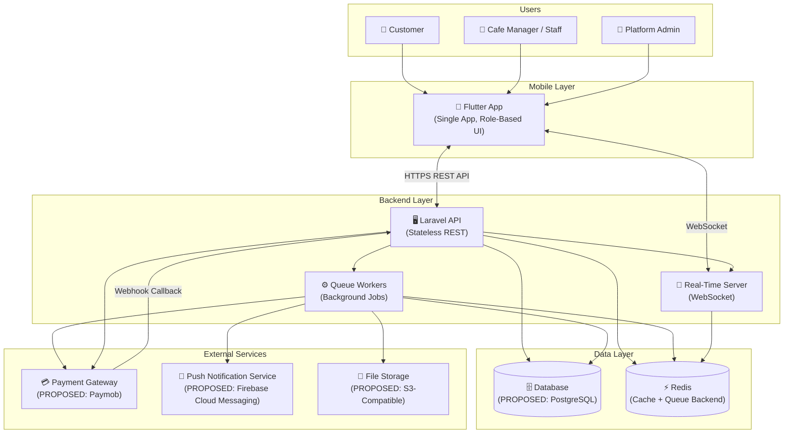

### 1.2 Key Characteristics

| Characteristic | Value |
|---|---|
| Architecture Style | Modular Monolith (Laravel) |
| API Style | RESTful JSON API |
| Authentication | Token-based (PROPOSED: Laravel Sanctum) |
| Real-Time | WebSocket (PROPOSED: Laravel Reverb) |
| Scalability Target | 30,000 concurrent users (initial milestone) |
| Market | Egypt (initial: Kafr El-Sheikh) |
| Mobile Platforms | iOS + Android (Flutter) |

---

## 2. Component Architecture

### 2.1 Internal Laravel Architecture

The backend follows a layered architecture with clear separation of concerns. The recommended pattern is **Service-Repository** (PROPOSED — AWAITING APPROVAL; see [ADR-015](./ARCHITECTURE_DECISIONS.md#adr-015)).

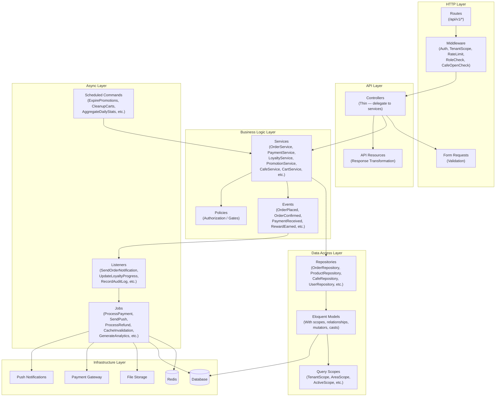

### 2.2 Layer Responsibilities

| Layer | Responsibility | Rules |
|---|---|---|
| **Middleware** | Authentication, authorization, rate limiting, tenant scoping, cafe open status checks | No business logic. Cross-cutting concerns only. |
| **Controllers** | Parse HTTP requests, delegate to services, return API Resources | Thin. No direct DB queries. No business logic. |
| **Form Requests** | Input validation and sanitization | All validation rules here. Return 422 on failure. |
| **API Resources** | Transform models to JSON API responses | Control data exposure. Never leak internal IDs/fields. |
| **Services** | Core business logic, orchestration, transaction management | Single Responsibility. Services may call other services. Fire events. |
| **Repositories** | Data access abstraction over Eloquent | All query logic here. Return models/collections. Apply tenant scoping. |
| **Models** | Eloquent ORM, relationships, scopes, casts, accessors/mutators | Define relationships, global scopes (TenantScope), attribute casting. |
| **Events** | Domain event definitions | Immutable data objects. Dispatched from services. |
| **Listeners** | React to events, dispatch jobs | Light logic. Dispatch heavy work to jobs. |
| **Jobs** | Background processing (payments, notifications, analytics) | Idempotent. Retryable. Contain failure handling. |
| **Policies** | Authorization rules (can user X do action Y on resource Z?) | Gate definitions. Checked in controllers/middleware. |

### 2.3 Key Middleware Stack

| Middleware | Purpose | Applied To |
|---|---|---|
| `auth:sanctum` | Token authentication | All protected routes |
| `role:{role}` | Role-based access control | Role-specific route groups |
| `tenant.scope` | Inject cafe_id context for cafe staff, scope all queries | Cafe management routes |
| `throttle:{limit}` | Rate limiting (Redis-backed) | All API routes |
| `cafe.open` | Verify cafe is accepting orders | Order placement routes |
| `active.order.check` | Verify customer has no active orders | Order placement routes |
| `customer.block.check` | Verify customer is not blocked at target cafe | Order placement routes |
| `locale` | Set language from `Accept-Language` header | All routes |

---

## 3. Data Flow Diagrams

### 3.1 Customer Browsing and Ordering

```mermaid
sequenceDiagram
    actor C as Customer
    participant App as Flutter App
    participant API as Laravel API
    participant Cache as Redis Cache
    participant DB as Database
    participant RT as Real-Time Server
    participant Cafe as Cafe Staff App

    Note over C, Cafe: Phase 1 — Browsing
    C->>App: Open app, select area
    App->>API: GET /api/v1/cafes?area_id=X
    API->>Cache: Check cafe list cache
    alt Cache Hit
        Cache-->>API: Cached cafe list
    else Cache Miss
        API->>DB: Query cafes in area (with open status)
        DB-->>API: Cafe list
        API->>Cache: Store with TTL
    end
    API-->>App: Cafe list JSON
    App-->>C: Display cafes

    C->>App: Select cafe, view menu
    App->>API: GET /api/v1/cafes/{id}/menu
    API->>Cache: Check menu cache
    alt Cache Hit
        Cache-->>API: Cached menu
    else Cache Miss
        API->>DB: Query categories, products, variants, modifiers
        DB-->>API: Full menu data
        API->>Cache: Store with TTL
    end
    API-->>App: Menu with variants/modifiers
    App-->>C: Display menu

    Note over C, Cafe: Phase 2 — Cart & Order
    C->>App: Add items (with variants/modifiers) to cart
    App->>API: POST /api/v1/cart/items
    API->>DB: Validate product, variant, modifiers; store cart
    API-->>App: Updated cart

    C->>App: Submit order (fulfillment type + payment method)
    App->>API: POST /api/v1/orders
    API->>DB: BEGIN TRANSACTION
    Note over API: Validate: cafe open, no active order,<br/>not blocked, prices, availability,<br/>variants/modifiers valid
    API->>DB: Create order + order_items (immutable snapshots)
    API->>DB: Create payment record
    API->>DB: COMMIT TRANSACTION
    API->>RT: Broadcast OrderPlaced event
    RT->>Cafe: New order notification
    API-->>App: Order created (201)
    App-->>C: Show order tracking screen
```

### 3.2 Payment Processing — Online

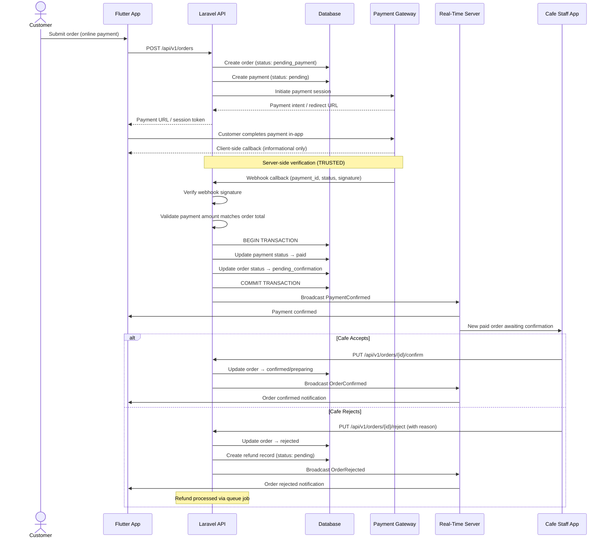

### 3.3 Payment Processing — Cash

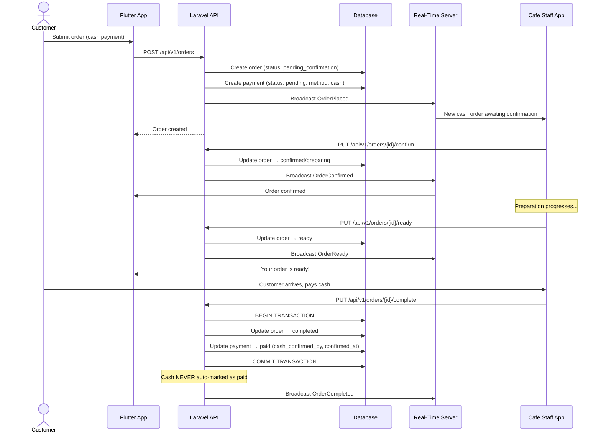

### 3.4 Real-Time Order Updates

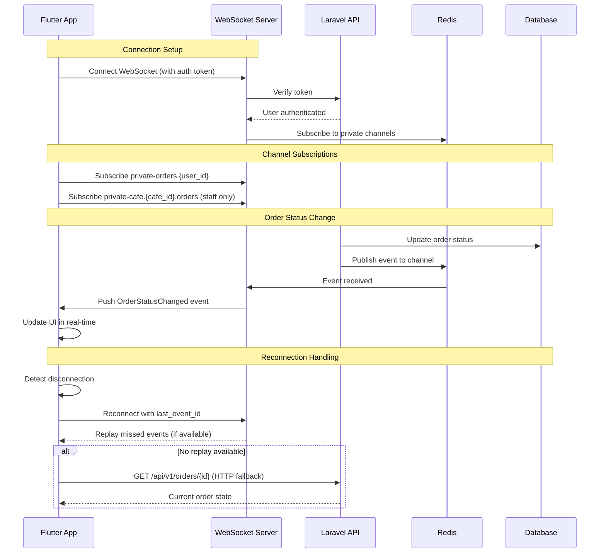

### 3.5 Push Notifications

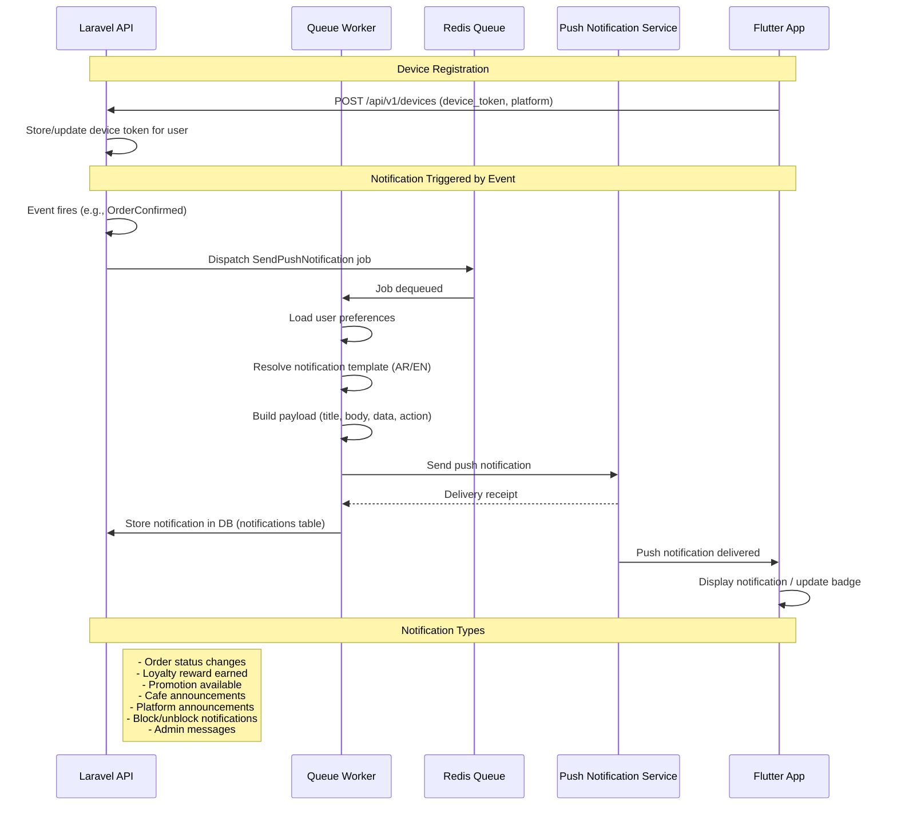

### 3.6 Loyalty Reward Progression and Redemption

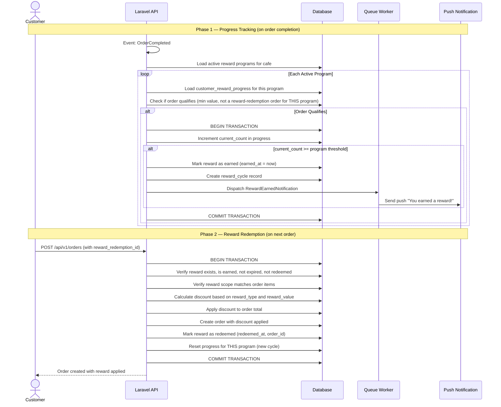

### 3.7 Promotion Eligibility Evaluation

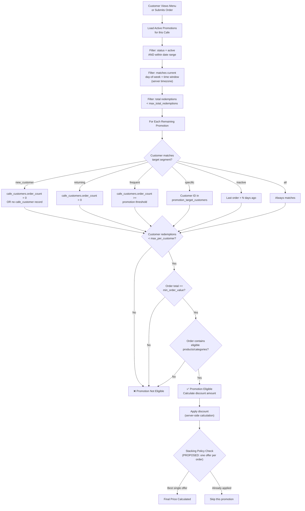

---

## 4. Multi-Tenancy Approach

> **Status: PROPOSED — AWAITING APPROVAL** (TD-C)

Cafe data isolation is a core requirement. Every cafe's data (products, orders, customers, loyalty, promotions) must be strictly isolated. This section evaluates three approaches.

### 4.1 Options Comparison

| Criterion | Option A: Shared Tables + `cafe_id` | Option B: Separate Schemas | Option C: Separate Databases |
|---|---|---|---|
| **Description** | All cafes share the same tables with a `cafe_id` column and strict query scoping | Each cafe gets its own PostgreSQL schema within one database | Each cafe gets a completely separate database instance |
| **Data Isolation** | Logical (enforced via scopes, middleware, authorization) | Schema-level (stronger boundary) | Physical (strongest boundary) |
| **Implementation Complexity** | Low — standard Laravel patterns with global scopes | Medium — requires schema switching middleware, custom connection management | High — dynamic connection management, cross-DB queries difficult |
| **Query Complexity** | Low — standard queries with WHERE cafe_id = ? | Medium — schema-qualified queries or schema search_path switching | High — cannot easily join across tenants for admin analytics |
| **Cross-Tenant Analytics** | Easy — direct queries across all data | Moderate — requires cross-schema queries or aggregation views | Very Hard — requires ETL/data warehouse approach |
| **Migration Complexity** | Low — single migration set | Medium — migrations run per-schema | High — migrations run per-database |
| **Scaling** | Good to ~10,000 cafes; indexes partition data effectively | Good to ~5,000 cafes per DB instance | Best for very large tenants; overkill for cafes |
| **Resource Usage** | Efficient — shared connection pool | Moderate — some overhead per schema | High — connection pool per database |
| **Laravel Ecosystem Support** | Excellent — native support | Moderate — packages exist (e.g., tenancyforlaravel) but add complexity | Limited — requires significant custom code |
| **Cost** | Lowest | Moderate | Highest |
| **Risk of Data Leakage** | Highest — requires disciplined scoping | Low | Lowest |

### 4.2 Recommendation: Option A — Shared Tables with `cafe_id`

> **PROPOSED — AWAITING APPROVAL**

**Rationale for this project:**

1. **Scale profile fits:** CupBack targets hundreds of cafes in Egyptian cities, not thousands of enterprise tenants. Shared tables with proper indexing handle this scale easily.
2. **Admin analytics are critical:** Platform Admin needs cross-cafe dashboards, order analytics, and dispute investigation — all trivially easy with shared tables.
3. **Laravel alignment:** Eloquent global scopes, middleware-injected tenant context, and authorization policies are the idiomatic Laravel approach.
4. **Development velocity:** No schema management overhead, simpler testing, standard migrations.
5. **Cost-effective:** Single database connection pool, simpler infrastructure.

### 4.3 Isolation Enforcement Strategy

The following mechanisms ensure strict data isolation despite shared tables:

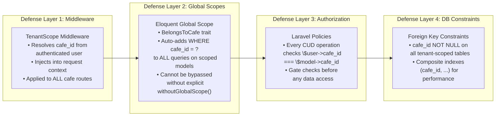

**Tables requiring `cafe_id` scoping:**

| Category | Tables |
|---|---|
| Products | `categories`, `products`, `product_variants`, `modifier_groups`, `modifiers` |
| Orders | `orders`, `order_items`, `order_item_modifiers`, `carts`, `cart_items` |
| Payments | `payments`, `refunds` |
| Loyalty | `reward_programs`, `reward_rules`, `customer_reward_progress`, `reward_cycles`, `reward_redemptions` |
| Promotions | `promotions`, `promotion_rules`, `promotion_eligible_products`, `promotion_eligible_categories`, `promotion_target_segments`, `promotion_target_customers`, `promotion_schedules`, `promotion_redemptions` |
| Cafe Data | `cafe_operating_hours`, `cafe_staff`, `cafe_customer_blocks` |
| Relationships | `cafe_customers` |

**Tables NOT scoped by `cafe_id` (platform-level):**

| Tables | Reason |
|---|---|
| `users`, `roles`, `permissions` | Global identity system |
| `areas`, `cities` | Platform geography |
| `cafes`, `cafe_branches` | Cafes are the tenants themselves |
| `notifications` | Cross-tenant notifications (platform announcements) |
| `audit_logs` | Platform-wide audit trail |
| `platform_settings` | Global configuration |

---

## 5. Redis Architecture

### 5.1 Overview

Redis is **mandatory** (APPROVED) and serves four distinct roles: caching, queue backend, real-time pub/sub, and rate limiting. Redis is **NEVER** the source of truth for critical data — the database remains authoritative.

### 5.2 Cache Strategy

| Data Type | Cache Key Pattern | TTL | Invalidation Trigger |
|---|---|---|---|
| Cafe list by area | `cafes:area:{area_id}` | 10 min | Cafe created/updated/status changed |
| Cafe detail | `cafe:{cafe_id}` | 15 min | Cafe info updated |
| Full menu (categories + products + variants + modifiers) | `menu:{cafe_id}` | 10 min | Any product/category/variant/modifier CRUD |
| Operating hours | `hours:{cafe_id}` | 30 min | Hours updated or manual toggle |
| Cafe open/closed status | `cafe_open:{cafe_id}` | 5 min | Manual toggle, schedule check |
| Active promotions for cafe | `promos:{cafe_id}` | 5 min | Promotion CRUD, schedule change |
| Customer reward progress | `loyalty:{cafe_id}:{user_id}` | 10 min | Order completed, reward redeemed |
| Platform areas list | `areas:all` | 60 min | Area CRUD |
| User permissions/roles | `user_perms:{user_id}` | 30 min | Role/permission change |

### 5.3 What Is NOT Cached (Source of Truth = Database)

| Data Type | Reason |
|---|---|
| Orders | Transactional data with state machines; must always be fresh |
| Payments | Financial data; no stale reads acceptable |
| Cart contents | Frequently mutated; caching adds complexity without benefit |
| Reward redemption status | Race condition risk; must verify against DB at redemption time |
| Block status | Security-sensitive; checked directly against DB at order time |
| Audit logs | Write-only data; never read from cache |

### 5.4 Cache Invalidation Strategy

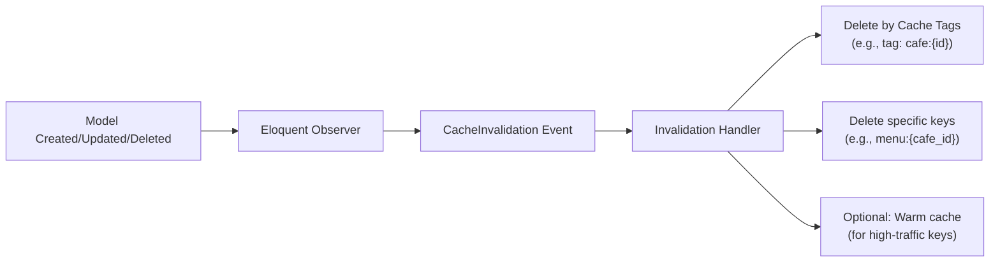

**Approach:** Tag-based invalidation using Redis cache tags. All cache entries for a cafe are tagged with `cafe:{cafe_id}`. When any cafe data changes, flush all related tags.

**Cache warming:** On cafe menu update, proactively rebuild the menu cache to avoid thundering herd on the next request.

### 5.5 Rate Limiting

| Endpoint Group | Limit | Window | Key |
|---|---|---|---|
| General API | 60 requests | 1 minute | `rate:{user_id}` |
| Authentication (login) | 5 attempts | 1 minute | `rate:auth:{ip}` |
| Order placement | 3 requests | 1 minute | `rate:order:{user_id}` |
| Payment initiation | 3 requests | 1 minute | `rate:pay:{user_id}` |
| File upload | 10 requests | 5 minutes | `rate:upload:{user_id}` |
| Admin operations | 120 requests | 1 minute | `rate:admin:{user_id}` |

### 5.6 Redis Database Allocation

| DB Index | Purpose |
|---|---|
| 0 | Application cache |
| 1 | Queue data |
| 2 | Session data (if needed) |
| 3 | Rate limiting |

> **Note:** In production, separate Redis instances for cache and queue are recommended for isolation and independent scaling.

---

## 6. Queue Architecture

### 6.1 Overview

A queue system is **mandatory** (APPROVED). Redis is the recommended queue backend (via Laravel's Redis queue driver). All non-critical, time-consuming, or external-service-dependent operations are processed asynchronously via jobs.

### 6.2 Queue Topology

| Queue Name | Priority | Purpose | Workers |
|---|---|---|---|
| `high` | 1 (highest) | Payment webhooks, order status changes, refund processing | 3–5 |
| `default` | 2 | Loyalty calculation, promotion validation, cart cleanup | 2–3 |
| `notifications` | 3 | Push notifications, in-app notifications, emails | 2–3 |
| `low` | 4 (lowest) | Analytics aggregation, cache warming, audit log flushing | 1–2 |

**Worker command:**
```bash
php artisan queue:work redis --queue=high,default,notifications,low
```

### 6.3 Job Types

| Job | Queue | Retry | Timeout | Description |
|---|---|---|---|---|
| `ProcessPaymentWebhook` | high | 3 | 30s | Verify and process payment gateway callbacks |
| `ProcessRefund` | high | 5 | 60s | Initiate refund with payment gateway |
| `UpdateOrderStatus` | high | 3 | 15s | Broadcast order status changes via WebSocket |
| `CalculateLoyaltyProgress` | default | 3 | 30s | Update reward progress after order completion |
| `EvaluatePromotionEligibility` | default | 2 | 20s | Pre-compute eligible promotions for customer |
| `UpdateCafeCustomerStats` | default | 3 | 15s | Update order_count, total_spent in cafe_customers |
| `CleanupExpiredCarts` | default | 1 | 60s | Remove carts not converted to orders (scheduled) |
| `SendPushNotification` | notifications | 3 | 30s | Send push via FCM/provider |
| `StoreNotificationRecord` | notifications | 2 | 10s | Persist notification to DB |
| `SendBulkCafeNotification` | notifications | 2 | 120s | Platform Admin → multiple cafes |
| `AggregateDailyStats` | low | 2 | 300s | Compile daily analytics per cafe |
| `WarmMenuCache` | low | 1 | 30s | Proactively rebuild menu cache after update |
| `RecordAuditLog` | low | 3 | 10s | Write audit trail entry |
| `ExpireRewards` | default | 2 | 60s | Mark expired rewards (if expiration configured) |
| `ExpirePromotions` | default | 1 | 60s | Transition expired promotions to expired status |

### 6.4 Retry Policies

| Failure Scenario | Strategy |
|---|---|
| Network timeout (payment gateway) | Exponential backoff: 10s, 30s, 90s. Max 3 retries. |
| Push notification delivery failure | Linear backoff: 5s, 10s, 15s. Max 3 retries. |
| Database deadlock | Immediate retry. Max 3 retries. |
| External service 5xx | Exponential backoff: 15s, 60s, 300s. Max 5 retries. |
| Validation/logic error | No retry — move to failed jobs. |

### 6.5 Dead-Letter / Failed Job Strategy

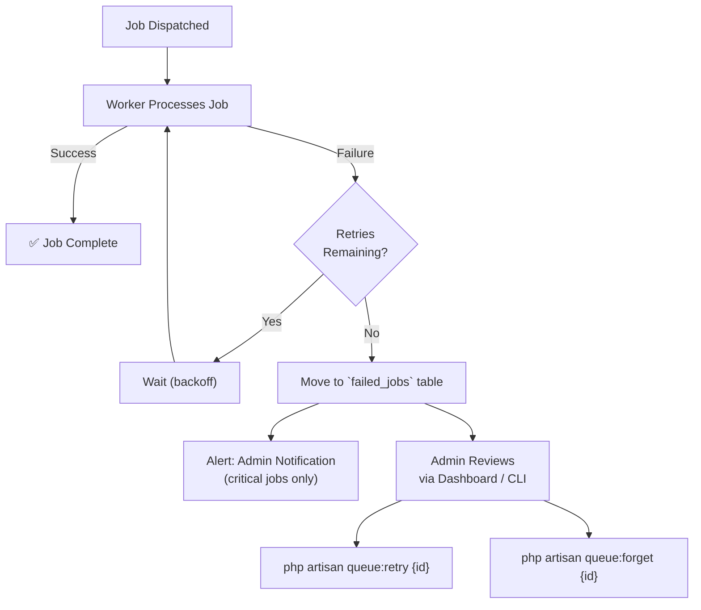

**Failed job handling:**

1. All failed jobs stored in `failed_jobs` table with payload, exception, and timestamps.
2. **Critical job failures** (payments, refunds) trigger immediate admin notification via a dedicated monitoring channel.
3. Admin can retry or dismiss failed jobs via CLI or admin dashboard.
4. Failed jobs older than 30 days are automatically pruned.
5. A daily scheduled command reports failed job counts for monitoring.

### 6.6 Worker Scaling Guidelines

| Load Profile | Workers | Notes |
|---|---|---|
| Development | 1 (all queues) | Single `queue:work` process |
| Staging | 2 (high+default, notifications+low) | Separate processes per priority group |
| Production (launch) | 8–10 total | Distributed across queue priorities as per §6.2 |
| Production (30K concurrent) | 15–20 total | Horizontal scaling, supervisor-managed |
| Peak (promotions/events) | Scale `notifications` workers to 5–8 | Burst capacity for push notification surges |

Workers are managed via **Supervisor** (or equivalent process manager) ensuring automatic restart on crash.

---

## 7. Technology Decision Proposals

Each subsection corresponds to an UNDECIDED technology choice (TD-A through TD-K). All recommendations are **PROPOSED — AWAITING APPROVAL**.

Detailed rationale is documented in [ARCHITECTURE_DECISIONS.md](./ARCHITECTURE_DECISIONS.md) as ADRs.

### 7.1 TD-A: Database Engine

> **PROPOSED — AWAITING APPROVAL** | See [ADR-014](./ARCHITECTURE_DECISIONS.md#adr-014)

| Criterion | PostgreSQL | MySQL 8.0+ |
|---|---|---|
| ACID Compliance | Full | Full (InnoDB) |
| JSON Support | Native `jsonb` with indexing, operators, partial indexes | `JSON` type with generated virtual columns for indexing |
| Complex Queries (promotions, segmentation) | CTEs, window functions, lateral joins, advanced aggregates — mature and performant | CTEs (since 8.0), window functions — functional but less optimized |
| Check Constraints | Full support, enforced | Parsed but **NOT enforced** in MySQL < 8.0.16; enforced since 8.0.16 |
| Partial Indexes | ✅ Supported — critical for `WHERE status = 'active'` | ❌ Not supported |
| Full-Text Search | Built-in `tsvector` with Arabic support | Built-in, limited Arabic support |
| Array Columns | Native `array` type | Not supported |
| Enum Handling | Native `enum` types + check constraints | `ENUM` column type (rigid, hard to alter) |
| Upsert (ON CONFLICT) | `INSERT ... ON CONFLICT DO UPDATE` | `INSERT ... ON DUPLICATE KEY UPDATE` |
| Laravel Integration | Excellent — first-class support | Excellent — most common pairing |
| Hosting/Managed Services | AWS RDS, Google Cloud SQL, DigitalOcean, etc. | AWS RDS, Google Cloud SQL, PlanetScale, etc. |
| Community/Ecosystem | Slightly smaller but highly technical | Largest MySQL community |

**Recommendation: PostgreSQL**

PostgreSQL's superior JSON indexing, partial indexes, check constraints, and advanced query capabilities make it the better fit for CupBack's complex promotion eligibility queries, customer segmentation, and loyalty cycle calculations. The `jsonb` type with GIN indexes is particularly valuable for flexible modifier/variant storage and querying.

### 7.2 TD-B: Backend Architectural Pattern

> **PROPOSED — AWAITING APPROVAL** | See [ADR-015](./ARCHITECTURE_DECISIONS.md#adr-015)

| Pattern | Pros | Cons |
|---|---|---|
| **Service-Repository** | Clear separation; testable services; swappable data layer; familiar to Laravel devs | Slight boilerplate; repository may feel redundant for simple CRUD |
| **Domain-Driven Design (DDD)** | Best for complex domains; bounded contexts; rich domain models | Over-engineering for this project size; steep learning curve; slower development |
| **Simple MVC + Services** | Fastest to start; minimal boilerplate; standard Laravel | Fat controllers/services tend to emerge; harder to test; tenant scoping harder to enforce |

**Recommendation: Service-Repository Pattern**

Balances structure with pragmatism. Repositories enforce tenant scoping at the data access layer, services encapsulate business logic, and the pattern is widely understood by Laravel developers.

### 7.3 TD-D: Authentication Strategy

> **PROPOSED — AWAITING APPROVAL** | See [ADR-017](./ARCHITECTURE_DECISIONS.md#adr-017)

| Criterion | Laravel Sanctum | Laravel Passport |
|---|---|---|
| Token Type | Simple API tokens (opaque or SHA-256 hashed) | Full OAuth2 (access tokens + refresh tokens) |
| Complexity | Low — minimal setup | High — OAuth2 server, client management |
| Mobile API Tokens | ✅ Perfect fit — issue token on login, send in header | ✅ Works but overkill for first-party app |
| Third-Party OAuth | ❌ Not designed for it | ✅ Full support (authorization code, client credentials) |
| Token Scoping | ✅ Abilities (string-based) | ✅ Scopes (more granular) |
| Token Revocation | ✅ Easy | ✅ Easy |
| Performance | Faster (DB lookup only) | Slower (JWT verification + DB) |
| Laravel Integration | Native, first-party | Native, first-party |
| Use Case Fit | First-party SPA/mobile APIs | Third-party API access, multi-app ecosystems |

**Recommendation: Laravel Sanctum**

CupBack is a first-party mobile app — there are no third-party API consumers. Sanctum's simplicity, performance, and native token abilities are the right fit. Passport's OAuth2 machinery adds unnecessary complexity.

### 7.4 TD-E: Payment Gateway (Egyptian Market)

> **PROPOSED — AWAITING APPROVAL** | See [ADR-018](./ARCHITECTURE_DECISIONS.md#adr-018)

| Criterion | Paymob | Fawry | Accept (by Paymob) |
|---|---|---|---|
| Market Position | Leading Egyptian online payment processor | Largest bill payment network in Egypt | Paymob's hosted checkout product |
| Mobile SDK | ✅ iOS + Android SDKs | ✅ Mobile integration | ✅ (Uses Paymob's SDK) |
| Card Payments | ✅ Visa, Mastercard, Meeza | ✅ Limited card support | ✅ |
| Mobile Wallets | ✅ Vodafone Cash, Orange, Etisalat, WE | ⚠️ Limited | ✅ |
| Webhooks | ✅ Server-side callbacks with HMAC | ✅ IPN notifications | ✅ |
| API Quality | Good REST API, well-documented | Adequate, older API style | Same as Paymob |
| Settlement | T+1 to T+3 to bank account | Varies | Same as Paymob |
| Onboarding | Fast — online registration | Moderate | Fast |
| Fees | ~2.5% cards, lower for wallets | ~2-3% | Same as Paymob |

**Recommendation: Paymob**

Paymob is the most feature-complete payment gateway for the Egyptian market, with excellent mobile SDK support, comprehensive wallet integration (critical for Egypt), and reliable webhook infrastructure. Its dominance in the Egyptian fintech ecosystem ensures long-term support and merchant familiarity.

### 7.5 TD-F: Real-Time Technology

> **PROPOSED — AWAITING APPROVAL** | See [ADR-019](./ARCHITECTURE_DECISIONS.md#adr-019)

| Criterion | Laravel Reverb | Pusher (Channels) | Soketi |
|---|---|---|---|
| Type | Self-hosted WebSocket server (first-party Laravel) | Hosted WebSocket service (SaaS) | Self-hosted, Pusher-compatible server |
| Cost | Free (infrastructure cost only) | Free tier: 200K messages/day; paid plans above | Free (infrastructure cost only) |
| Laravel Integration | Native — built for Laravel Broadcasting | Excellent — officially supported driver | Good — uses Pusher protocol/driver |
| Private/Presence Channels | ✅ | ✅ | ✅ |
| Scalability | Horizontal with Redis pub/sub | Managed by Pusher | Horizontal with Redis adapter |
| Ops Complexity | Medium — self-manage the process | None — fully managed | Medium — self-manage |
| Latency | Lowest (same network as API) | Slightly higher (external hop) | Low (same network) |
| Vendor Lock-in | None | High (Pusher protocol, but switchable) | None (Pusher-compatible) |

**Recommendation: Laravel Reverb**

As a first-party Laravel package, Reverb offers the tightest integration, zero recurring costs, lowest latency, and avoids vendor lock-in. It supports horizontal scaling via Redis pub/sub, which aligns with our existing Redis infrastructure.

### 7.6 TD-G: Push Notification Provider

> **PROPOSED — AWAITING APPROVAL** | See [ADR-020](./ARCHITECTURE_DECISIONS.md#adr-020)

| Criterion | Firebase Cloud Messaging (FCM) | OneSignal |
|---|---|---|
| Cost | Free (unlimited) | Free tier: 10K subscribers; paid above |
| iOS + Android | ✅ (APNs via FCM) | ✅ |
| Flutter SDK | `firebase_messaging` — excellent | `onesignal_flutter` — good |
| Segmentation | Basic (topics) | Advanced built-in segmentation |
| Analytics | Firebase Analytics integration | Built-in delivery analytics |
| Server SDK (PHP) | HTTP v1 API, Laravel packages available | REST API, PHP SDK available |
| Reliability | Google-grade infrastructure | Reliable, smaller scale |

**Recommendation: Firebase Cloud Messaging (FCM)**

Free, unlimited, and Google-backed reliability. Flutter's `firebase_messaging` package is mature and well-documented. Custom segmentation logic lives in our backend (not the push provider), making FCM's simpler model sufficient.

### 7.7 TD-H: Cloud Provider & Infrastructure

> **PROPOSED — AWAITING APPROVAL**

| Criterion | AWS | Google Cloud (GCP) | DigitalOcean |
|---|---|---|---|
| Managed PostgreSQL | ✅ RDS | ✅ Cloud SQL | ✅ Managed Databases |
| Managed Redis | ✅ ElastiCache | ✅ Memorystore | ✅ Managed Redis |
| Object Storage | ✅ S3 | ✅ Cloud Storage | ✅ Spaces (S3-compatible) |
| Compute | EC2, ECS, Lambda | GCE, Cloud Run | Droplets, App Platform |
| Egypt Region | ❌ (nearest: Bahrain) | ❌ (nearest: Doha, Qatar) | ❌ (nearest: Frankfurt) |
| Cost | Moderate–High | Moderate–High | Low–Moderate |
| Complexity | High | High | Low |
| Scaling | Excellent | Excellent | Good for this scale |

**Recommendation:** DigitalOcean for V1 launch (simplicity, cost), with migration path to AWS/GCP if scaling demands it. All components should use portable abstractions (S3-compatible storage, standard PostgreSQL, standard Redis).

### 7.8 TD-I: API Versioning Strategy

> **PROPOSED — AWAITING APPROVAL** | See [ADR-021](./ARCHITECTURE_DECISIONS.md#adr-021)

| Strategy | Pros | Cons |
|---|---|---|
| **URL Prefix (`/api/v1/`)** | Explicit, visible, easy to route, cacheable, easy to deprecate | URL "pollution"; potentially breaking clients on version bump |
| **Header-based (`Accept: application/vnd.CupBack.v1+json`)** | Clean URLs, content negotiation | Hidden, harder to test/debug, proxy issues, less discoverable |

**Recommendation: URL Prefix `/api/v1/`**

Simpler, more explicit, easier to test and debug, better proxy/CDN caching support.

### 7.9 TD-J: File Storage

> **PROPOSED — AWAITING APPROVAL** | See [ADR-022](./ARCHITECTURE_DECISIONS.md#adr-022)

| Criterion | Local Disk | S3-Compatible Storage |
|---|---|---|
| Scalability | Limited to single server | Unlimited, distributed |
| CDN Integration | Manual | Native (CloudFront, Cloudflare, etc.) |
| Cost | Included with server | Pay per GB stored + transfer |
| Redundancy | None (unless RAID) | Built-in replication |
| Laravel Integration | Native `local` driver | Native `s3` driver |
| Development Use | Perfect for local dev | Requires credentials or MinIO |

**Recommendation: S3-Compatible Storage**

Use Laravel's filesystem abstraction with `s3` driver in production (compatible with AWS S3, DigitalOcean Spaces, MinIO) and `local` driver in development. Images served through a CDN for performance.

### 7.10 TD-K: Monitoring & Observability

> **PROPOSED — AWAITING APPROVAL**

| Tool | Purpose | Cost |
|---|---|---|
| **Laravel Telescope** | Local dev debugging: queries, jobs, events, cache | Free (disable in production) |
| **Laravel Horizon** | Redis queue monitoring dashboard | Free (first-party) |
| **Sentry** | Error tracking, performance monitoring, release tracking | Free tier: 5K events/mo |
| **Laravel Pulse** | Production application performance monitoring | Free (first-party) |
| **UptimeRobot / BetterStack** | Uptime monitoring, status page | Free tier available |

**Recommendation:** Use all five. Telescope for development, Horizon for queue management, Sentry for error/performance tracking, Pulse for production metrics, and UptimeRobot/BetterStack for uptime monitoring.

---

## 8. Deployment Architecture

> **Note:** Cloud provider is UNDECIDED (TD-H). This diagram shows a generic, provider-agnostic deployment architecture.

### 8.1 High-Level Deployment Diagram

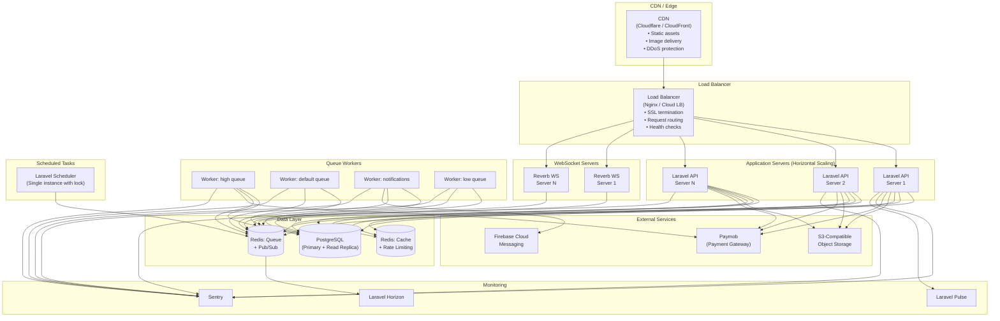

### 8.2 Environment Strategy

| Environment | Purpose | Infrastructure |
|---|---|---|
| **Local** | Developer workstations | Docker Compose (PHP, PostgreSQL, Redis, MinIO, Reverb) |
| **Staging** | Pre-production testing, QA | Single server or small cluster mirroring production topology |
| **Production** | Live users | Full cluster per §8.1 |

### 8.3 Deployment Pipeline (High-Level)

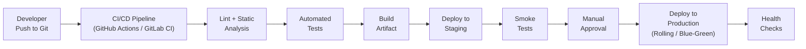

### 8.4 Scaling Strategy

| Component | Scaling Approach | Trigger |
|---|---|---|
| API Servers | Horizontal — add instances behind load balancer | CPU > 70% or response time > 200ms |
| WebSocket Servers | Horizontal — Redis pub/sub for cross-server messaging | Connection count > 5000/server |
| Queue Workers | Horizontal — add worker processes | Queue depth > 1000 or job wait time > 10s |
| Database | Vertical first → read replicas for analytics queries | Query latency > 50ms or connection pool exhaustion |
| Redis Cache | Vertical first → Redis Cluster for cache if needed | Memory > 80% or hit rate < 90% |
| Redis Queue | Separate instance from cache → vertical scaling | Queue depth sustained high |

---

*End of System Architecture Document*

