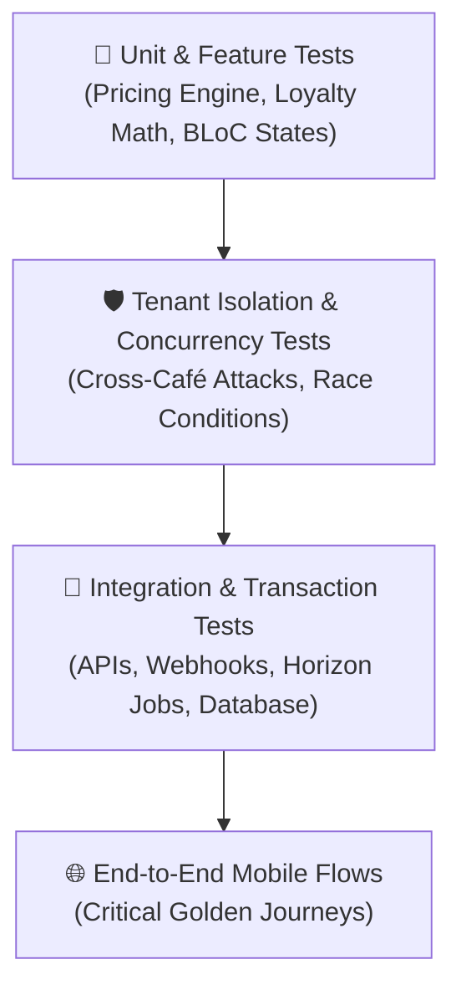

# CupBack — Quality Assurance, Testing Strategy & Verification Gates

> **Platform:** CupBack Mobile Café Marketplace  
> **Code Coverage Target:** $\ge 80\%$ Backend (PHPUnit / Pest), $\ge 70\%$ Flutter Client  
> **Testing Philosophy:** Zero Tolerance for Financial Inaccuracy, Race Conditions, or Tenant Leakage  
> **Audience:** QA Engineers, Backend Developers, Flutter Developers, Gemini Implementation Agent  

---

## 1. Testing Pyramid & Quality Gates

CupBack enforces a strict multi-tiered testing hierarchy. A feature is never considered complete or mergeable until its corresponding test suite passes in CI/CD without failure.



---

## 2. Backend Testing Specifications (PHPUnit / Pest)

### 2.1 Unit Testing: Mathematical & Business Rules
- **Pricing Calculation Suite:**
  - Verify variant base price + modifier price adjustments $\times$ quantity matches expected piasters.
  - Verify percentage discounts round down to nearest piaster (protecting customer balance).
  - Verify fixed discounts cannot exceed subtotal (minimum total is 0 piasters).
- **Loyalty Cycle Mechanics Suite:**
  - Verify order count increments strictly on `completed` status.
  - Verify reward unlocks upon order $N$ completion.
  - Verify redeeming reward on order $N+1$ resets counter to 0.
  - **Critical Test:** Verify order $N+1$ (the reward order) does NOT increment the counter for cycle 2.
- **Promotion Scheduling & Timezone Suite:**
  - Verify intra-day campaigns execute only during configured hours.
  - Verify overnight campaigns (20:00 to 02:00) validate correctly before and after midnight in Cairo time.

### 2.2 Critical Tenant Isolation Tests (Zero Leakage)
Every café-scoped API endpoint must be subjected to automated penetration and isolation assertions:

```php
test('cafe manager A cannot view or manipulate orders belonging to cafe B', function () {
    $cafeA = Cafe::factory()->create();
    $cafeB = Cafe::factory()->create();
    $managerA = User::factory()->create();
    $managerA->assignRole('cafe_manager');
    CafeStaff::factory()->create(['cafe_id' => $cafeA->id, 'user_id' => $managerA->id]);

    $orderB = Order::factory()->create(['cafe_id' => $cafeB->id]);

    // Manager A attempts to accept Order B
    $response = $this->actingAs($managerA, 'sanctum')
                     ->putJson("/api/v1/cafe-management/orders/{$orderB->id}/accept");

    // Must return 403 Forbidden or 404 Not Found (never 200 OK)
    $response->assertStatus(403);
});
```

### 2.3 Concurrency & Race Condition Verification
- **Simultaneous Active Orders Attack:**
  - Simulate 2 concurrent POST `/orders` requests from the same customer using parallel threads or asynchronous HTTP pools.
  - Assert that exactly ONE order succeeds with `201 Created` and the second request is rejected with `409 Conflict`.
- **Duplicate Loyalty Reward Redemption:**
  - Trigger 2 parallel order checkouts attempting to apply the identical `reward_redemption_id`.
  - Assert that pessimistic database row locking (`FOR UPDATE`) allows only one checkout to commit; the competitor fails with `409 Conflict`.
- **Limited Promotion Schedular Depletion:**
  - Simulate 10 concurrent customers attempting to redeem a campaign with `max_total_redemptions = 1`.
  - Assert that exactly 1 customer receives the discount; 9 customers receive full un-discounted pricing.

---

## 3. Disciplinary Blocking Verification (Rule Q18)

Automated tests must explicitly validate all facets of the customer blocking specification:
1. **Immediate Rejection:** Customer blocked by Café A receives `403 Forbidden` when attempting to order from Café A.
2. **Cross-Café Isolation:** Customer blocked by Café A CAN successfully place an order with Café B without impediment.
3. **Active Order Protection:** Placing a block on a customer while they have an order in `preparing` status at Café A must NOT cancel or modify the active order.
4. **Mandatory Audit Trail:** Assert that every block creates a corresponding `audit_logs` record containing actor, customer, café, and justification.
5. **Administrative Override:** Assert that Platform Admin calling `/admin/customers/{cafe_id}/{cust_id}/unblock` deactivates the block and permits new orders.

---

## 4. Flutter Client Testing Strategy

### 4.1 BLoC Unit Tests (`bloc_test`)
- **CartBloc:** Adding items from Café A $\to$ Attempting to add item from Café B emits `CartConflictState` with confirmation event.
- **OrderTrackingBloc:** WebSocket status update frames transition state cleanly from `OrderPreparingState` to `OrderReadyState`.
- **ProductCustomizerBloc:** Selecting a required modifier group enables the "Add to Cart" CTA and updates calculated price in real time.

### 4.2 Widget & Golden Snapshot Tests
- Verify Product Customization Bottom Sheet renders properly in Arabic (RTL) without label overlap or font clipping.
- Verify Order Status Stepper pulses on the active state.
- Verify Disciplinary Block Modal displays respectful customer explanation and never reveals internal staff notes.

---

## 5. Release Quality Gates

Before any build is promoted to Staging or Production:
1. **Static Analysis & Linting:**
   - Backend: PHPStan level 8 passing with 0 errors; Laravel Pint formatting compliant.
   - Mobile: `flutter analyze` passing with 0 warnings; Dart Code Metrics compliant.
2. **Automated Test Coverage:**
   - 100% of API endpoints covered by feature tests.
   - Zero test failures across 1,000+ unit and integration tests.
3. **Security Scan:**
   - `composer audit` and `dart pub audit` report 0 critical or high vulnerabilities.
   - Snyk / GitHub Dependabot scans clean.
4. **Performance Gate:**
   - k6 load test executed against staging environment: 30K concurrent virtual users sustained with $p95 \le 200\text{ ms}$ for reads and $p95 \le 500\text{ ms}$ for writes.
