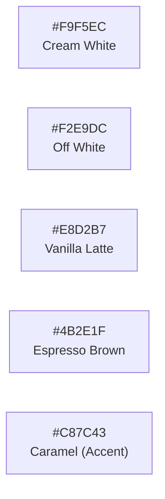

# CupBack — UI/UX Design System & Brand Guidelines

> **Platform:** CupBack Mobile Café Marketplace (Flutter Single App)  
> **Brand Concept:** CupBack — The Café Rewards App (Drink · Earn · Return)  
> **Color Identity:** Artisanal Warm Coffee Palette (Cream White, Off White, Vanilla Latte, Espresso Brown, Caramel)  
> **Official App Icon:** Selected Variant 2 (Middle: Warm Cream/Off-White Background with Espresso Brown Cup & Crescent)  
> **Layout Modes:** Native Arabic (RTL, Primary) & English (LTR)  
> **Audience:** Flutter Engineers, UI/UX Designers, QA Engineers, Gemini Implementation Agent  

---

## 1. Official Brand Identity & Color Palette

The visual identity of CupBack reflects authentic café culture: combining deep roasted espresso tones with smooth vanilla and rich caramel accents on warm organic cream backgrounds.



### 1.1 Color Tokens Specification (Official Hex Codes)

| Token Name | Hex Code | Semantic Role | Usage Context |
|------------|----------|---------------|---------------|
| `cb_cream_white` | `#F9F5EC` | Primary Background (Light) | App main background, cards contrast, light dialogs. |
| `cb_off_white` | `#F2E9DC` | Secondary Surface | Card surfaces, search inputs, icon background. |
| `cb_vanilla_latte` | `#E8D2B7` | Tertiary Surface / Borders | Card borders, divider lines, subtle badge backgrounds. |
| `cb_espresso_brown` | `#4B2E1F` | Core Brand & Text | Primary CTA buttons, primary titles, active navigation icon. |
| `cb_caramel_accent` | `#C87C43` | Accent & Loyalty | Special offer badges ("عرض خاص"), active stamps, progress ring. |
| `cb_success_green` | `#2ECC71` | Status: Success | "Order Ready", "Payment Confirmed", "In Stock". |
| `cb_error_red` | `#E63946` | Status: Destructive | "Order Rejected", "Customer Blocked", errors. |
| `cb_info_blue` | `#3498DB` | Status: Informational | "Preparing", table number tag, dine-in badge. |

---

## 2. Official App Icon Specification

Per the finalized brand exploration (Image 4), the application icon is **The Middle Variant (Variant 2)**:

```
+------------------------------------------+
|          [ OFFICIAL APP ICON ]           |
|                                          |
|  Background:  Off White / Cream (#F2E9DC)|
|  Graphic:     Espresso Brown (#4B2E1F)   |
|               - Crescent wrapping left   |
|               - Coffee Cup in center     |
|               - Latte art (heart/leaf)   |
|               - Rising aroma curls       |
+------------------------------------------+
```

- **App Icon Insets & Export Standards:**
  - Android Adaptive Icon: Foreground SVG of cup & crescent with `#4B2E1F` path; Background layer `#F2E9DC`.
  - iOS App Icon: 1024x1024 PNG flattened with `#F2E9DC` solid background and `#4B2E1F` artwork.
  - Notification Icon: Monochrome silhouette (white on transparent alpha) for Android status bar.

---

## 3. Typography Specification

### 3.1 Font Families & Pairing
- **English Brand & Display:** **Skellige-inspired** elegant serif/display typography for headings, brand hero text, and "CupBack" wordmark.
- **Arabic Display & Headings:** **Palestine-inspired** stylized Arabic calligraphy/display font for prominent screens, section titles, and badges (e.g., "المكافآت", "عروض مميزة", "الرئيسية").
- **Body & Operational Text (Bilingual):**
  - Arabic Body: **Cairo** (Weights: Regular 400, SemiBold 600, Bold 700) for UI elements, descriptions, and lists.
  - English Body: **Plus Jakarta Sans** (Weights: Regular 400, Medium 500, SemiBold 600) for descriptions and numbers.

### 3.2 Typographic Hierarchy Scale

| Style Token | Font & Weight | Size | Line Height | Usage Context |
|-------------|---------------|------|-------------|---------------|
| `brandDisplay` | Skellige / Palestine Display | 32sp | 40sp | Splash wordmark, screen main titles ("المكافآت"). |
| `headlineLarge` | Cairo / Palestine Bold (700) | 22sp | 30sp | "خصم 20% على المشروبات الباردة", "مرحبًا بك في CupBack". |
| `titleMedium` | Cairo SemiBold (600) | 16sp | 24sp | Café names, product names, section headers. |
| `bodyLarge` | Cairo Regular (400) | 15sp | 22sp | Subtitles ("أنت على بعد مشروب واحد من مشروب مجاني! 🎁"). |
| `bodyMedium` | Cairo Regular (400) | 13sp | 18sp | Metadata ("ساري حتى 31 يناير", location tags). |
| `labelLarge` | Cairo SemiBold (600) | 15sp | 22sp | CTA button text ("استخدم العرض", "عرض المكافآت"). |
| `stampCounter` | Plus Jakarta Sans Bold (700)| 20sp | 24sp | Progress fraction counter ("4 / 5"). |

---

## 4. Key Screen Visual Guidelines (From Official Brand Board)

### 4.1 Home Screen (الرئيسية)
- **Top App Bar:**
  - Leading/Trailing: CupBack stylized logo with coffee cup icon on the left/start.
  - Action items: Notification bell icon (with unread badge) + Customer profile avatar.
- **Greeting Card:**
  - *"مرحبًا بك في CupBack — اكتشف المقاهي، والعروض، واجمع المكافآت مع كل زيارة."*
- **Hero Carousel Banner (عروض مميزة):**
  - High-res photo of freshly poured latte/coffee.
  - Overlay badge: "عروض مميزة ✨".
  - Floating pill CTA: "استعرض العروض ←" in Off-White on dark overlay.
- **Featured Cafes Grid / List (المقاهي المميزة):**
  - Section header with "عرض الكل ←".
  - Café cards with rounded corners (`16dp`), high-quality photo, café name ("مقهى الزيتون", "مقهى البلدة"), and location badge ("كفر الشيخ", "وسط البلد").
- **Bottom Navigation Bar (5 Items):**
  - 🏠 **الرئيسية** (Home) — Active item highlighted in Espresso Brown `#4B2E1F`.
  - 🏷️ **العروض** (Offers).
  - 🎁 **المكافآت** (Rewards).
  - ☕ **المقاهي** (Cafés).
  - 👤 **حسابي** (Profile / Orders).

### 4.2 Offers Screen (العروض)
- **Header:** Simple back arrow (`chevron_right` in RTL) + "العروض".
- **Hero Offer Card:**
  - Full-width hero image (e.g., iced caramel latte on rustic coffee table) with pill badge "عرض خاص" in `#C87C43`.
  - Title: *"خصم 20% على المشروبات الباردة"*.
  - Subtitle: *"في مقهى الزيتون"*.
  - Expiry notice: Calendar icon + *"ساري حتى 31 يناير"*.
  - Primary CTA: Full-width Espresso Brown button (`#4B2E1F`) with rounded pill corners (`28dp`): *"استخدم العرض"*.

### 4.3 Rewards Screen (المكافآت)
- **Header:** "المكافآت".
- **Radial Progress Gauge:**
  - Prominent circular arc in Caramel Accent (`#C87C43`) on Vanilla Latte background (`#E8D2B7`).
  - CupBack cup icon placed in the center of the arc.
  - Large counter in bold numerals: **4 / 5**.
  - Cheerful motivational caption: *"أنت على بعد مشروب واحد من مشروب مجاني! 🎁"*.
- **Stamp Counter Row:**
  - A horizontal row of 5 cup stamp icons inside a soft Vanilla Latte container (`#E8D2B7` / `#F2E9DC`).
  - First 4 cups filled with solid Espresso Brown (`#4B2E1F`).
  - 5th cup outlined/dashed, awaiting the final qualifying order.
- **Primary CTA Button:**
  - Large Espresso Brown button (`#4B2E1F`): *"عرض المكافآت"*.

---

## 5. UI Component Library Standards

### 5.1 Buttons
- **Primary Action (Filled):**
  - Background: `cb_espresso_brown` (`#4B2E1F`).
  - Text/Icon: `cb_cream_white` (`#F9F5EC`).
  - Corner Radius: `24dp` (Pill).
  - Elevation: `0` with subtle press ripple (`#E8D2B7` highlight).
- **Secondary Action (Outlined):**
  - Background: Transparent or `cb_off_white` (`#F2E9DC`).
  - Border: `1.5dp` solid `cb_espresso_brown` (`#4B2E1F`).
  - Text: `cb_espresso_brown` (`#4B2E1F`).
- **Accent Badge / Tag:**
  - Background: `cb_caramel_accent` (`#C87C43`).
  - Text: White (`#FFFFFF`).
  - Radius: `12dp`.

### 5.2 Product Customization Bottom Sheet
- Top Sheet Handle: Centered bar in `cb_vanilla_latte` (`#E8D2B7`), width `40dp`, height `4dp`.
- Sheet Surface: `cb_cream_white` (`#F9F5EC`).
- Variant Selection: Segmented radio pills in `cb_off_white` (`#F2E9DC`); selected pill turns `cb_espresso_brown` (`#4B2E1F`) with cream text.
- Sticky Action Bar:
  - Fixed at sheet bottom with blur backdrop.
  - Price text on the right: *"المجموع: 85.00 ج.م"*.
  - Button on the left: *"إضافة إلى الطلب"* in `cb_espresso_brown`.

---

## 6. Internationalization & RTL Guidelines

1. **Directional Inversion:** All horizontal flows automatically invert when switching from English (LTR) to Arabic (RTL):
   - Back arrow flips to point right in RTL.
   - Circular progress arc fills clockwise starting from the right.
   - Stamp counter progresses from right to left in Arabic.
2. **Numbers & Currency:**
   - Arabic text displays Arabic or Indo-Arabic numerals consistently.
   - Currency symbol is displayed as `ج.م` in Arabic and `EGP` in English.
