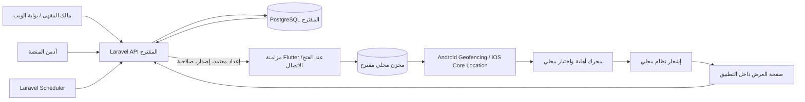
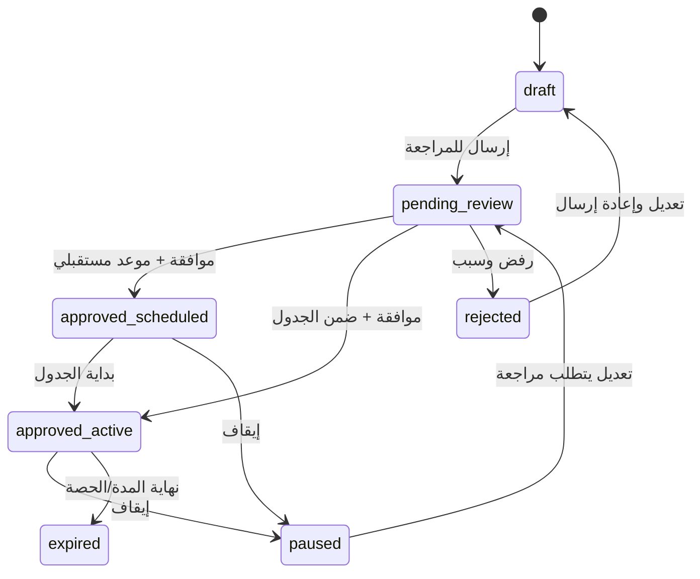
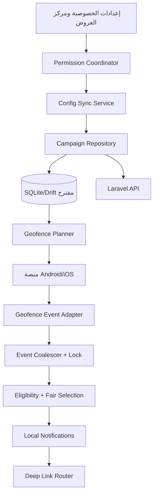
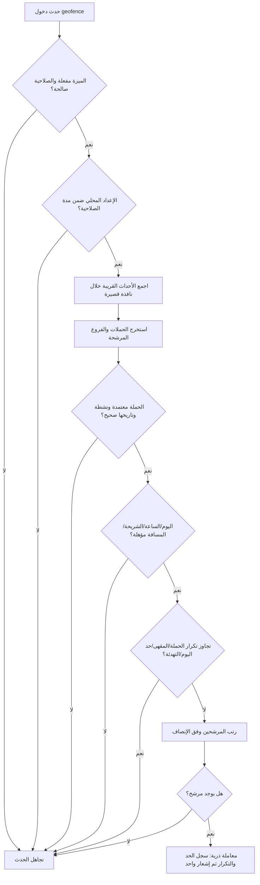

# تصميم نظام التنبيهات والعروض المعتمدة على الموقع

> **الحالة:** دراسة وتصميم مقترح فقط؛ لا توجد في هذا المستودع ميزة منفذة أو موافقة منتج نهائية عليها.  
> **النطاق:** تحليل المعمارية، التكاملات، البيانات، الأمان والخصوصية، التكاليف، القيود وخطة تنفيذ مستقبلية.  
> **الجمهور:** مالك المنتج، مطورو Flutter وLaravel، مهندس البنية التحتية ومراجع الخصوصية.

## 1. الملخص التنفيذي

يقترح هذا المستند ميزة ترسل تنبيهًا محليًا على هاتف العميل عندما يدخل نطاقًا قريبًا من مقهى، مع مراعاة حالة الحملة ومواعيدها وشريحة العميل، منع التكرار، حد يومي عام، وحد يومي لكل مقهى. يختار التطبيق المرشحين الموجودين في النطاق بطريقة عادلة، ويعرض تنبيهًا واحدًا عند تداخل نطاقات عدة مقاهٍ.

**التوصية:** إشعار محلي يصدره الهاتف بعد حدث geofence محلي، مع تنزيل إعدادات الحملات الموافق عليها من API عبر مزامنة دورية/عند فتح التطبيق. لا يرسل الهاتف طلبًا إلى الخادم عند كل دخول نطاق، ولا يرفع موقع العميل الدقيق. بذلك لا يعتمد قرار الإشعار على اتصال لحظي، وتبقى قواعد الحملة تحت تحكم الخادم. يظل الهاتف قادرًا على تطبيق إعداد مخبأ صالح عند انقطاع الشبكة، ضمن مدة صلاحية محدودة.

هذه الميزة ليست في نطاق V1 الحالي: وثيقة [نطاق المشروع](../PROJECT_SCOPE.md) تسجل أن قائمة المناطق ثابتة ويديرها الأدمن وأن فرز القرب عبر GPS مؤجل إلى V2. لذلك يلزم اعتماد تغيير النطاق قبل التطوير. كما أن المستودع الحالي لا يحتوي على Laravel backend فعلي أو تكامل موقع/إشعارات في تطبيق Flutter؛ المستندات تصف قرارات ومقترحات لا تنفيذًا قائمًا.

## 2. نتيجة فحص المستودع: الموجود والمفقود

| المجال | ما وجدته في المشروع | أثره على التصميم |
|---|---|---|
| تطبيق العميل | تطبيق Flutter/Dart في `cupback_mobile/`، واجهة Material، بيانات وحالة تجريبية محلية في `lib/core/state/app_state.dart` | إضافة الميزة ستكون ضمن Flutter مع تكامل أصلي Android وiOS أو إضافة Flutter موثوقة. |
| الحزم | `google_fonts` وتوطين Flutter وحزم واجهة؛ لم أجد حزم geofencing أو إشعارات محلية أو Firebase أو قاعدة محلية في `pubspec.yaml`/القفل | يلزم اختيار وإضافة الاعتمادات في مرحلة التنفيذ، بعد مراجعة الصيانة والتوافق. |
| Android | يوجد `AndroidManifest.xml`، لكن لا توجد أذونات موقع أو إشعارات أو geofence receiver في النسخة الحالية. قيم min/target SDK تحال إلى إعداد Flutter ولم تثبت من الملفات. | لا يصح افتراض صلاحيات أو دعم خلفية جاهز؛ يجب تثبيت إعدادات الإصدارات المستهدفة والتحقق من سياسات المتجر عند التنفيذ. |
| iOS | يوجد Runner، حد النشر المسجل iOS 15.0، ولا توجد مفاتيح وصف صلاحية الموقع في `Info.plist`. | إضافة geofence تتطلب شرحًا واضحًا في واجهة الاستخدام ومفاتيح صلاحية ومراجعة سلوك Core Location. |
| الخادم | لا توجد شيفرة Laravel أو routes/controllers/models/migrations في المستودع. Laravel 11+ وPostgreSQL/Redis خيارات موصوفة في وثائق التصميم. | كل endpoints والجداول والمهام في هذا التقرير مقترحة وليست موجودة. |
| قاعدة البيانات | `docs/DATABASE_DESIGN.md` مقترح SQL؛ `cafes` و`cafe_branches` لا يقدمان إحداثيات فرع جاهزة، ولا يوجد كيان لحملات قرب جغرافي | نحتاج إضافة موقع للفروع أو جدول إعداد حملة مرتبط بالفرع. لا يمكن بناء geofence من حقل العنوان النصي. |
| الحملات | مخطط `promotions` المقترح يدعم عروضًا وجدولة واستهدافًا وحالات، لكنه لا يعرّف نصف قطرًا/إحداثيات/مراجعة إدارية للحملات المكانية. | نعيد استخدام العرض كمصدر الحقيقة ونضيف إعدادات مكانية ومراجعة صريحة، دون تكرار قواعد الخصم. |
| الإشعارات | `docs/REALTIME_AND_NOTIFICATIONS.md` يقترح FCM للإشعارات البعيدة، لكنه ينتظر الموافقة. `fcm_device_token` مذكور كمقترح في تصميم البيانات فقط. | الإشعار المحلي المقترح لا يحتاج FCM. لا نعامل FCM كقرار منفذ أو شرط لهذه الميزة. |
| لوحة الويب | بوابة صاحب المقهى الموجودة في `cafe_owner_web/` نموذج محلي ببيانات وهمية حسب README، ولا يوجد فيها تكامل خادم. | واجهات إدارة الحملات المقترحة تحتاج API وصلاحيات وخادمًا حقيقيًا قبل الاستخدام التشغيلي. |
| وثائق متضاربة | `docs/PROJECT_MASTER_REPORT.md` يقترح بدائل تقنية مختلفة عن ADRs/`docs/` | يجب اعتماد مرجع معماري واحد قبل التنفيذ؛ هذا التقرير يتبع قرارات `docs/` ويفصل المقترح عن المعتمد. |

المراجع الداخلية ذات الصلة: [قرارات المعمارية](../ARCHITECTURE_DECISIONS.md)، [تصميم قاعدة البيانات](../DATABASE_DESIGN.md)، [توثيق API](../API_DOCUMENTATION.md)، [الأسئلة المفتوحة](../OPEN_QUESTIONS.md)، [الاتصالات والإشعارات](../REALTIME_AND_NOTIFICATIONS.md)، [نطاق المشروع](../PROJECT_SCOPE.md).

## 3. تعريف الميزة وحدودها

### 3.1 السيناريو

1. يوافق العميل صراحة على إشعارات القرب وصلاحية الموقع التي يحتاجها النظام.
2. أثناء استخدام التطبيق، يحدد التطبيق منطقة CupBack الحالية ويجلب إعدادات حملات صالحة ومقاهيها وإحداثياتها.
3. يسجل الهاتف نطاقات جغرافية للمقاهي القريبة التي يمكن للنظام مراقبتها.
4. عند دخول نطاق، يتحقق محرك محلي من أهلية الحملات، التوقيت، حدود الإشعار، سجل الإشعارات والقيود المحلية.
5. إن اجتاز أكثر من مقهى الشروط في فترة متقاربة، يختار التطبيق حملة واحدة وفق ترتيب ثابت ومنصف، ثم يعرض إشعارًا محليًا واحدًا.
6. الضغط على الإشعار يفتح صفحة المقهى/العرض داخل التطبيق. يبقى تطبيق الخصم على الطلب خاضعًا للتحقق النهائي على الخادم عند checkout؛ التنبيه لا يمنح خصمًا ولا يضمن الأهلية النهائية.

### 3.2 ما يدخل في MVP المقترح

- التنبيه عند الدخول إلى منطقة مقهى، وليس تتبع مسار المستخدم باستمرار.
- عروض نشطة ومعتمدة فقط، مرتبطة بفرع ذي إحداثيات صالحة.
- أوقات عمل الحملة والمنطقة الزمنية، أيام الأسبوع، شريحة العميل، حدود التكرار وفترة تهدئة.
- إشعار محلي واحد عند تداخل أحداث/نطاقات متقاربة.
- إعداد تشغيل/إيقاف عام من الأدمن كقاطع طوارئ، وإيقاف الميزة من إعدادات العميل.
- مزامنة إعدادات مخبأة ذات إصدار ومدة صلاحية، مع إبطال/حذف عند تغير المنطقة أو تسجيل الخروج.
- قياس محدود غير دقيق مثل عدد مرات عرض/فتح الإشعار إن تمت الموافقة على analytics؛ لا إحداثيات GPS خام ولا سجل حركة.

### 3.3 ما لا يدخل في المقترح الأول

- تتبع حي متواصل، رسم مسار الحركة، أو رفع موقع دقيق إلى الخادم.
- شراء الإعلان أو فوترة حسب الظهور/الزيارة، attribution تجاري، أو إثبات دخول العميل للفرع.
- ضمان وصول فوري أو ظهور التنبيه دائمًا؛ أنظمة التشغيل تدير وقت إبلاغ التطبيق عن geofence.
- الدفع الإلكتروني أو احتساب خصم خارج قواعد الطلب الموجودة.
- إرسال إشعار بعيد لكل دخول نطاق. ذلك يضيف تأخيرًا وشبكة واعتمادًا على APNs/FCM دون فائدة للقرار المحلي.
- أكثر من 15 geofence مسجلة في الوقت نفسه على الجهاز في النسخة الأولى، حتى يبقى السقف المشترك دون حد iOS الرسمي.

## 4. المعمارية الموصى بها



### 4.1 لماذا هذا الخيار

| النهج | المزايا | السلبيات | القرار |
|---|---|---|---|
| A. إشعار محلي وبيانات ثابتة داخل التطبيق | لا خادم ولا اتصال ولا كلفة إرسال لكل حدث | الحملات لا تتغير مركزيًا؛ يلزم تحديث التطبيق؛ لا يمكن إيقاف حملة بسرعة | غير مناسب لإدارة حملات فعلية. |
| B. إرسال موقع الهاتف للخادم عند كل حركة | تحكم مركزي وقياس لحظي نظريًا | جمع موقع حساس، استهلاك بطارية/شبكة، الاعتماد على الخلفية والاتصال، حمل/كلفة أعلى، ومشكلة وصول متأخر | مرفوض لهذه الحاجة. |
| C. خادم يزامن إعدادات + geofence محلي + إشعار محلي | يعمل دون اتصال، يقلل تسريب الموقع، ويحافظ على إدارة مركزية للحملات | يجب إدارة cache والتصاريح وقيود الأنظمة؛ الإبطال ليس لحظيًا على جهاز غير متصل | **موصى به.** |
| D. C بالإضافة إلى FCM/APNs لكل عرض | يصلح لتنبيهات عامة مستقلة عن مكان المستخدم أو قاطع طوارئ عند اتصال الجهاز | كلفة/تعقيد إضافيان، لا يثبت القرب، وقد يصل متأخرًا أو يتأثر بتفضيلات المستخدم | توسعة اختيارية لاحقًا؛ ليس شرطًا لإشعار القرب. |

استخدام Laravel Scheduler لتحديث/انتهاء الحملات مناسب للأعمال المجدولة، ويمكن وضع أعمال ثقيلة مثل معالجة صور/تجميع إحصاءات في Laravel queues. لا حاجة لإرسال Job لكل دخول نطاق؛ حدث الدخول يعالجه الهاتف. هذه توصية معمارية تعتمد Laravel المقترح في ADRs، وليست بنية منشورة حاليًا. [Laravel Task Scheduling](https://laravel.com/docs/12.x/scheduling) و[Laravel Queues](https://laravel.com/docs/12.x/queues).

## 5. تدفق إنشاء الحملة والموافقة

1. مالك المقهى ينشئ عرضًا عاديًا أو يختار عرضًا موجودًا ثم يفعّل خيار **«إرسال تنبيه عند الاقتراب»**.
2. يحدد الفرع، نطاقًا بالأمتار، فترة العرض، أيام/ساعات الإرسال، شريحة العملاء، الحد اليومي، فترة التهدئة، عنوان/نص التنبيه والرابط الداخلي.
3. النظام يتحقق أن الفرع مملوك لهذا الحساب وله إحداثيات، وأن النطاق ضمن الحدود التي يحددها المنتج، وأن المحتوى لا يتجاوز قيود النظام.
4. تحفظ الحملة كـ `draft`، ثم `pending_review`. لا يحق لصاحب المقهى نشر رسالة geofence من تلقاء نفسه في MVP المقترح.
5. أدمن المنصة يعاين الاسم والنص والصورة والموقع والنطاق والجدولة، ويختار **اعتماد** أو **رفض مع سبب** أو **إيقاف فوري**.
6. بعد الاعتماد فقط تدخل الحملة في config sync. التعديلات الجوهرية على النص/الموقع/النطاق تعيدها للمراجعة. تغيير السعر أو قواعد العرض يخضع كذلك لقواعد API/الخصومات.
7. عند تعديل أو تعليق أو انتهاء الحملة، يزداد إصدار إعدادات المنطقة، ويصدر tombstone/حذف للمزامنة القادمة. عند اتصال الأجهزة فقط يمكن وصول التغيير إليها؛ حتى ذلك الوقت تُطبق مدة صلاحية قصيرة للإعداد المحلي.



**قاعدة نشر:** اعتماد المحتوى والموقع شيء غير تفعيل العرض التجاري في checkout. يجب أن يتحقق الخادم من تفعيل العرض، حدوده، استنفاد استخدامه، أهلية العميل والسعر عند الطلب. لا يثق بالخدمة في الهاتف.

## 6. إدارة الميزة في لوحة الويب

### 6.1 صفحة حملات الموقع لصاحب المقهى

محتوى الصفحة المقترح:

- جدول الحملات بأعمدة: اسم العرض، الفرع، الحالة، المراجعة، بداية/نهاية، النطاق، عدد الإشعارات/الفتح (إن أجيز القياس)، وآخر تعديل.
- شريط فلاتر: الحالة، الفرع، تاريخ البداية والنهاية، النوع، بحث بالاسم.
- زر **حملة جديدة**، وأزرار الصف **عرض**، **تعديل**، **إيقاف مؤقت**، **نسخ**، **الأداء**.
- شارات حالات واضحة: مسودة، بانتظار المراجعة، معتمد مجدول، نشط، موقوف، مرفوض، منتهي، مستنفد.
- لا يظهر زر «نشر» لصاحب المقهى؛ الزر هو **إرسال للمراجعة**. عند الرفض يظهر سبب الرفض وما يحتاج إصلاحًا.
- عند الإيقاف يظهر تأكيد يشرح أن الأجهزة غير المتصلة قد تحتفظ بإعداد مخبأ إلى أن تنتهي صلاحيته.

### 6.2 نموذج حملة جديدة/تعديل

الحقول والأزرار المقترحة:

| الحقل/الزر | السلوك |
|---|---|
| **اسم داخلي للحملة** | مطلوب، لا يظهر للعميل. |
| **اختيار العرض** | يعيد استخدام عرض promotions، ولا ينشئ تسعيرًا ثانيًا. يعرض نوع الخصم وقيمته والحد الأدنى وتاريخ الصلاحية. |
| **اختيار الفرع** | قائمة فروع المقهى المخول فقط. يمنع الاختيار إن كانت إحداثيات الفرع ناقصة. |
| **خريطة معاينة + دائرة** | توضيح مكان الدبوس والدائرة؛ إذا تغير الدبوس، يحفظ كموقع الفرع بعد صلاحية مستقلة، لا كتغيير خفي في الحملة. الخريطة اختيارية وقد تتطلب مزود خرائط؛ لا حاجة لـ Google Maps API في تشغيل geofence نفسه. |
| **نطاق التنبيه (متر)** | قيمة مقيدة بخيارات معتمدة (مثال أولي: 100–500 م؛ يقرر المنتج النطاق النهائي بعد اختبار ميداني). تظهر ملاحظة أن دقة التشغيل تختلف ولا يوجد ضمان دخول عند مسافة هندسية دقيقة. |
| **عنوان الإشعار** | مطلوب وقصير، معاينة عدد الأحرف. |
| **نص الإشعار** | مطلوب، بلا بيانات حساسة، يعرض معاينة باللغة العربية والاتجاه RTL. |
| **الأيام والساعات** | أيام الأسبوع، وقت بداية/نهاية، المنطقة الزمنية الافتراضية منطقة الفرع؛ دعم فترة تعبر منتصف الليل بوضوح. |
| **التواريخ** | بدء وانتهاء، مع تعطيل الحملة تلقائيًا بعد الانتهاء. |
| **الشريحة** | كل العملاء/جدد/عائدون/متكررون/عملاء محددون وفق تعريفات CRM الحالية. لا تستخدم بيانات خارج مقهى صاحب الحملة. |
| **حد الإرسال لكل عميل** | يوميًا للحملة، مع مدة تهدئة دنيا قابلة للضبط. |
| **زر حفظ كمسودة** | يتحقق من الحقول ويحفظ بلا إرسال. |
| **زر معاينة** | يعرض شكل الإشعار على الهاتف؛ لا يرسل إشعارًا حقيقيًا. |
| **زر إرسال للمراجعة** | يثبت الحقول، يسجل نسخة المحتوى، ويغير الحالة إلى `pending_review`. يعرض ملخص مراجعة قبل التأكيد. |
| **إلغاء** | يرجع للقائمة ويحذر من فقد تغييرات غير محفوظة. |

التحكم البصري العام (الألوان والخطوط والصور) يخص صفحة المقهى العامة فقط ولا يغير شكل إشعار نظام التشغيل؛ إشعارات OS تستخدم أيقونة/قالب المنصة. صورة العرض تظهر بعد فتح التطبيق ولا يلزم تنزيلها في الخلفية.

### 6.3 صفحة المراجعة للأدمن — ضمن تصميم المستقبل لا ضمن تنفيذ هذا التقرير

مع أن لوحة الأدمن مؤجلة في المنتج، يحتاج النظام جهة اعتماد مركزية. شاشة المراجعة تعرض محتوى الرسالة، العرض، الفرع/الإحداثيات، الدائرة على خريطة، النطاق، الجمهور، الفترة، وسياسة الإرسال. الأزرار: **اعتماد**، **رفض** مع سبب إلزامي، **إيقاف الآن**، **سجل المراجعات**. جميع القرارات تكتب actor/time/old/new/reason في سجل تدقيق. لا تتجاوز التوصية قرارًا تجاريًا قائمًا حول صلاحيات الأدمن؛ هذه إضافة صلاحيات/تدفق مقترحة.

## 7. مكونات Flutter والهاتف



**مسؤوليات الوحدات:**

- `Permission Coordinator`: يطلب الصلاحية في سياق مفهوم وبالحد الأدنى، ويتعامل مع رفض/تقريب الموقع وإيقاف الخدمة.
- `Config Sync Service`: يرسل معرف المنطقة وإصدار cache، لا إحداثيات العميل الدقيقة؛ يطبق ETag وdelta/deletion.
- `Campaign Repository`: مصدر واحد لحالة الحملات المحلية؛ يخزن نسخة الإعداد ومتى تنتهي صلاحيتها.
- `Geofence Planner`: يرتب الفروع القريبة ويسجل حدًا أعلى قدره **15** نطاقًا نشطًا على الجهاز في MVP.
- `Event Coalescer`: يجمع callbacks المتقاربة زمنيًا ويمنع أكثر من إشعار في معاملة واحدة.
- `Eligibility + Fair Selection`: يطبق جميع شروط الأهلية والتكرار محليًا قبل إصدار إشعار.
- `Local Notifications`: قناة Android وفئة iOS مناسبة، معرف إشعار ثابت/غير متصادم، ونص قابل للفتح deep link.
- `Deep Link Router`: يعيد المستخدم لصفحة العرض المناسبة بعد النقر، مع فحص صلاحيتها مجددًا من API عند توفر الشبكة.

### 7.1 اختيار النطاقات المسجلة

- عند اختيار منطقة CupBack أو فتح التطبيق، يستخدم التطبيق موقعًا foreground لتحديد أقرب الفروع فقط إذا وافق العميل على ذلك.
- لا تسجل كل فروع الدولة. سجل أقرب 15 geofence مؤهلًا ضمن المنطقة/المدينة الحالية، مع هامش مسافة محسوب لدقة الموقع. منطقة CupBack هي مدخل تصفية، وليست بديلًا عن الإحداثيات.
- عند انتقال العميل إلى منطقة أخرى، احذف القديم وسجل النطاقات الجديدة. حدث التسجيل عند فتح التطبيق/عودة foreground، وبعد تغييرات config المهمة، وليس عبر polling GPS دائم.
- إذا رفض المستخدم الصلاحية أو اختار approximate location، أوقف ميزة القرب بأدب مع بقاء قائمة المقاهي والعروض العادية متاحة. لا تكرر نافذة الإذن بإلحاح.
- اجعل إشعارات القرب قابلة للإيقاف من إعدادات الحساب/الخصوصية. حذف التطبيق/تسجيل الخروج يزيل تسجيلات المستخدم وبياناتها المحلية قدر الإمكان.

### 7.2 مخطط قرار الهاتف



### 7.3 قواعد الأهلية والتكرار

يتحقق المحرك محليًا، بالترتيب، من:

1. تفعيل المفتاح العام من config، وتفعيل المستخدم للميزة، وصلاحية النظام الضرورية.
2. وجود cache غير منتهٍ؛ وحالة approved/active وعدم وجود تعطيل/حذف معروف.
3. وقت الجهاز بالنسبة لفترة الحملة، أيام الأسبوع والمنطقة الزمنية للفرع. إن كان وقت الجهاز غير موثوق/غير واضح، يطبق انتهاء cache محافظًا ويؤجل الحملة عند الشك بدل إرسالها بعد انتهائها.
4. انتماء المستخدم لشريحة الجمهور حسب snapshot متزامن. لا يفترض الهاتف بيانات طلبات/CRM غير موجودة في cache.
5. دخول نطاق geofence. لا تقارن GPS خامًا كل دقيقة؛ سجلات النظام هي محفز أولي. لا يمكن ضمان دقة مسافة مثالية بسبب قيود OS ودقة الموقع.
6. عدم إشعار المستخدم بالحملة نفسها سابقًا ضمن الحد المحدد، وعدم تجاوز الحد اليومي العام، وحد المقهى اليومي وفترة التهدئة.
7. قفل/معاملة محلية ذرية حول اختيار المرشح واستهلاك الحد لمنع دخول حدثين متزامنين من تجاوز السقف.

مفاتيح منع التكرار المقترحة: `campaign_id + local_day + customer/device scope`، و`cafe_id + local_day`، و`global + local_day`. تحدد قواعد المنتج هل السقف يطبق على حساب العميل أم الجهاز؛ المفضل حساب العميل عند تسجيل الدخول، ومعرف تثبيت عشوائي مخصص عند عدمه، دون بصمة جهاز.

**ملاحظة جوهرية:** حد يومي محلي على الهاتف يمنع التكرار لهذا الجهاز/الحساب فقط. لا يضمن سقفًا عامًا مشتركًا عبر عدة أجهزة للعميل أثناء offline. إذا تطلبت السياسة سقفًا مركزيًا دقيقًا، يلزم اتصال عند إصدار الإشعار أو نقل القرار للخادم، ما يغير الخصوصية/الاعتمادية والتصميم. نوصي بتعريف الحد اليومي في MVP على أنه حد جهاز/حساب محلي، مع حد استهلاك العرض الحقيقي والتحقق النهائي مركزيًا عند checkout.

### 7.4 عدالة الاختيار عند تعدد المقاهي

لا يعتمد التطبيق على ترتيب callbacks. عند عدة أحداث في نافذة تجميع قصيرة (مثل 20–30 ثانية، قيمة أولية للتجربة)، يستبعد غير المؤهل ثم يرتب المرشحين كالتالي:

1. أولوية الحملة التي يحددها الأدمن ضمن نطاق محكوم.
2. المقهى الأقل حصولًا على إشعارات هذا العميل في آخر 7 أيام.
3. الأقل إشعارًا لهذا العميل في اليوم الحالي.
4. الأقرب بناءً على بيانات النطاق/الموقع المتاحة محليًا كعامل كسر تعادل، لا كقياس مضمون.
5. تدوير ثابت باستخدام `last_notified_at` ثم ID ثابت لتجنب التذبذب.

تُجرى عملية الاختيار وتحديث العداد المحلي في معاملة واحدة. يعاد التقييم إذا تغيرت قائمة الأحداث قبل إصدار الإشعار. لا ترسل إشعارين من حدثين متزامنين. سجّل نتيجة الاختيار/الاستبعاد محليًا بأكواد أسباب مختصرة فقط، واحتفظ بها مدة قصيرة محددة.

### 7.5 العمل دون اتصال

- الإعدادات تحمل `config_version`, `generated_at`, `valid_until`, `global_enabled`, قائمة الحملات ومواقع/أنصاف أقطار الفروع اللازمة فقط، وtombstones للحذف.
- عند اتصال التطبيق/عودته foreground: اطلب delta باستخدام الإصدار السابق، أو استجابة كاملة إذا انتهت صلاحية/تغيرت المنطقة. استخدم `ETag`/`If-None-Match` كي لا ينزل الملف كاملًا عند عدم وجود تغيير.
- مدة الصلاحية المقترحة مبدئيًا **24 ساعة**، قابلة للتعديل وفق تجربة الإبطال وحمل الخادم. عند انتهائها، لا تنفذ geofence محليًا حتى تنجح مزامنة؛ يمكن للتطبيق عرض العروض المعتادة عند فتحه.
- الإيقاف الطارئ على الخادم لا يصل لهاتف بلا اتصال قبل عودته أو انتهاء lease. لا توجد آلية تقنية تحقق kill switch فوريًا على جهاز معزول وهو غير متصل. يجب إظهار هذا الحد بوضوح في تشغيل المنتج.
- لا تخزن أكثر من الحد اللازم من بيانات الجمهور. لا تخزن سجل الطلبات الكامل أو GPS خامًا لأجل قرار التنبيه.

## 8. مخطط قاعدة البيانات المقترح

هذه إضافة على **مخطط الوثائق فقط**. المبدأ: كيان `promotions` المقترح يظل مصدر نص الخصم، الأهلية والجدولة. كيانات الموقع تصف مكان/طريقة تنبيه الحملة.

### 8.1 الجداول/الحقول

#### تعديل `cafe_branches` المقترح

```text
latitude             DECIMAL(9,6) NULL
longitude            DECIMAL(9,6) NULL
location_verified_at TIMESTAMP NULL
location_source      VARCHAR NULL
```

تحقق من المجال `-90..90` و`-180..180`، الإحداثيات غير صالحة تمنع التقديم. لا تخزن كل حركة العميل؛ هذه إحداثيات ثابتة تخص فرعًا تجاريًا. استخدم نوع geography/index مكانيًا إذا تطلب البحث على الخادم ذلك؛ تشغيل geofence بالهاتف وحده لا يفرض مزود خرائط.

#### `location_campaign_settings` (مقترح 1:1 مع promotion)

```text
id UUID PK
promotion_id UUID FK UNIQUE
cafe_id UUID FK
branch_id UUID FK
enabled BOOLEAN
radius_meters SMALLINT
notification_title VARCHAR(80)
notification_body VARCHAR(180)
priority SMALLINT DEFAULT 0
cooldown_hours SMALLINT
max_per_customer_per_day SMALLINT
review_status ENUM('pending_review','approved','rejected','suspended')
reviewed_by UUID NULL
reviewed_at TIMESTAMP NULL
review_reason TEXT NULL
approved_content_hash VARCHAR NULL
created_at / updated_at / deleted_at
```

قيود: `branch_id` تابع لنفس `cafe_id`، النطاق موجب وداخل range تنظيمي، عنوان/متن غير فارغين، إعداد واحد لكل promotion/branch حسب قرار تعدد الفروع النهائي. يمنع تغيير `branch_id`, `radius_meters`, title/body بعد الاعتماد دون إعادة المراجعة.

#### `location_config_versions` (مقترح)

```text
scope_type ENUM('global','area')
scope_id UUID NULL
version BIGINT
global_enabled BOOLEAN
generated_at TIMESTAMP
valid_until TIMESTAMP
updated_at TIMESTAMP
UNIQUE(scope_type, scope_id)
```

الإصدار/التفعيل العام يمكّن cache validators والإيقاف المركزي عند المزامنة التالية. إذا كانت قائمة الحملات كبيرة، افصل مواد snapshot إلى جدول/تخزين cache بدل عمود JSON دائم؛ لا تجعل Redis مصدر الحقيقة.

#### التدقيق والأداء (خيارات)

- استخدم سجل التدقيق العام المقترح في وثائق الأمان إن وجد بعد التحقق من شكله. وإلا أنشئ `location_campaign_review_events` يحفظ actor، الفعل، السبب، المحتوى/الإصدار السابق والجديد والتوقيت.
- لا حاجة لتسجيل حدث geofence على الخادم في MVP الموصى به. إن وافق المنتج على analytics، خزّن أحداثًا مجمعة مثل impression/open بمعرف حملة/يوم/منطقة coarse، دون lat/lon أو معرف دائم غير لازم، مع retention وحذف محددين.
- جداول counters المركزية ضرورية فقط لو تغيّرت السياسة لحد عالمي فعلي؛ التصميم الحالي لا يدعي ذلك.

### 8.2 سلامة بيانات الحملة

`promotions.start_at/end_at`, أيام الأسبوع، ساعات اليوم، الشريحة، سقوف العرض واستخدامه تظل قواعد الخادم المرجعية. تحفظ أوقات UTC مع `timezone` IANA للفرع/الحملة لتفسير الجدول. يجب توحيد تعريف `active` بين مستهلك config وcheckout، وتصفية query في الخادم على حالة المراجعة + تفعيل العرض + نافذة الجدولة + الإيقاف العام. السجل الناقص لا يتحول إلى حملة نشطة افتراضيًا.

## 9. API مقترح

لا توجد endpoints لهذه الميزة في `docs/API_DOCUMENTATION.md` ولا كود API فعلي. المسارات التالية أمثلة تحتاج مواءمة مع أسماء المسارات الحالية ومراجعة صلاحيات Sanctum/tenant scope المقترحة في ADRs.

### 9.1 إدارة صاحب المقهى

| Method + path (مقترح) | الغرض | الصلاحية المقترحة |
|---|---|---|
| `GET /api/v1/cafe-management/location-campaigns` | قائمة حملات مقاهي المستخدم مع فلاتر page/status/branch/date | عضو مقهى نشط + `manage_promotions` |
| `POST /api/v1/cafe-management/location-campaigns` | إنشاء/ربط إعداد geofence بالعرض والفرع | `manage_promotions`؛ يصبح `pending_review` فقط عند submit |
| `GET /api/v1/cafe-management/location-campaigns/{id}` | تفاصيل/أسباب مراجعة | نفس tenant scope |
| `PATCH /api/v1/cafe-management/location-campaigns/{id}` | تعديل draft/rejected، أو طلب إعادة مراجعة للتغييرات الجوهرية | نفس المقهى وصلاحية تعديل |
| `POST /api/v1/cafe-management/location-campaigns/{id}/submit-review` | تجميد نسخة المراجعة وإرسالها | `manage_promotions` |
| `POST /api/v1/cafe-management/location-campaigns/{id}/pause` | طلب إيقاف حملة من المالك | مالك الحملة؛ الإيقاف يسري على الخادم فورًا والمزامنة بعد اتصال العميل |

### 9.2 إعدادات المراجعة والتحكم المركزي

| Method + path (مقترح) | الغرض |
|---|---|
| `GET /api/v1/admin/location-campaigns?status=pending_review` | قائمة المراجعة للأدمن. |
| `POST /api/v1/admin/location-campaigns/{id}/approve` | اعتماد نسخة محتوى/موقع ثابتة + إنشاء audit + bump config version. |
| `POST /api/v1/admin/location-campaigns/{id}/reject` | رفض مع سبب إلزامي + audit. |
| `POST /api/v1/admin/location-campaigns/{id}/suspend` | تعليق/إيقاف مركزي طارئ + bump version. |
| `PATCH /api/v1/admin/location-notification-settings` | global enable/disable، الحد الأعلى للنطاق والـ lease، مع حماية وتدقيق. |

هذه القدرات للأدمن جزء من معمارية الإشراف المطلوبة، مع أن تنفيذ لوحة الأدمن مستبعد من نطاق العمل الحالي ومؤجل في النقاش السابق.

### 9.3 إعدادات المزامنة للعميل

`GET /api/v1/customer/location-campaign-config?area_id={id}` (مقترح). لا يرسل lat/lon. يطلبه مستخدم مصادق؛ إذا دعمنا anonymous لاحقًا فيجب تعريف سياسة جهاز واضحة.

Headers:

```http
Authorization: Bearer <sanctum-token>
If-None-Match: "area-<id>-v42"
Accept: application/json
```

استجابة `200` مبسطة:

```json
{
  "config_version": 43,
  "generated_at": "2026-11-11T08:00:00Z",
  "valid_until": "2026-11-12T08:00:00Z",
  "global_enabled": true,
  "timezone": "Africa/Cairo",
  "deleted_campaign_ids": ["cmp-old"],
  "campaigns": [
    {
      "campaign_id": "cmp-123",
      "promotion_id": "promo-456",
      "cafe_id": "cafe-12",
      "branch_id": "branch-9",
      "branch_latitude": 30.0444,
      "branch_longitude": 31.2357,
      "radius_meters": 180,
      "title": "قهوة اليوم بخصم خاص",
      "body": "افتح التطبيق لمعرفة تفاصيل العرض",
      "deep_link": "cupback://cafes/cafe-12/offers/promo-456",
      "starts_at": "2026-11-11T08:00:00Z",
      "ends_at": "2026-11-20T22:00:00Z",
      "timezone": "Africa/Cairo",
      "weekday_mask": [1, 2, 3, 4, 5, 6, 7],
      "daily_start": "08:00",
      "daily_end": "22:00",
      "audience": "returning_customers",
      "max_per_customer_per_day": 1,
      "cooldown_hours": 24,
      "priority": 0
    }
  ]
}
```

`304 Not Modified` عند تطابق ETag. لا يرسل الخادم IDs حساسة للعملاء المستهدفين؛ يرسل تعريف segment code ويطبق التطبيق نسخة أهلية CRM المسموح بها، أو يقرر المنتج قصر نسخة segment على قواعد يستطيع الخادم إعدادها محليًا. سجّل الردود بمعدل محدد، وطبّق tenant/area scope، وحدود حجم payload، ومخطط إصدار واضح. لا تعِد بيانات العرض كاملة إذا كانت واجهة المقهى/العروض تجلبها من API منفصل.

## 10. تكامل أنظمة التشغيل والصلاحيات

### 10.1 Android

- Geofencing API يتطلب صلاحيات موقع دقيقة؛ على Android 10+ يلزم `ACCESS_BACKGROUND_LOCATION` لمعظم سيناريوهات geofence في الخلفية. Android 11+ يطلب من المستخدم منح الخلفية من صفحة إعدادات منفصلة، وقرار approximate يظل approximate حتى في الخلفية.
- Android 13+ يتطلب `POST_NOTIFICATIONS` runtime permission لعرض الإشعارات العادية.
- يوجد حد رسمي 100 geofence لكل تطبيق/مستخدم على الجهاز. الحد المقترح 15 هو حد المنتج المحافظ المشترك مع iOS، وليس السقف التقني لأندرويد.
- دليل Android يوصي بنصف قطر لا يقل عادة عن 100 متر، وقد تتأخر أحداث الخلفية؛ لا تعرض للمستخدم أو المقهى وعدًا بدقة بوابة دخول أو توقيت مضمون.
- صلاحية الخلفية تخضع لسياسة Google Play: يجب أن تكون الميزة أساسية ومبررة، مع إفصاح واضح ومراجعة متطلبات المتجر. موافقة المستخدم وحدها لا تضمن الموافقة على النشر.
- يجب إعادة إنشاء geofences عند فتح التطبيق/بعد التحديث أو إعادة التثبيت؛ Google Play Services يزيلها في حالات reset/update/uninstall/force-restart المذكورة في API.

المراجع: [Android Geofencing](https://developer.android.com/develop/sensors-and-location/location/geofencing)، [صلاحيات الموقع](https://developer.android.com/develop/sensors-and-location/location/permissions)، [صلاحية الخلفية](https://developer.android.com/develop/sensors-and-location/location/permissions/background)، [صلاحية الإشعار Android 13+](https://developer.android.com/develop/ui/compose/notifications/notification-permission)، [GeofencingClient](https://developers.google.com/android/reference/com/google/android/gms/location/GeofencingClient).

### 10.2 iOS

- Core Location يدعم مراقبة المناطق لكنه يحدد **20 شرط/منطقة لكل تطبيق**؛ لذلك حد 15 شاملًا هوامش إدارة مناسب كبداية.
- يجب طلب صلاحية الموقع المناسبة لعمل الميزة في الخلفية وتقديم purpose strings صريحة ومفهومة. اطلب When In Use أولًا، ثم Always فقط إذا أثبتت الوظيفة أنها ضرورية وأوضح التطبيق سببها.
- النظام قد يوقظ التطبيق عند تغير المنطقة، لكن توقيت الاستدعاء مرتبط بالنظام والظروف. عند إعادة التشغيل لا تعاد المراقبة قبل فتح الجهاز؛ يجب أن يعيد التطبيق بناء تسجيلاته عند تشغيله/استئنافه. لا نعتمد على callback لحظي أو نعد به.
- إشعار محلي يمكن جدولتُه/إصداره من الجهاز؛ لا يحتاج خادم push أو شبكة وقت العرض. يلزم إذن إشعارات منفصل بحسب تجربة iOS.
- عند رفض Always أو إيقاف Location Services/Background App Refresh قد تقل/تتوقف قدرة الخلفية. تظل وظيفة تصفح العروض يدويًا متاحة.

المراجع: [Core Location region monitoring](https://developer.apple.com/documentation/CoreLocation/monitoring-the-user-s-proximity-to-geographic-regions)، [طلب Always authorization](https://developer.apple.com/documentation/corelocation/cllocationmanager/requestalwaysauthorization()), [تحديث الموقع في الخلفية](https://developer.apple.com/documentation/corelocation/handling-location-updates-in-the-background)، [جدولة إشعار محلي](https://developer.apple.com/documentation/UserNotifications/scheduling-a-notification-locally-from-your-app).

### 10.3 ما الذي يحتاج APNs/FCM؟

| الحالة | هل يلزم APNs/FCM؟ | التفسير |
|---|---|---|
| كشف دخول نطاق وإظهار إشعار على الهاتف | لا | OS geofence يحفز التطبيق والإشعار محلي. |
| إعدادات الحملات | لا؛ يلزم API عادي عند المزامنة | يحدّث التطبيق snapshot عند فتحه/اتصاله. |
| تحديث فوري لحملة على جهاز متصل بالخلفية | ليس في النهج المقترح | يمكن إضافة push كإشارة «زامن config»، مع بقاء الإعداد API مصدر الحقيقة. لا حاجة لإرسال نص الحملة عبر push. |
| رسالة عامة/حالة طلب بعيدة عندما لا يعمل التطبيق | نعم لخدمة push | FCM خيار موثق لكنه ما زال مقترحًا في المشروع؛ على iOS يستخدم APNs عبر FCM إن اختير. |

FCM موصوف من Firebase كخدمة بلا تكلفة استخدام مباشرة، لكن ذلك لا يجعل تشغيل التطبيق مجانيًا: قواعد البيانات والخادم والتخزين والاتصال/العمليات لها تكاليفها. [أسعار Firebase](https://firebase.google.com/pricing/)، [إعداد FCM مع Flutter](https://firebase.google.com/docs/cloud-messaging/flutter/get-started)، [تسجيل APNs](https://developer.apple.com/documentation/usernotifications/registering-your-app-with-apns)، [خادم APNs](https://developer.apple.com/documentation/usernotifications/setting-up-a-remote-notification-server). يمكن لـ APNs تخزين/تأخير/تقييد الطلبات؛ لذلك لا يضمن push وصولًا فوريًا. [إرسال طلبات APNs](https://developer.apple.com/documentation/usernotifications/sending-notification-requests-to-apns).

## 11. الخصوصية والأمان

- **تقليل البيانات:** لا يرفع التطبيق latitude/longitude الخاص بالعميل ولا يسجل مساره. GPS يُستخدم محليًا لفرز/تسجيل أقرب geofences.
- **إذن مفهوم:** قبل نافذة النظام، شاشة تفسير تشرح: ما الذي سيحدث، لماذا صلاحية الخلفية مطلوبة، كيف توقف الميزة، وأن الدقة والتوقيت غير مضمونين.
- **اختيار اختياري:** إبقاء استكشاف المقاهي والطلبات والعروض اليدوية قائمًا بلا موقع. رفض الإذن ليس سببًا لتعطيل حساب CupBack.
- **أقل صلاحية:** API مزامنة read-only للعميل على منطقته وعروضه المسموح بها؛ لا يسمح بتعديل حملة أو فرع عبر endpoint المزامنة.
- **عزل المستأجر:** كل mutations لصاحب المقهى تتحقق في الخادم من cafe membership/permission وملكية branch/campaign، ولا تعتمد على `cafe_id` المرسل وحده. تحقق من الصلاحية داخل كل query وليس في الواجهة فقط.
- **المراجعة:** لا يدرج config إلا الحملات approved. توقيع/نسخة المحتوى يمنع تغيير النص أو الموقع بعد الموافقة دون إعادة مراجعة.
- **التدقيق:** سجّل من أنشأ/غيّر/أوقف/اعتمد الحملة والسبب والتوقيت. لا تحفظ بيانات موقع العميل في log.
- **التخزين:** DB محلي مقترح للـ cache وسجل التكرار؛ مخزن آمن للنظام للـ access token فقط. امسح بيانات الحساب/campaign cache عند logout أو تبديل الحساب، واحترم طلب حذف الحساب وفق سياسة المنتج.
- **الإشعار المقفول:** نص عام لا يكشف مشتريات أو شريحة حساسة. لا تضع قيمة الخصم كضمان، ولا معلومات شخصية.
- **ضوابط إساءة الاستخدام:** حدود طول النص/معدل التقديم، منع الروابط التعسفية، تحديد radius/priority، كشف الحملات المكررة، ومفتاح إيقاف عام محمي بصلاحية admin مع audit.
- **الاحتفاظ:** مدة cache لا تتجاوز صلاحية config؛ سجلات محلية قصيرة؛ قياس مجمع بأقل مدة لازمة. يحتاج المنتج/القانون تحديد سياسة retention والخصوصية قبل الإطلاق.
- **التعامل مع الوقت:** افترض أن ساعة الجهاز قد تكون خاطئة؛ صلاحية snapshot والخادم يحميان من استمرار حملة منتهية. Checkout يعيد تقييم كل شروط العرض على الخادم.

## 12. الأداء والاعتمادية

- config حسب `area_id` ونسخة/ETag، وليس نسخة كاملة من كل حملات المنصة.
- pagination/حد أعلى للحملات وإحداثيات الفروع في response. انقل التفاصيل/الصورة إلى API المقهى عند فتح التنبيه.
- لا يوجد endpoint لكل callback جغرافي؛ هذا يلغي نمط traffic burst عند خروج آلاف المستخدمين من حدث عام.
- استخدم delta + tombstones، ضغط HTTP، ومدة cache قصيرة قابلة للتهيئة. استعمل Redis cache/queue عند الحاجة وفق القرارات، لكن PostgreSQL المقترح يبقى مصدر الحقيقة.
- منع التكرار محليًا مع transaction/lock لأن النظام قد يرسل callbacks متوازية.
- تتعامل طبقة التسجيل مع سقوف OS والأخطاء (location off، permission denied، exceeded limit) دون crash، وتعيد المحاولة عند استئناف foreground.
- راقب مؤشرات خالية من الموقع الدقيق: نجاح المزامنة، حجم config، أخطاء تسجيل النطاق، callbacks، إشعارات مجمعة، فتحات من deep link، وانتهاء cache. لا تستخدم impression كقياس حضور/دخول مؤكد.

## 13. تقدير الطلبات وحركة البيانات

هذه أمثلة تخطيطية وليست تسعيرة استضافة. الافتراضات: 30 يومًا، 3 محاولات مزامنة لكل مستخدم نشط يوميًا، 50 KB لحزمة كاملة، أو 0.5 KB تقريبيًا لاستجابة 304 قبل احتساب التفاصيل الدقيقة للـ HTTP/TLS. الطلبات أدناه تخص المستخدمين النشطين؛ الأجهزة غير النشطة لا تزامن في هذا التقدير.

| السيناريو | مستخدمون مسجلون | نشطون يوميًا (افتراض) | طلبات sync بالشهر | تنزيل كامل افتراضيًا (50 KB لكل محاولة) | 304 تقريبيًا (0.5 KB لكل محاولة) |
|---|---:|---:|---:|---:|---:|
| صغير | 1,000 | 200 | 18,000 | 0.9 GB | 9 MB |
| متوسط | 10,000 | 2,000 | 180,000 | 9 GB | 90 MB |
| كبير | 50,000 | 10,000 | 900,000 | 45 GB | 450 MB |
| نمو | 100,000 | 20,000 | 1,800,000 | 90 GB | 900 MB |

الصيغة: `DAU × 3 × 30`. الرقم الفعلي يتوقف على فتح التطبيق، سياسات المزامنة، تغيّر الحملات، وحجم الرؤوس/الضغط/الـ delta. مع ETag لا تنقل الحزمة الكاملة عند عدم التغيير؛ هذا لا يلغي تكلفة API أو TLS أو logs. قد يقل عدد المحاولات إذا اقتصر sync على فتح/استئناف التطبيق مع backoff. لا توجد أرقام تكلفة شهرية موثوقة قبل اختيار مزود الاستضافة، حجم DB، البيئة/النسخ الاحتياطية، عدد العمال ومعدل استخدام فعلي. FCM نفسه بلا كلفة مباشرة وفق صفحة Firebase؛ يظل الخادم والتخزين/الشبكة مدفوعًا حسب المزود. لا يحتاج geofence إلى خرائط Google؛ تكلفة Maps تظهر فقط إذا أضيفت خريطة تفاعلية تعتمد مزودًا مدفوعًا.

### 13.1 النمو المتوقع على مستوى المنتج

- **أقل من 1k DAU:** API مزامنة عادي وDB القائمة، بلا queue لهذه الوظيفة، مع cache validators.
- **1k–10k DAU:** فهرسة area/status، مراقبة أزمنة API، ضغط/delta config، وcache قصير عند الحاجة.
- **10k–50k DAU:** قياس payload/304 الفعلي، فصل jobs للمعالجة الثقيلة فقط، autoscaling API وفق telemetry، وتخفيض معدل إعادة التزامن.
- **أعلى من 50k DAU:** اختبار حمل واقعي، CDN/edge للـ config العام بعد تحليل auth/privacy، مراجعة partitioning/retention، وموازنة الاتصالات. لا تتطلب زيادة العملاء وحدها بث WebSocket لكل حدث جغرافي.

هذه شرائح قرار تقريبية وليست ضمان سعة لخادم غير موجود. اعتمد على اختبار حمل بعد اختيار مزود واستضافة ومواصفات تشغيل حقيقية.

## 14. حالات الفشل والتعافي

| الحالة | السلوك المتوقع |
|---|---|
| لا إنترنت أثناء الحدث + cache صالح | نفذ القواعد المحلية وأظهر إشعارًا محليًا إن تأهل؛ لا ترفع الموقع. |
| لا إنترنت وcache منتهٍ | لا ترسل تنبيه قرب؛ اترك العرض اليدوي يعمل عند فتح التطبيق. |
| الإذن مرفوض/الموقع مغلق | لا تسجيل geofence؛ اشرح كيفية تفعيلها عند طلب المستخدم. |
| تقريب الموقع فقط | لا توعد بنطاق دقيق؛ حسب قيود المنتج إما السماح مع سلوك تقريبي واضح أو إيقاف الميزة، مع إبقاء باقي التطبيق. |
| الحملة أوقفت على الخادم والجهاز offline | لا يمكن الإيقاف الفوري؛ ينتهي تأثير snapshot عند المزامنة أو `valid_until`. لا نمدد lease بلا اتصال. |
| أكثر من geofence في اللحظة نفسها | جمع قصير، مرشحون مؤهلون، ترتيب عادل، معاملة ذرية، إشعار واحد. |
| استنفاد العرض/تغير حالة العميل دون تحديث | قد يصل تنبيه لا يعود مؤهلًا؛ صفحة التفاصيل/checkout تتحقق من الخادم وتشرح انتهاء العرض. قلل هذا الاحتمال بمزامنة متكررة معقولة. |
| إعادة تشغيل/تحديث/إعادة تثبيت التطبيق | أعد التسجيل بعد تشغيل/عودة foreground، بعد إعادة sync. لا تعتمد على بقاء التسجيل السابق. |
| وقت الجهاز غير مضبوط | اعتمد صلاحية cache وحدود تحفظية؛ عند التعارض مع انتهاء العرض، امنع الإشعار. |
| إرسال callback مكرر | مفتاح idempotency محلي وسجل يومي مع lock. |
| تبديل حساب على الجهاز | امسح audience cache/limits المرتبطة بالحساب، أعد sync وتسجيل النطاقات المناسبة. |

## 15. خطة تنفيذ مرحلية مستقبلية

التسلسل أدناه خطة، وليس إذنًا لتعديل الشيفرة في هذا المستند.

### المرحلة 0 — قرارات المنتج والحوكمة

- اعتماد تغيير Q19: GPS/geofence ضمن إصدار جديد، بدل تأجيله إلى V2.
- حسم ما إذا كانت الميزة اختيارية افتراضيًا (التوصية: نعم) ومعنى «اليومي» ومدة التهدئة، ومدى radius، وهل الحد اليومي على الجهاز أم الحساب.
- تحديد owner للمراجعة: أدمن المنصة، سياسة سبب الرفض والتظلم، وعبارات الإذن/الخصوصية.
- توحيد مرجع التقنية لأن `PROJECT_MASTER_REPORT.md` متعارض مع ADRs والوثائق الرئيسية.

### المرحلة 1 — نموذج البيانات وAPI الخادم

- تثبيت Laravel/PostgreSQL/queue/auth الفعلي قبل بناء تكاملات عليه.
- إضافة إحداثيات موثقة للفروع وقيودها، وجدول إعداد geofence/حالة المراجعة وaudit.
- endpoints المالك والمراجعة وconfig sync، tenant-scoping وRate limiting وETag/delta/tombstones.
- قواعد server-side eligibility/checkout تبقى المصدر الحاسم للخصم.
- تهيئة scheduler لانتقالات الجدولة/انتهاء campaign/config version إذا كان الاستعلام لا يكفي. استخدم queue للأعمال الثقيلة فقط.

### المرحلة 2 — بوابة المالك والمراجعة

- إضافة صفحة الحملات إلى Cafe Owner Web مع حالات وأزرار النموذج أعلاه، صلاحية `manage_promotions` وعزل مقهى كامل.
- شاشة مراجعة أدمن أو أداة داخلية بسيطة، audit، إيقاف عام ومراقبة التعديلات.
- تجربة preview وإرسال للمراجعة، رفض مع سبب، وإعادة تقديم النسخة.

### المرحلة 3 — مكتبة Flutter والمزامنة

- اختيار plugin geofencing/local notifications بعد التحقق من نشاط صيانته وتوافقه مع Android/iOS الحاليين.
- تنفيذ permission coordinator وSQLite cache وsecure token storage وsync ETag/delta.
- بناء planner يحد العدد إلى 15، ويعيد التسجيل عند تغير المنطقة/عودة التطبيق.
- قنوات الإشعار وdeep links وإعداد إيقاف الميزة.

### المرحلة 4 — محرك القرار والإنصاف

- قواعد eligibility/quiet hours/segments/cooldowns/الحدود، coalescing، transaction/lock، عدالة الفرص، وevent idempotency.
- عمر config lease، tombstones، logout/account switch، وعمل محافظ عند فساد cache أو ساعة جهاز غير موثوقة.
- منع عرض خصم كأنه مضمون، والتحقق من العرض عند فتحه/checkout.

### المرحلة 5 — مراجعة الخصوصية، المتاجر، وتجربة ميدانية

- سياسة خصوصية وإفصاح permission rationale، مراجعة سياسات Google Play وApp Store، App Store purpose strings وAndroid runtime permission flows.
- اختبار في مدن وأحياء كثيفة ومتناثرة وعلى أجهزة Android من مصنعين مختلفين وiOS؛ قياس تأخير/دقة geofence لاختبار نطاق تجاري واقعي.
- تجربة مغلقة opt-in، مراقبة بطارية وسلوك الخلفية، نسبة الإذن والانسحاب، ثم توسع تدريجي.
- خطة kill switch وإجراءات التعامل مع حملة ضارة، انتهاء cache، استدعاءات API الفاشلة وشكاوى التنبيه.

### المرحلة 6 — تحسينات بعد MVP

- FCM/APNs كإشارة اختيارية لمزامنة عاجلة/تنبيه عام بعد حسم ADR-024، لا كبديل لقواعد geofence المحلية.
- analytics مجمعة/حملات متقدمة، خيارات استهداف أوسع أو attribution فقط بعد تقييم خصوصية وتجاري منفصل.
- تحديث geofences أثناء تنقل العميل بصورة لا تستهلك الموقع/البطارية بشكل مستمر.

## 16. خطة التحقق قبل الإطلاق

الاختبارات هنا متطلبات مستقبلية للفريق، لم تُشغّل ضمن إعداد هذا التقرير.

- **وحدات قواعد:** جدول الوقت/المنطقة الزمنية، منتصف الليل، يوم الأسبوع، بداية/نهاية، segments، الحدود اليومية، التهدئة، الحملة الموقوفة والتغيرات المحلية.
- **اختيار عادل:** عشرة مقاهٍ مرشحة، تساوي الأولويات، تدوير، تزامن callbacks، قفل ذري، وعدم تجاوز سقف إشعار واحد.
- **تكامل API:** ETag 200/304، delta والتombstone، tenant escape، branch غير تابع، حملة معلقة/مرفوضة، إيقاف عام، cache expiry، auth منتهي، rate limit.
- **تطبيق/قاعدة محلية:** corruption، migration للـ cache، تغيير منطقة/حساب، logout، مساحة قليلة، إعادة تشغيل التطبيق.
- **Android:** API المستهدف الفعلي، approximate/precise، background location، POST_NOTIFICATIONS، location off، إعادة تشغيل وتحديث وforce stop، حد geofence، battery saver، Google Play services غير متاح.
- **iOS:** authorization transitions، Always/When-In-Use/denied، Background App Refresh، reboot/unlock، حد 20، Focus/notification settings، app terminated، تحديث التطبيق.
- **اختبارات ميدانية:** داخل المبنى وخارجه، شارع حضري كثيف، GPS ضعيف، نطاقات متداخلة، عبور سريع، عدم دخول، بعدة أجهزة.
- **الأداء:** حجم sync عند 200/2k/10k/20k DAU وفق جدول التقدير، ضغط، معدلات 304، ذروة فتح التطبيق، مراقبة scheduler/queue عند إدخال أعمال مجدولة.
- **الخصوصية:** تحقق network inspection أن الهاتف لا يرسل coordinates ولا IDs إعلانية؛ مراجعة logs وcrash reports والتخزين المحلي والحذف بعد logout/account removal.
- **معايير قبول UX:** رسالة إذن مفهومة؛ رفض الإذن لا يعطل التطبيق؛ يمكن إيقاف ميزة القرب؛ التنبيه واحد فقط؛ الضغط يفتح شاشة صحيحة؛ العرض المنتهي لا يطبق؛ لا يوجد وعد بموعد/مسافة دقيقة.

## 17. المخاطر والقرارات التي تحتاج حسمًا

| القرار/الخطر | التوصية | المالك |
|---|---|---|
| الميزة خارج نطاق V1 الموثق | اعتماد نسخة/نطاق جديد قبل البرمجة | مالك المنتج |
| تباين أنظمة الخلفية | صياغة تجربة best effort واختبار ميداني؛ لا ضمان فوري | المنتج + Flutter |
| صلاحية الخلفية ورفض المتجر | تبرير ضرورة واضحة ومراجعة مبكرة للسياسات | المنتج + النشر |
| حد يومي «للمستخدم» عبر أجهزة مختلفة | اعتباره محليًا للحساب/الجهاز؛ وإلا يلزم اتصال/تصميم مركزي | مالك المنتج |
| إيقاف campaign والجهاز offline | lease قصيرة وشرح أن الإيقاف يصل عند الاتصال/انتهاء الصلاحية | backend + المنتج |
| GPS وإحداثيات الفروع غير موجودة | إضافة وسيلة إدخال والتحقق من المواقع، مراجعة مضادة للتلاعب | مالك المقهى + الأدمن |
| تكرار قواعد promotion والموقع | promotion مصدر شروط الخصم؛ إعداد geofence مرتبط به فقط | backend |
| FCM غير معتمد | لا نعتمد عليه في الحدث المحلي؛ احسم ADR-024 فقط لاستخدامات push الأخرى | مالك المنصة |
| تعارض الوثائق المعمارية | حسم Laravel مقابل البدائل الموصوفة في التقرير الرئيسي | مالك المنتج/المعمارية |
| سياسة الاحتفاظ/التحليلات | أقل بيانات وأقصر مدة؛ اعتمدها قانونيًا/منتجيًا قبل القياس | مالك الخصوصية |

## 18. الخلاصة التنفيذية

إذا تقررت الميزة، البنية الأقل مخاطرة هي: **إعداد حملة ومراجعتها على الخادم → مزامنة موقعة/ذات إصدار حسب المنطقة → geofences محلية محدودة في Flutter/النظام → تحقق أهلية وتدوير محلي → إشعار محلي واحد → تحقق خادمي نهائي للعرض عند الاستخدام**. لا يحتاج هذا التدفق FCM ولا إرسال موقع العميل للخادم. لكن بناءه يتطلب أولًا اعتماد تغيير نطاق V1/V2، تنفيذ Backend غير موجود حاليًا، إحداثيات الفروع، مسار مراجعة إداري، وإضافة تكاملات أصلية وصلاحيات غير موجودة اليوم.

## 19. مراجع رسمية

- [Android Geofencing](https://developer.android.com/develop/sensors-and-location/location/geofencing)
- [Android Location Permissions](https://developer.android.com/develop/sensors-and-location/location/permissions)
- [Android Background Location Permission](https://developer.android.com/develop/sensors-and-location/location/permissions/background)
- [Android Notifications Runtime Permission](https://developer.android.com/develop/ui/compose/notifications/notification-permission)
- [Google Play Services GeofencingClient](https://developers.google.com/android/reference/com/google/android/gms/location/GeofencingClient)
- [Apple Core Location Region Monitoring](https://developer.apple.com/documentation/CoreLocation/monitoring-the-user-s-proximity-to-geographic-regions)
- [Apple Request Always Location Authorization](https://developer.apple.com/documentation/corelocation/cllocationmanager/requestalwaysauthorization())
- [Apple Background Location Updates](https://developer.apple.com/documentation/corelocation/handling-location-updates-in-the-background)
- [Apple Schedule a Local Notification](https://developer.apple.com/documentation/usernotifications/scheduling-a-notification-locally-from-your-app)
- [Apple User Notifications](https://developer.apple.com/documentation/usernotifications)
- [Firebase Cloud Messaging Pricing](https://firebase.google.com/pricing/)
- [Firebase Cloud Messaging for Flutter](https://firebase.google.com/docs/cloud-messaging/flutter/get-started)
- [Apple APNs Registration](https://developer.apple.com/documentation/usernotifications/registering-your-app-with-apns)
- [Apple APNs Server Setup](https://developer.apple.com/documentation/usernotifications/setting-up-a-remote-notification-server)
- [Apple APNs Delivery Behavior](https://developer.apple.com/documentation/usernotifications/sending-notification-requests-to-apns)
- [Laravel Task Scheduling](https://laravel.com/docs/12.x/scheduling)
- [Laravel Queues](https://laravel.com/docs/12.x/queues)
- [Laravel Cache](https://laravel.com/docs/12.x/cache)
